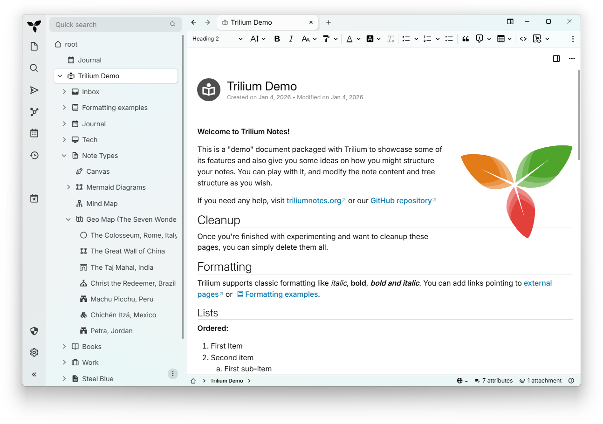

# Trilium Notes


\

\
[](https://hosted.weblate.org/engage/trilium/)

<!-- translate:off -->
<!-- LANGUAGE SWITCHER -->
[Arabic](./README-ar.md) | [Chinese (Simplified Han script)](./README-ZH_CN.md)
| [Chinese (Traditional Han script)](./README-ZH_TW.md) |
[Czech](./README-cs.md) | [English (United Kingdom)](./README-en_GB.md) |
[English](../README.md) | [French](./README-fr.md) | [German](./README-de.md) |
[Greek](./README-el.md) | [Indonesian](./README-id.md) | [Irish](./README-ga.md)
| [Italian](./README-it.md) | [Japanese](./README-ja.md) |
[Korean](./README-ko.md) | [Polish](./README-pl.md) | [Romanian](./README-ro.md)
| [Russian](./README-ru.md) | [Spanish](./README-es.md) |
[Ukrainian](./README-uk.md) | [Urdu](./README-ur.md) | [Uyghur](./README-ug.md)
| [Vietnamese](./README-vi.md)
<!-- translate:on -->

Trilium Notes یک برنامهٔ آزاد و متن‌باز و چندسکویی برای یادداشت‌برداری
سلسله‌مراتبی است که بر ساخت پایگاه‌های دانش شخصی بزرگ تمرکز دارد.

به‌دنبال «Trillium Notes» می‌گردید؟ نگارش درست نام پروژه «Trilium Notes» است، با
یک `l`.



## ⏬ دریافت
- [آخرین انتشار](https://github.com/TriliumNext/Trilium/releases/latest) – نسخهٔ
  پایدار، برای بیشتر کاربران پیشنهاد می‌شود.
- [نسخهٔ شبانه](https://github.com/TriliumNext/Trilium/releases/tag/nightly) –
  نسخهٔ توسعهٔ ناپایدار که هر روز با تازه‌ترین قابلیت‌ها و اصلاحات به‌روزرسانی
  می‌شود.

## 📚 مستندات

**مستندات کامل ما را در [docs.triliumnotes.org](https://docs.triliumnotes.org/)
ببینید**

مستندات ما در چند قالب مختلف در دسترس است:
- **مستندات آنلاین**: مستندات کامل را در
  [docs.triliumnotes.org](https://docs.triliumnotes.org/) مرور کنید
- **راهنمای درون‌برنامه‌ای**: کلید `F1` را در Trilium بزنید تا همان مستندات
  مستقیماً در برنامه در دسترستان باشد
- **گیت‌هاب**: [راهنمای کاربر](./User%20Guide/User%20Guide/) را در همین مخزن
  ببینید

### پیوندهای سریع
- [راهنمای شروع کار](https://docs.triliumnotes.org/)
- [دستورالعمل‌های نصب](https://docs.triliumnotes.org/user-guide/setup)
- [راه‌اندازی
  Docker](https://docs.triliumnotes.org/user-guide/setup/server/installation/docker)
- [ارتقای TriliumNext](https://docs.triliumnotes.org/user-guide/setup/upgrading)
- [مفاهیم و قابلیت‌های
  پایه](https://docs.triliumnotes.org/user-guide/concepts/notes)
- [الگوهای پایگاه دانش
  شخصی](https://docs.triliumnotes.org/user-guide/misc/patterns-of-personal-knowledge)

## 🎁 قابلیت‌ها

* یادداشت‌ها را می‌توان در درختی با عمق دلخواه چید. هر یادداشت می‌تواند در چند
  جای درخت هم‌زمان قرار گیرد (ببینید
  [کلون‌کردن](https://docs.triliumnotes.org/user-guide/concepts/notes/cloning))
* ویرایشگر بصری (WYSIWYG) غنی برای یادداشت‌ها با جدول، تصویر و [فرمول
  ریاضی](https://docs.triliumnotes.org/user-guide/note-types/text) همراه با
  [قالب‌بندی
  خودکار](https://docs.triliumnotes.org/user-guide/note-types/text/markdown-formatting)
  مارک‌داون
* پشتیبانی از ویرایش [یادداشت‌های حاوی کد
  منبع](https://docs.triliumnotes.org/user-guide/note-types/code)، همراه با
  برجسته‌سازی نحوی
* [جابه‌جایی سریع و آسان بین
  یادداشت‌ها](https://docs.triliumnotes.org/user-guide/concepts/navigation/note-navigation)،
  جست‌وجوی تمام‌متن و [بالابردن
  یادداشت](https://docs.triliumnotes.org/user-guide/concepts/navigation/note-hoisting)
* [نسخه‌بندی](https://docs.triliumnotes.org/user-guide/concepts/notes/note-revisions)
  یکپارچه برای یادداشت‌ها
* [ویژگی‌های](https://docs.triliumnotes.org/user-guide/advanced-usage/attributes)
  یادداشت که برای سازمان‌دهی، جست‌وجو و
  [اسکریپت‌نویسی](https://docs.triliumnotes.org/user-guide/scripts) پیشرفته
  به‌کار می‌روند
* رابط کاربری به زبان‌های انگلیسی، آلمانی، اسپانیایی، فرانسوی، رومانیایی و چینی
  (ساده و سنتی)
* [یکپارچه‌سازی مستقیم با OpenID و
  TOTP](https://docs.triliumnotes.org/user-guide/setup/server/mfa) برای ورود
  امن‌تر
* [همگام‌سازی](https://docs.triliumnotes.org/user-guide/setup/synchronization)
  با سرور همگام‌سازی خودمیزبان
  * [سرویس‌های شخص
    ثالثی](https://docs.triliumnotes.org/user-guide/setup/server/cloud-hosting)
    برای میزبانی سرور همگام‌سازی هم وجود دارند
* [اشتراک‌گذاری](https://docs.triliumnotes.org/user-guide/advanced-usage/sharing)
  (انتشار) یادداشت‌ها در اینترنت عمومی
* [رمزگذاری قوی
  یادداشت](https://docs.triliumnotes.org/user-guide/concepts/notes/protected-notes)
  با دقت در سطح هر یادداشت
* رسم نمودار مبتنی بر [Excalidraw](https://excalidraw.com/) (نوع یادداشت «بوم»)
* [نقشهٔ
  روابط](https://docs.triliumnotes.org/user-guide/note-types/relation-map) و
  [نقشهٔ
  یادداشت/پیوند](https://docs.triliumnotes.org/user-guide/note-types/note-map)
  برای تجسم یادداشت‌ها و ارتباط‌شان
* نقشهٔ ذهنی، مبتنی بر [Mind Elixir](https://docs.mind-elixir.com/)
* [نقشهٔ جغرافیایی](https://docs.triliumnotes.org/user-guide/collections/geomap)
  با نشانگرهای مکانی و مسیرهای GPX
* [اسکریپت‌نویسی](https://docs.triliumnotes.org/user-guide/scripts) - ببینید
  [نمونه‌های
  پیشرفته](https://docs.triliumnotes.org/user-guide/advanced-usage/advanced-showcases)
* [رابط برنامه‌نویسی
  REST](https://docs.triliumnotes.org/user-guide/advanced-usage/etapi) برای
  خودکارسازی
* کارایی و سرعت خوب حتی با بیش از 100,000 یادداشت
* [نمای موبایل](https://docs.triliumnotes.org/user-guide/setup/mobile-frontend)
  بهینه‌شده برای لمس، مخصوص گوشی و تبلت
* [پوستهٔ تیرهٔ](https://docs.triliumnotes.org/user-guide/concepts/themes) داخلی
  و پشتیبانی از پوسته‌های کاربر
* درون‌ریزی و برون‌بری از
  [Evernote](https://docs.triliumnotes.org/user-guide/concepts/import-export/import-from-apps/evernote.html)
  و
  [مارک‌داون](https://docs.triliumnotes.org/user-guide/concepts/import-export/markdown)
* [برش‌دهندهٔ وب](https://docs.triliumnotes.org/user-guide/setup/web-clipper)
  برای ذخیرهٔ آسان محتوای وب
* رابط کاربری قابل‌سفارشی‌سازی (دکمه‌های نوار کناری، ابزارک‌های کاربرساخته و…)
* [متریک‌ها](https://docs.triliumnotes.org/user-guide/advanced-usage/metrics)،
  همراه با داشبورد Grafana.

✨ برای دیدن منابع و انجمن‌های شخص ثالث دیگر دربارهٔ TriliumNext این‌ها را هم
ببینید:

- [awesome-trilium](https://github.com/Nriver/awesome-trilium) برای پوسته‌ها،
  اسکریپت‌ها، افزونه‌های شخص ثالث و بیشتر.
- [TriliumRocks!](https://trilium.rocks/) برای آموزش‌ها، راهنماها و موارد بیشتر.

## ❓چرا TriliumNext؟

توسعه‌دهندهٔ اصلی Trilium (به نام [Zadam](https://github.com/zadam)) با بزرگواری
مخزن Trilium را به پروژهٔ جامعه‌محوری سپرد که اکنون در
https://github.com/TriliumNext قرار دارد.

### ⬆️آیا از Zadam/Trilium مهاجرت می‌کنید؟

برای مهاجرت از یک نمونهٔ zadam/Trilium به TriliumNext/Trilium نیازی به مرحلهٔ
خاصی نیست. کافی است [TriliumNext/Trilium را مانند همیشه نصب
کنید](#-installation) تا از پایگاه‌دادهٔ فعلی شما استفاده کند.

نسخه‌های تا
[v0.90.4](https://github.com/TriliumNext/Trilium/releases/tag/v0.90.4) با آخرین
نسخهٔ zadam/trilium یعنی
[v0.63.7](https://github.com/zadam/trilium/releases/tag/v0.63.7) سازگارند.
نسخه‌های بعدی TriliumNext/Trilium شمارهٔ نسخهٔ همگام‌سازی‌شان بالاتر رفته و
مهاجرت مستقیم دیگر ممکن نیست.

## 💬 با ما گفت‌وگو کنید

خوشحال می‌شویم به گفت‌وگوهای رسمی ما بپیوندید! دوست داریم بدانیم چه قابلیت،
پیشنهاد یا مشکلی دارید:

- [Matrix](https://matrix.to/#/#triliumnext:matrix.org) (برای گفت‌وگوی هم‌زمان)
  - اتاق `General` در Matrix به
    [XMPP](xmpp:discuss@trilium.thisgreat.party?join) هم پل زده شده است
- [بحث‌های گیت‌هاب](https://github.com/TriliumNext/Trilium/discussions) (برای
  گفت‌وگوی غیرهم‌زمان)
- [مسائل گیت‌هاب](https://github.com/TriliumNext/Trilium/issues) (برای گزارش
  اشکال و درخواست قابلیت)

## 🏗 نصب

### ویندوز / مک‌اواس

نسخهٔ دودویی متناسب با سیستم‌عامل خود را از [صفحهٔ آخرین
انتشار](https://github.com/TriliumNext/Trilium/releases/latest) دریافت کنید،
بستهٔ فشرده را باز کنید و فایل اجرایی `trilium` را اجرا کنید.

### لینوکس

اگر توزیع شما در جدول زیر فهرست شده، از بستهٔ همان توزیع استفاده کنید.

[](https://repology.org/project/trilium/versions)

همچنین می‌توانید نسخهٔ دودویی متناسب با سیستم‌عامل خود را از [صفحهٔ آخرین
انتشار](https://github.com/TriliumNext/Trilium/releases/latest) دریافت کنید،
بستهٔ فشرده را باز کنید و فایل اجرایی `trilium` را اجرا کنید.

TriliumNext به‌صورت Flatpak هم ارائه می‌شود، هرچند هنوز روی Flathub منتشر نشده
است.

### مرورگر (هر سیستم‌عاملی)

اگر نصب سرور دارید (پایین‌تر ببینید)، می‌توانید مستقیماً به رابط وب دسترسی داشته
باشید (که تقریباً یکسان با برنامهٔ رایانه است).

در حال حاضر فقط آخرین نسخه‌های Chrome و Firefox پشتیبانی (و آزمایش) می‌شوند.

### موبایل

برای استفاده از TriliumNext روی موبایل می‌توانید از مرورگر موبایل خود برای
دسترسی به رابط موبایل یک نصب سرور استفاده کنید (پایین‌تر ببینید).

برای اطلاعات بیشتر دربارهٔ پشتیبانی از برنامهٔ موبایل، ایشوی
https://github.com/TriliumNext/Trilium/issues/4962 را ببینید.

#### TriliumDroid

اگر برنامهٔ بومی اندروید می‌خواهید، می‌توانید از
[TriliumDroid](https://apt.izzysoft.de/fdroid/index/apk/eu.fliegendewurst.triliumdroid)
استفاده کنید. اشکالات و قابلیت‌های ازقلم‌افتاده را در [مخزن
آن‌ها](https://github.com/FliegendeWurst/TriliumDroid) گزارش دهید. نکته: بهتر
است هنگام استفاده از TriliumDroid، به‌روزرسانی خودکار نصب سرور خود را غیرفعال
کنید (پایین‌تر ببینید)، زیرا شمارهٔ نسخهٔ همگام‌سازی Trilium و TriliumDroid باید
یکسان باشد.

#### Pocket Trilium

اگر می‌خواهید یک برنامهٔ بومی اندروید تمام‌عیار داشته باشید، [Pocket
Trilium](https://github.com/Nriver/pocket-trilium) را ببینید. این برنامه یک
نمونهٔ کامل Trilium را روی گوشی شما اجرا می‌کند، از کارکرد کاملاً آفلاین
پشتیبانی می‌کند و امکان همگام‌سازی با سرورتان را می‌دهد.

#### Trinote

اگر برنامهٔ بومی iOS می‌خواهید، می‌توانید از
[Trinote](https://apps.apple.com/us/app/trinote/id6761228249) استفاده کنید؛
کارخواهی متن‌باز برای سرور خودمیزبان Trilium یا TriliumNext شما. با آن می‌توانید
درخت یادداشت‌هایتان را مرور و سازمان‌دهی کنید، در سرور جست‌وجو کنید، همهٔ انواع
یادداشت (متن، کد، نقشهٔ ذهنی، صفحه‌گستر، نقشهٔ جغرافیایی، بوم و…) را بخوانید و
ویرایش کنید، و به‌صورت آفلاین هم به یادداشت‌ها دسترسی و آن‌ها را ویرایش کنید.
اگر می‌خواهید مشارکت کنید، [مخزن آن](https://github.com/StephenArg/Trinote) را
ببینید و برای بازخورد یا پیشنهاد، به
[دیسکورد](https://discord.com/invite/ghjJG56EUS) آن‌ها سر بزنید.

### سرور

برای نصب TriliumNext روی سرور خودتان (از جمله از طریق Docker در
[Dockerhub](https://hub.docker.com/r/triliumnext/trilium))، [مستندات نصب
سرور](https://docs.triliumnotes.org/user-guide/setup/server) را دنبال کنید.


## 💻 مشارکت کنید

### ترجمه

اگر به زبان مادری خود مسلط هستید، با سری‌زدن به [صفحهٔ
Weblate](https://hosted.weblate.org/engage/trilium/) ما به ترجمه کمک کنید.

این هم پوشش زبانی فعلی ما:

[](https://hosted.weblate.org/engage/trilium/)

### کد

مخزن را دریافت کنید، وابستگی‌ها را با `pnpm` نصب کنید و سپس سرور را اجرا کنید
(در http://localhost:8080 در دسترس خواهد بود):
```shell
git clone https://github.com/TriliumNext/Trilium.git
cd Trilium
pnpm install
pnpm run server:start
```

### مستندات

مخزن را دریافت کنید، وابستگی‌ها را با `pnpm` نصب کنید و سپس محیط لازم برای
ویرایش مستندات را اجرا کنید:
```shell
git clone https://github.com/TriliumNext/Trilium.git
cd Trilium
pnpm install
pnpm edit-docs:edit-docs
```

یا اگر Nix نصب دارید:
```shell
# اجرای مستقیم
nix run .#edit-docs

# یا نصب در پروفایل شما
nix profile install .#edit-docs
trilium-edit-docs
```


### ساخت فایل اجرایی
مخزن را دریافت کنید، وابستگی‌ها را با `pnpm` نصب کنید و سپس برنامهٔ رایانهٔ
ویندوز را بسازید:
```shell
git clone https://github.com/TriliumNext/Trilium.git
cd Trilium
pnpm install
pnpm run --filter desktop electron-forge:make --arch=x64 --platform=win32
```

برای جزئیات بیشتر، [مستندات
توسعه](https://github.com/TriliumNext/Trilium/tree/main/docs/Developer%20Guide/Developer%20Guide)
را ببینید.

### مستندات توسعه‌دهندگان

لطفاً [راهنمای
مستندات](https://github.com/TriliumNext/Trilium/blob/main/docs/Developer%20Guide/Developer%20Guide/Environment%20Setup.md)
را برای جزئیات ببینید. اگر پرسش بیشتری دارید، از طریق پیوندهای بخش «با ما
گفت‌وگو کنید» در بالا با ما در ارتباط باشید.

## 💖 حامیان

<table>
  <tr>
    <td align="center" width="25%">
      <a href="https://www.netperfect.fr">
        <br />
        <b>NetPerfect</b>
      </a>
      <br />EV certificate &amp; Windows CI
    </td>
    <td align="center" width="50%">
      <a href="https://ckeditor.com/ckeditor-5/features/">
        <br />
        <b>CKEditor</b>
      </a>
      <br />Premium editor features
    </td>
    <td align="center" width="25%">
      <a href="https://dosu.dev/">
        <br />
        <b>Dosu</b>
      </a>
      <br />Automated GitHub support
    </td>
  </tr>
</table>

## 👏 تقدیر و تشکر

* [zadam](https://github.com/zadam) برای مفهوم اولیه و پیاده‌سازی برنامه.
* [Sarah Hussein](https://github.com/Sarah-Hussein) برای طراحی نماد برنامه.
* [nriver](https://github.com/nriver) برای کارش روی بین‌المللی‌سازی.
* [Thomas Frei](https://github.com/thfrei) برای کار اولیه‌اش روی بوم (Canvas).
* [antoniotejada](https://github.com/nriver) برای ابزارک اولیهٔ برجسته‌سازی
  نحوی.
* [Tabler Icons](https://tabler.io/icons) برای نمادهای سینی سیستم.
*   نمادهای برنامه در پنجرهٔ درون‌برد از این‌جاها هستند:
    *   [Material Design Icons](https://pictogrammers.com/library/mdi/) برای
        OneNote، Google Keep، Evernote.
    *   [Font Awesome](https://fontawesome.com/) برای Notion، Obsidian.
    *   [SVGicons.com](https://svgicons.com/icon/187676/anytype) برای Anytype.
*  نمادهای ارائه‌دهندگان LLM از [Lobe Icons](https://lobehub.com/icons) هستند.

Trilium بدون فناوری‌های پشت آن ممکن نبود:

* [CKEditor 5](https://github.com/ckeditor/ckeditor5) - ویرایشگر بصری پشت
  یادداشت‌های متنی.
* [CodeMirror](https://github.com/codemirror/CodeMirror) - ویرایشگر کد با
  پشتیبانی از تعداد زیادی زبان.
* [Mermaid](https://github.com/mermaid-js/mermaid) - نمودارهای یادداشت‌های
  Mermaid را رندر می‌کند؛ تجزیه‌گرهای آن الگویی برای برجسته‌سازی نحو آن‌ها
  هستند.
* [codemirror-lang-mermaid](https://github.com/inspirnathan/codemirror-lang-mermaid)
  - پایهٔ برجسته‌سازی نحو Mermaid.
* [Excalidraw](https://github.com/excalidraw/excalidraw) - تختهٔ سفید بی‌نهایت
  استفاده‌شده در یادداشت‌های بوم.
* [Mind Elixir](https://github.com/SSShooter/mind-elixir-core) - ارائه‌دهندهٔ
  قابلیت نقشهٔ ذهنی.
* [Leaflet](https://github.com/Leaflet/Leaflet) - برای رندر نقشه‌های جغرافیایی.
* [Tabulator](https://github.com/olifolkerd/tabulator) - برای جدول تعاملی
  استفاده‌شده در مجموعه‌ها.
* [FancyTree](https://github.com/mar10/fancytree) - کتابخانهٔ درخت غنی از
  قابلیت، بدون رقیب واقعی.

## 🤝 حمایت

Trilium با [صدها ساعت
کار](https://github.com/TriliumNext/Trilium/graphs/commit-activity) ساخته و
نگهداری می‌شود. حمایت شما آن را متن‌باز نگه می‌دارد، قابلیت‌ها را بهبود می‌بخشد
و هزینه‌هایی مثل میزبانی را پوشش می‌دهد.

برای حمایت از توسعه‌دهندهٔ اصلی برنامه
([eliandoran](https://github.com/eliandoran)) می‌توانید از این راه‌ها استفاده
کنید:

- [GitHub Sponsors](https://github.com/sponsors/eliandoran)
- [PayPal](https://paypal.me/eliandoran)
- [Buy Me a Coffee](https://buymeacoffee.com/eliandoran)

## 🔑 مجوز

حق نشر 2017-2025 zadam، Elian Doran و دیگر مشارکت‌کنندگان

این برنامه نرم‌افزاری آزاد است: می‌توانید آن را طبق شرایط مجوز عمومی Affero GNU
که توسط بنیاد نرم‌افزار آزاد منتشر شده، بازتوزیع و/یا تغییر دهید؛ چه نسخهٔ 3
مجوز و چه (به‌انتخاب خودتان) هر نسخهٔ بعدی آن.
