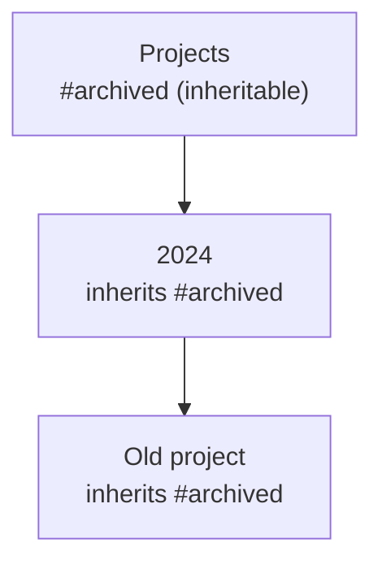
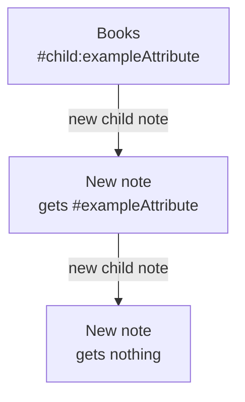

# Attribute Inheritance
Inheritance refers to the process of having a [label](Labels.md) or a [relation](Relations.md) shared across multiple notes, generally in parent-child relations (or anywhere if using templates).

## Standard Inheritance

In Trilium, attributes can be automatically inherited by child notes if they have the `isInheritable` flag set to `true`. This means the attribute (a key-value pair) is applied to the note and all its descendants.

To make an attribute inheritable, simply use the visual editor for <a class="reference-link" href="Labels.md">Labels</a> or <a class="reference-link" href="Relations.md">Relations</a>. Alternatively, the attribute can be manually defined where `#myLabel=value` becomes `#myLabel(inheritable)=value` when inheritable.

As an example, the `archived` label can be set to be inheritable, allowing you to hide a whole subtree of notes from searches and other dialogs by applying this label at the top level.

Standard inheritance forces all the notes that are children (and sub-children) of a note to have that particular label or relation. If there is a need to have some notes not inherit one of the labels, then _copying inheritance_ or _template inheritance_ needs to be used instead.

## Copying Inheritance

Copying inheritance differs from standard inheritance by using a `child:` prefix in the attribute name. This prefix causes new child notes to automatically receive specific attributes from the parent note. These attributes are independent of the parent and will persist even if the note is moved elsewhere.

If a parent note has the label `#child:exampleAttribute`, all newly created child notes (one level deep) will inherit the `#exampleAttribute` label. This can be useful for setting default properties for notes in a specific section.

Similarly, for relations use `~child:myRelation`.

Due to the way it's designed, copying inheritance cannot be used to cascade infinitely within a hierarchy. For that use case, consider using either standard inheritance or templates.

### Chained inheritance

It is possible to define labels across multiple levels of depth. For example, `#child:child:child:foo` applied to a root note would create:

*   `#child:child:foo` on the first-level children.
*   `#child:foo` on the second-level children.
*   `#foo` on the third-level children.

Similarly, use `~child:child:child:foo` if dealing with relations.

Do note that same as simple copying inheritance, the changes will not apply retroactively to existing notes in the hierarchy, it will only apply to the newly created notes.

## Template Inheritance

Attributes can also be inherited from <a class="reference-link" href="../Templates.md">Templates</a>. When a new note is created using a template, it inherits the attributes defined in that template. This is particularly useful for maintaining consistency across notes that follow a similar structure or function.