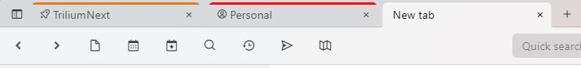

# Workspaces
Workspace is a concept built up on top of [note hoisting](Note%20Hoisting.md). It is based on the idea that a user has several distinct spheres of interest. An example might be "Personal" and "Work", these two spheres are quite distinct and don't interact together. When I focus on Work, I don't really care about personal notes.

So far workspace consists of these features:

*   [note hoisting](Note%20Hoisting.md) - you can "zoom" into a workspace subtree to focus only on the relevant notes
*   easy entering of workspace: 
    
    
*   opening a workspace in a new tab: right-click the  button of the <a class="reference-link" href="../UI%20Elements/Tabs.md">Tabs</a> bar and select the workspace.
*   on a phone, the workspaces are listed at the top of the <a class="reference-link" href="../UI%20Elements/Note%20Tree.md">Note Tree</a> while it shows the root of a tab that is not hoisted, such as a new tab. Tap one to enter it, and tap the  button at the top of the workspace's tree to leave it.
*   visual identification of workspace in tabs:  
    

### Configuration

| Label | Description |
| --- | --- |
| `workspace` | Marks this note as a workspace, button to enter the workspace is controlled by this |
| `workspaceIconClass` | defines box icon CSS class which will be used in tab when hoisted to this note, and in the menu of the tab bar's  button |
| `workspaceTabBackgroundColor` | CSS color used in the note tab when hoisted to this note, for the workspace's icon in the menu of the tab bar's  button, and for the  button that leaves the workspace on a phone; use any CSS color format, e.g. "lightblue" or "#ddd". See [https://www.w3schools.com/cssref/css\_colors.asp](https://www.w3schools.com/cssref/css_colors.asp). |
| `workspaceCalendarRoot` | Marking a note with this label will define a new per-workspace calendar for <a class="reference-link" href="../../Advanced%20Usage/Advanced%20Showcases/Day%20Notes.md">Day Notes</a>. If there's no such note, the global calendar will be used. |
| `workspaceTemplate` | This note will appear in the selection of available template when creating new note, but only when hoisted into a workspace containing this template |
| `workspaceSearchHome` | new search notes will be created as children of this note when hoisted to some ancestor of this workspace note |
| `workspaceInbox` | Default inbox location for new notes when hoisted to some ancestor of this workspace note. See <a class="reference-link" href="../Notes/Note%20Inbox.md">Note Inbox</a> for more information. |