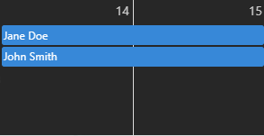
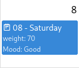
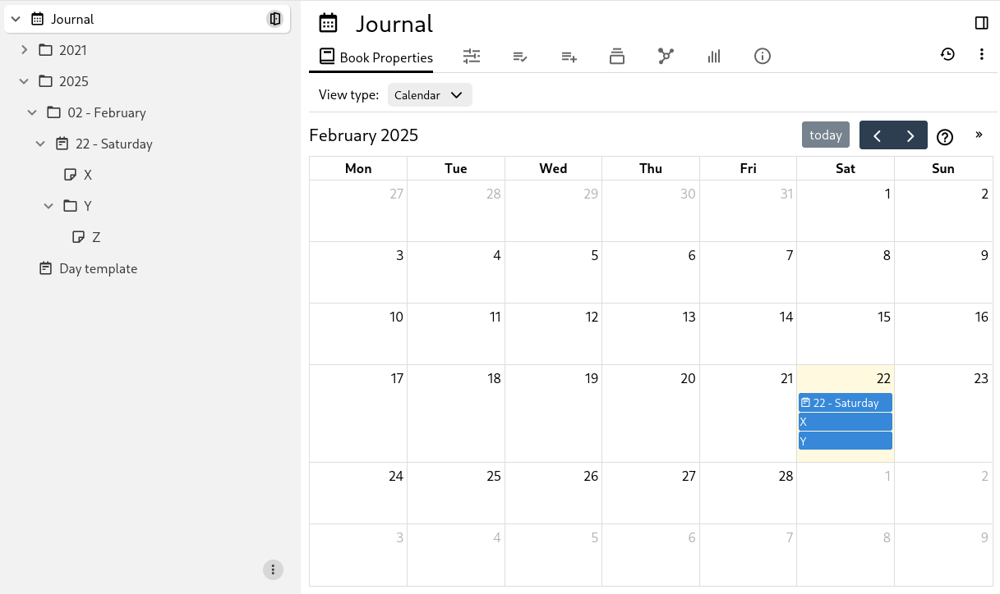
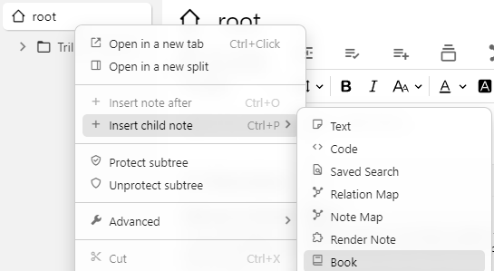
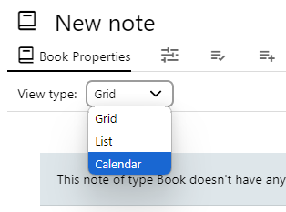
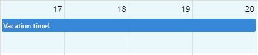

# Calendar
<figure class="image"></figure>

The Calendar view will display each child note in a calendar that has a start date and optionally an end date, as an event.

The Calendar view has multiple display modes:

*   Month view, where the entire month is displayed and all-day events can be inserted. Both time-specific events and all-day events are listed.
*   Week view, where all the 7 days of the week (or 5 if the weekends are hidden) are displayed in columns. This mode allows entering and displaying time-specific events, not just all-day events.
*   Day view, which views only a single day. Especially useful for heavy agendas or mobile views.
*   List view, which displays all the events of a given month in sequence.
*   Year view, which displays the entire year for quick reference.

Unlike other Collection view types, the Calendar view also allows some kind of interaction, such as moving events around as well as creating new ones.

## Creating a calendar

Right click on an existing note in the <a class="reference-link" href="../Basic%20Concepts%20and%20Features/UI%20Elements/Note%20Tree.md">Note Tree</a> and select _Insert child note_ → _Collection_ → _Calendar_.

## Creating a new event/note

To create a new event:

*   First, click the desired day (month & year views) or the desired timeslot (day view).
*   Alternatively, drag across multiple days (or time slots) to set both the start and end date.

In either cases, a small popup will show with a prompt for a title and the date & time of the event that will be created. The date and time can be changed there the same way as in the popup view of an existing event (see below).

At this point, the event hasn't been created yet to protect against accidental clicks. Add a title optionally and press the _Create_ button. If no title is provided, the event will follow the <a class="reference-link" href="../Advanced%20Usage/Default%20Note%20Title.md">Default Note Title</a> rules.

The <span class="tn-icon bx bx-detail"></span> template field below the date and time shows the note type or template the event's note is made from. To make the event from another one, press the field and select it from the list; the calendar remembers the choice for the next event. Select _More templates…_ to change which templates are listed (see [Event templates](#event-templates)). The date and time entered for the event replace any dates and times the template carries.

To give the event a time before creating it (for example, after clicking a day in the month view), press _Add time_ and set the start and end time; the duration is shown to the right of them. To make the event all-day again, press the <span class="tn-icon bx bx-x"></span> button at the end of the row. Adding or removing a time keeps the dates, so an event can start at a time on one day and end at a time on another (for example, a night shift). Changing the start date or time moves the end by the same amount, keeping the duration. An empty end date means the event ends on the day it starts; setting the end time before the start time moves the end date to the next day.

After creating the event, it will show up on the calendar. To edit the content of the event (including recurrence), click on it to bring it into the popup view.

> [!NOTE]
> Creating new notes from the calendar will respect the `~child:template` relation if set on the Collection note.

## Interacting with events

*   Hovering the mouse over an event will display information about the note.  
    
*   Left clicking the event will open a dedicated popup to quickly configure the event or edit its note content.
*   Right click will offer more options including opening the note in a new split or window.
*   Drag and drop an event on the calendar to move it to another day.
*   The length of an event can be changed by placing the mouse to the right edge of the event and dragging the mouse around.

On a [read-only](../Basic%20Concepts%20and%20Features/Notes/Read-Only%20Notes.md) calendar, events can't be dragged, resized or created, their context menu only offers the places to open them in, and the button to pin the current date is hidden. Switching between the month, week and day views still works, but the choice isn't saved.

### Popup view

When an event is clicked, a popup will show near the event which contains the following inforamtion:

*   The title and icon of the event, both editable.
*   Buttons to interact with the event:
    *   Open the event in the same pane, new tab, etc.
    *   Color picker to change the color of the event.
    *   Button to remove the event from the calendar, which can optionally delete its corresponding note.
*   Calendar-specific features:
    *   The start date and, for an event spanning several days, the end date.
    *   The start and end time with the duration to the right of them, and a <span class="tn-icon bx bx-x"></span> button that removes the time, making the event all-day. An all-day event shows an _Add time_ button instead.
    *   A full recurrence editor, opened from the dropdown below the time, to have the same event show up weekly, monthly, etc.
*   The <a class="reference-link" href="../Advanced%20Usage/Attributes/Promoted%20Attributes.md">Promoted Attributes</a> of the marker, if any.
*   The note's content which can be edited directly from the panel.

To dismiss the popup:

*   Press the X button at the top-right of the popup.
*   In the calendar, press anywhere outside the popup.
*   Or simply press the <kbd>Escape</kbd> key.

It is possible to switch between events by clicking on them even when the popup view is already open.

Events can have <a class="reference-link" href="../Note%20Types/Text/Links/Internal%20(reference)%20links.md">Internal (reference) links</a> between them and clicking on such a link will automatically navigate the calendar to the right date and the popup view to the new note.

## Interaction on mobile

When Trilium is on mobile, the interaction with the calendar is slightly different:

*   Clicking on an event displays the popup view, which allows editing the event.
*   Long-presing an event triggers the contextual menu, including the option to open in <a class="reference-link" href="../Basic%20Concepts%20and%20Features/Navigation/Quick%20edit.md">Quick edit</a>.
*   To insert a new event, touch and hold the empty space. When successful, the empty space will become colored to indicate the selection.
    *   Before releasing, drag across multiple spaces to create multi-day events.
    *   When released, a prompt will appear to enter the note title.
*   To move an existing event, touch and hold the event until the empty space near it will become colored.
    *   At this point the event can be dragged across other days on the calendar.
    *   Or the event can be resized by tapping on the small circle to the right end of the event.
    *   To exit out of editing mode, simply tap the empty space anywhere on the calendar.

## Configuring the calendar view

In the <a class="reference-link" href="Collection%20Properties.md">Collection Properties</a>, it's possible to:

*   Hide weekends from the week view.
*   Display week numbers on the calendar.
*   Hide routine events from the month, year and list views (see [Hiding routine events](#hiding-routine-events)).
*   Set the slot duration (the length of each time row in day/week view).
*   Set the slot label interval (how often time labels appear on the axis in day/week view).

The same settings are also listed under _General_ in the <span class="tn-icon bx bx-cog"></span> _Calendar properties_ dialog (see [Event templates](#event-templates) for how to open it). The time slots are listed there whichever view the calendar is in. Its _Included notes_ section sets whether archived notes are shown and how deep the calendar looks for events (see [Limiting the depth](#limiting-the-depth)).

### Event templates

By default, a new event is a <a class="reference-link" href="../Note%20Types/Text.md">Text</a> note. To make events from other note types, or from <a class="reference-link" href="../Advanced%20Usage/Templates.md">Templates</a> with predefined content and attributes (such as a color), open the <span class="tn-icon bx bx-cog"></span> _Calendar properties_ dialog from the <a class="reference-link" href="../Basic%20Concepts%20and%20Features/UI%20Elements/Note%20menu.md">Note menu</a> or from the settings menu of the <a class="reference-link" href="Collection%20Properties.md">Collection Properties</a>, and find _Event templates_. Here you can:

*   Include a note type or note template already created in your knowledge base by pressing the <span class="tn-icon bx bx-list-plus"></span> _Add existing template_ button and then selecting the desired note type or template.
*   Create a new template by pressing the <span class="tn-icon bx bx-plus"></span> _Create a new template_ button. The template is created as a child of the calendar, and is not shown as an event.
*   Press the <span class="tn-icon bx bx-x"></span> button to remove a template from the list. The template is removed only from the list, not deleted.
*   Press the <span class="tn-icon bx bx-dots-vertical-rounded"></span> button of a custom template to edit, open in a new window, duplicate, or delete it.
*   Drag a template by its handle to reorder the list shown when creating an event.

The dialog is not available on a read-only calendar, or on a calendar marked with `#calendarRoot` or `#workspaceCalendarRoot` (see [Using with the Journal / calendar](#using-with-the-journal--calendar)).

### Event attributes

Events can show the values of their attributes below their title, in the month view, and in the week and day views for all-day events and for timed ones tall enough to hold them. To choose which attributes are shown, open the <span class="tn-icon bx bx-cog"></span> _Calendar properties_ dialog (see [Event templates](#event-templates) for how to open it) and find _Event attributes_. It lists the <a class="reference-link" href="../Advanced%20Usage/Attributes/Promoted%20Attributes.md">Promoted Attributes</a> the calendar defines, and those its events define themselves. Here you can:

*   Turn an attribute on to show it on the events. New attributes are hidden until you turn them on, which keeps the calendar from getting cluttered.
*   Drag an attribute by its handle to change the order in which the events show them.
*   Create a new attribute, which is shown on the events right away, or edit or delete one the calendar defines.

The dates, times and recurrence of the events are not listed, as the calendar always shows them itself.

To change an attribute's value without opening the event, right-click the event (or long-press it on a phone) and use the _Attributes_ section of its context menu. It lists the shown attributes of the “checkbox”, “select” and “date” types, and works as on a [Kanban Board](Kanban%20Board.md).

If an event has a `#calendar:displayedAttributes` label, including one inherited from the calendar, the attributes listed in that label are shown instead.

## Configuring the calendar using attributes

The following attributes can be added to the Collection type:

<table>
    <thead>
        <tr>
            <th>Name</th>
            <th>Description</th>
        </tr>
    </thead>
    <tbody>
        <tr>
            <td><code>#calendar:hideWeekends</code></td>
            <td>When present (regardless of value), it will hide Saturday and Sundays from the calendar.</td>
        </tr>
        <tr>
            <td><code>#calendar:weekNumbers</code></td>
            <td>When present (regardless of value), it will show the number of the week on the calendar.</td>
        </tr>
        <tr>
            <td><code>#calendar:hideRoutineEvents</code></td>
            <td>When present (regardless of value), it will hide routine events from the month, year and list views. See <a href="#hiding-routine-events">Hiding routine events</a>.</td>
        </tr>
        <tr>
            <td><code>#calendar:initialDate</code></td>
            <td>Change the date the calendar opens on. When not present, the calendar opens on the current date.</td>
        </tr>
        <tr>
            <td><code>#calendar:view</code></td>
            <td><p>Which view to display in the calendar:</p><ul><li><code>timeGridDay</code> for the <em>day</em> view;</li><li><code>timeGridWeek</code> for the <em>week</em> view;</li><li><code>dayGridMonth</code> for the <em>month</em> view;</li><li><code>multiMonthYear</code> for the <em>year</em> view;</li><li><code>listMonth</code> for the <em>list</em> view.</li></ul><p>Any other value will be dismissed and the default view (month) will be used instead.</p><p>The value of this label is automatically updated when changing the view using the UI buttons.</p></td>
        </tr>
        <tr>
            <td><code>#calendar:slotDuration</code></td>
            <td>Sets how long each timeslot is on the calendar. Defaults to <code>00:15:00</code> (15 minutes). Must have the format "HH:MM:SS". For example, to create timeslots for every 10 minutes, you would set <code>#calendar:slotDuration="00:10:00"</code>.</td>
        </tr>
        <tr>
            <td><code>#calendar:slotLabelInterval</code></td>
            <td>Sets how often the timeslots on the calendar should be labeled. Defaults to <code>01:00:00</code> (1 hour). Must have the format "HH:MM:SS". For example, to label timeslots every 30 minutes, you would set <code>#calendar:slotLabelInterval="00:30:00"</code>.</td>
        </tr>
        <tr>
            <td><code>~child:template</code></td>
            <td>Defines the template for newly created notes in the calendar (via dragging or clicking).</td>
        </tr>
    </tbody>
</table>

In addition, the first day of the week can be either Sunday or Monday and can be adjusted from the application settings.

## Configuring the calendar events using attributes

For each note of the calendar, the following attributes can be used:

| Name | Description |
| --- | --- |
| `#startDate` | The date the event starts, which will display it in the calendar. The format is `YYYY-MM-DD` (year, month and day separated by a minus sign). |
| `#endDate` | Similar to `startDate`, mentions the end date if the event spans across multiple days. The date is inclusive, so the end day is also considered. The attribute can be missing for single-day events. |
| `#startTime` | The time the event starts at. If this value is missing, then the event is considered a full-day event. The format is `HH:MM` (hours in 24-hour format and minutes). |
| `#endTime` | Similar to `startTime`, it mentions the time at which the event ends (in relation with `endDate` if present, or `startDate`). |
| `#recurrence` | This is an optional CalDAV `RRULE` string that if present, determines whether a task should repeat or not. Note that it does not include the `DTSTART` attribute, which is derived from the `#startDate` and `#startTime` directly. For examples of valid `RRULE` strings see [https://icalendar.org/rrule-tool.html](https://icalendar.org/rrule-tool.html) |
| `#color` | Displays the event with a specified color (named such as `red`, `gray` or hex such as `#FF0000`). This will also change the color of the note in other places such as the note tree. |
| `#calendar:color` | **❌️ Removed since v0.100.0. Use** `#color` **instead.**       <br>  <br>Similar to `#color`, but applies the color only for the event in the calendar and not for other places such as the note tree. |
| `#iconClass` | If present, the icon of the note will be displayed to the left of the event title. |
| `#calendar:title` | Changes the title of an event to point to an attribute of the note other than the title, can either a label or a relation (without the `#` or `~` symbol). See _Use-cases_ for more information. |
| `#calendar:titleTemplate` | Changes the title an event is displayed with on the calendar, filled in again for every occurrence of a repeating event. See _Use-cases_ for displaying an age on a birthday. |
| `#calendar:displayedAttributes` | Takes precedence over the [Event attributes](#event-attributes) chosen in the calendar's properties. Allows displaying the value of one or more attributes in the calendar, in the order given, like this:            <br>  <br>           <br>  <br>`#weight="70" #Mood="Good" #calendar:displayedAttributes="weight,Mood"`          <br>  <br>It can also be used with relations, case in which it will display the title of the target note:           <br>  <br>`~assignee=@My assignee #calendar:displayedAttributes="assignee"` |
| `#calendar:startDate` | Allows using a different label to represent the start date, other than `startDate` (e.g. `expiryDate`). The label name **must not be** prefixed with `#`. If the label is not defined for a note, the default will be used instead. |
| `#calendar:endDate` | Similar to `#calendar:startDate`, allows changing the attribute which is being used to read the end date. |
| `#calendar:startTime` | Similar to `#calendar:startDate`, allows changing the attribute which is being used to read the start time. |
| `#calendar:endTime` | Similar to `#calendar:startDate`, allows changing the attribute which is being used to read the end time. |

## How the calendar works


The calendar displays all the child notes of the Collection that have a `#startDate`. An `#endDate` can optionally be added.

A text note with a start date is shown with the <span class="tn-icon bx bx-calendar-event"></span> icon in the note tree and elsewhere, unless it has an icon of its own (set with `#iconClass`). The start date is read from the label `#calendar:startDate` names, if any.

The start date & end date can easily be edited from the calendar collection itself by clicking on the event. To edit the date while in the event note itself, the following attributes can be added to the Collection note:

```
#viewType=calendar #label:startDate(inheritable)="promoted,alias=Start Date,single,date"
#label:endDate(inheritable)="promoted,alias=End Date,single,date"
#hidePromotedAttributes 
```

This will result in:



When not used in a Journal, the calendar is recursive. That is, it will look for events not just in its child notes but also in the children of these child notes.

### Limiting the depth

To limit how deep the calendar looks for events, set _Maximum nesting depth_ under _Included notes_ in the <span class="tn-icon bx bx-cog"></span>_Calendar properties_ dialog (see [Event templates](#event-templates) for how to open it), or the `#maxNestingDepth` label: `0` shows only the child notes, `1` adds their children, and so on. Without a value, events are looked for at every level. The setting doesn't apply in a Journal.

## Recurrence

The built in calendar view also supports repeating tasks (e.g. every week, every month as well as more complex recurrency rules).

Starting with v0.105.0, recurrence can be directly edited from the calendar by clicking on an event and then selecting the _Repeats_ option.

### Custom recurrence using a subset of RRULE

If the existing recurrence editor from the event popup is not sufficient, more complex rules can be manually set via the `#recurrence` label.

For example, to make a note repeat on the calendar:

*   Every Day - `#recurrence="FREQ=DAILY;INTERVAL=1"`
*   Every 3 days - `#recurrence="FREQ=DAILY;INTERVAL=3"`
*   Every week - `#recurrence="FREQ=WEEKLY;INTERVAL=1"`
*   Every 2 weeks on Monday, Wednesday and Friday - `#recurrence="FREQ=WEEKLY;INTERVAL=2;BYDAY=MO,WE,FR"`
*   Every 3 months - `#recurrence="FREQ=MONTHLY;INTERVAL=3"`
*   Every 2 months on the First Sunday - `#recurrence="FREQ=MONTHLY;INTERVAL=2;BYDAY=1SU"`
*   Every month on the Last Friday - `#recurrence="FREQ=MONTHLY;INTERVAL=1;BYDAY=-1FR"`

For other examples of valid `RRULE` strings see [https://icalendar.org/rrule-tool.html](https://icalendar.org/rrule-tool.html)

Note that the recurrence string does not include the `DTSTART` attribute as defined in the iCAL specifications. This is derived directly from the `startDate` and `startTime` attributes

If you want to override the label the calendar uses to fetch the recurrence string, you can use the `#calendar:recurrence` attribute. For example, you can set `#calendar:recurrence=taskRepeats`. Then you can set your recurrence string like `#taskRepeats="FREQ=DAILY;INTERVAL=1"`

Also note that the recurrence label can be made promoted as with the start and end dates. 

> [!WARNING]
> If the recurrence string is not valid, a toast will be shown with the note ID and title of the note with the erroneous recurrence message. This note will not be added to the calendar

### Hiding routine events

Events that repeat on most days of the week, such as sleep or working hours, fill every cell of the month view. To hide them from the views that show many days at once, check _Hide routine events_ in the <a class="reference-link" href="Collection%20Properties.md">Collection Properties</a> (or set `#calendar:hideRoutineEvents`).

An event counts as routine when it has a start time and repeats on 4 or more days a week on average, for example:

| Event | Days a week | Hidden from the month, year and list views |
| --- | --- | --- |
| Every day from 23:00 to 07:00 | 7 | Yes |
| Monday to Friday from 09:00 to 17:00 | 5 | Yes |
| Every other day at 07:00 | 3.5 | No |
| Monday, Wednesday and Friday at 18:00 | 3 | No |
| Every day, without a start time | 7 | No, as it lasts the whole day |
| Every month or every year | — | No |

The day and week views always show routine events. To show them everywhere again, uncheck the option.

## Customizing the slot duration and label interval

Time slots in day and week views can be customized from <a class="reference-link" href="Collection%20Properties.md">Collection Properties</a>

*   _Slot duration_ controls how tall each time slot is on the calendar (essentially the smallest unit of time the grid is divided into).
    *   A shorter duration means more rows and finer granularity; a longer one means fewer, chunkier rows.
    *   The default is one row every 15 minutes.
*   _Label interval_ controls how often a time label appears on the left-hand axis.
    *   This is independent of the slot size: you can have very small slots but only label every hour to keep the axis readable.
    *   The default is a time label shown every hour.

> [!NOTE]
> These values can also be customized directly via the `#calendar:slotDuration` and `#calendar:slotLabelInterval` [labels](../Advanced%20Usage/Attributes/Labels.md). Both values use `HH:mm:ss` format. Hours can go up to `24` (`24:00:00`), while minutes and seconds must be between `00` and `59`. The minimum meaningful duration is 1 minute (`00:01:00`).

## Use-cases

### Using with the Journal / calendar

It is possible to integrate the calendar view into the Journal with day notes. In order to do so change the note type of the Journal note (calendar root) to Collection and then select the Calendar View.

While in journal mode, the popup editor will not show dates, recurrence, colors or removal, since day notes aren't editable events.

Based on the `#calendarRoot` (or `#workspaceCalendarRoot`) attribute, the calendar will know that it's in a calendar and apply the following:

*   The calendar events are now rendered based on their `dateNote` attribute rather than `startDate`.
*   Interactive editing such as dragging over an empty era or resizing an event is no longer possible.
*   Clicking on the empty space on a date will automatically open that day's note or create it if it does not exist.
*   Direct children of a day note will be displayed on the calendar despite not having a `dateNote` attribute. Children of the child notes will not be displayed.



### Using a different attribute as event title

By default, events are displayed on the calendar by their note title. However, it is possible to configure a different attribute to be displayed instead.

To do so, assign `#calendar:title` to the child note (not the calendar/Collection note), with the value being `name` where `name` can be any label (make not to add the `#` prefix). The attribute can also come through inheritance such as a template attribute. If the note does not have the requested label, the title of the note will be used instead.

```
#startDate=2025-02-11 #endDate=2025-02-13 #name="My vacation" #calendar:title="name"
```

### Using a relation attribute as event title

Similarly to using an attribute, use `#calendar:title` and set it to `name` where `name` is the name of the relation to use.

Moreover, if there are more relations of the same name, they will be displayed as multiple events coming from the same note.

```
#startDate=2025-02-14 #endDate=2025-02-15 ~for=@John Smith ~for=@Jane Doe #calendar:title="for"
```

Note that it's even possible to have a `#calendar:title` on the target note (e.g. “John Smith”) which will try to render an attribute of it. Note that it's not possible to use a relation here as well for safety reasons (an accidental recursion  of attributes could cause the application to loop infinitely).

```
#calendar:title="shortName" #shortName="John S."
```

### Displaying an age on a recurring event

A birthday or an anniversary repeats every year, and what is interesting about each occurrence is the number of years it marks. To display it:

1.  Set the event's start date to the original date (for example, the date of birth).
2.  Click the event, then select the _Repeats_ dropdown.
3.  Select _Yearly_ and check _Show the number of years in the title_.

The event is then displayed as “John Smith (35)” in 2025, “John Smith (36)” in 2026, and so on. Only the calendar is affected; the note keeps its own title.

The checkbox sets the `#calendar:titleTemplate` label, which sets the title an event is displayed with and is filled in again for every occurrence the recurrence rule produces:

```
#startDate=1990-05-12 #recurrence="FREQ=YEARLY" #calendar:titleTemplate="${title} (${years})"
```

To word the title differently, edit the label directly. The checkbox is then disabled, as it is when the template is inherited, so that it never overwrites a template of your own.

The following values can be used in the template:

| Value | Description |
| --- | --- |
| `${title}` | The title the event would otherwise be displayed with: the note title, or the attribute `#calendar:title` points to. |
| `${years}` | The whole years between `#startDate` and the occurrence being displayed. It is `0` on the first occurrence. |
| `${date}` | The date of the occurrence being displayed, as a [day.js](https://day.js.org/docs/en/display/format) object. For example, `${date.format('YYYY')}`. |
| `${startDate}` | The date the event starts on, in the same form. For example, `${startDate.format('YYYY')}`. |

To use the same template for every event of a calendar, make the label inheritable on the Collection note:

```
#calendar:titleTemplate(inheritable)="${title} (${years})"
```

> [!NOTE]
> A template that cannot be read — an unknown value, or an expression other than a value and the `format` call shown above — leaves the event with its plain title and reports the reason in the browser console.