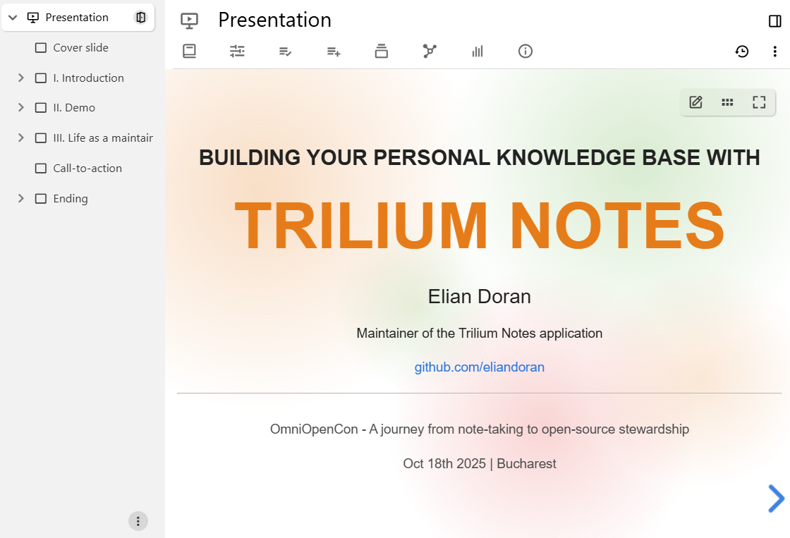
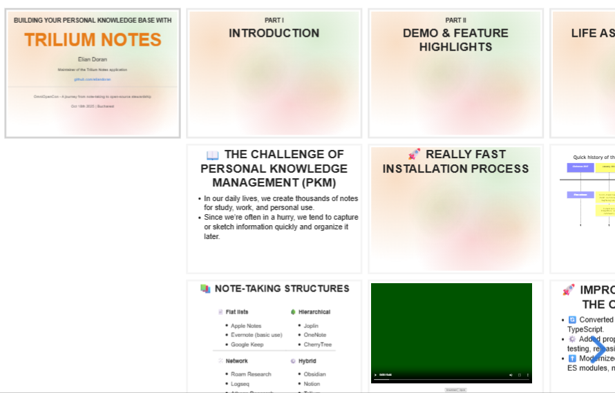

# Presentation
<figure class="image"></figure>

The Presentation view allows the creation of slideshows directly from within Trilium.

### Creating a new presentation

Right click on an existing note in the <a class="reference-link" href="../Basic%20Concepts%20and%20Features/UI%20Elements/Note%20Tree.md">Note Tree</a> and select _Insert child note_ → _Collection_ → _Presentation_.

## How it works

*   Each slide is a child note of the collection.
*   The slides are not shown in the <a class="reference-link" href="../Basic%20Concepts%20and%20Features/UI%20Elements/Note%20Tree.md">Note Tree</a> by default, since the slide sidebar already lists them (see <a class="reference-link" href="../Basic%20Concepts%20and%20Features/UI%20Elements/Note%20Tree/Hiding%20the%20subtree.md">Hiding the subtree</a>). To show them, open the collection's <span class="tn-icon bx bx-cog"></span> settings and turn off _Hide child notes in tree_.
*   The order of the child notes determines the order of the slides.
*   Unlike traditional presentation software, slides can be laid out both horizontally and vertically (see below for more information).
*   Direct children will be laid out horizontally and the children of those will be laid out vertically. Children deeper than two levels of nesting are ignored.
*   A <a class="reference-link" href="Kanban%20Board.md">Kanban Board</a> or <a class="reference-link" href="Table.md">Table</a> collection is shown as one slide, working as it does in the note itself, so its children are not laid out as vertical slides. Other collections keep their children as vertical slides.
*   Slides have a fixed 16:9 shape (1280×720). The preview in the note is a scaled-down copy of what is shown in full-screen, so content that fits in the preview fits when presenting. When the window or the screen has a different shape, the slide is centered with bars around it.
*   A slide whose content is larger than the slide is zoomed out until it fits, text included. To keep the text large, split the content over several slides.

## Interaction and navigation

### Slide sidebar

A sidebar to the left of the slides shows a thumbnail of every slide in the presentation's theme, with vertical slides indented under the slide they belong to. Web view, <a class="reference-link" href="Kanban%20Board.md">Kanban Board</a> and <a class="reference-link" href="Table.md">Table</a> slides are shown as an icon.

*   The slide being shown is outlined, and the sidebar scrolls to keep it in view.
*   Click a thumbnail to go to its slide.
*   To move a slide, drag its thumbnail; a line shows where it goes. Dragged straight up or down, a slide keeps its level:
    *   A top-level slide takes its vertical slides with it, and dragged over another slide's vertical slides it goes after that whole stack.
    *   A vertical slide can go among the vertical slides of any slide. Dropped below a slide that has none, it becomes that slide's first vertical slide, and the line is indented.
*   To change a slide's level, drag it to the side as well: to the right to make it a vertical slide, to the left to make it a top-level slide. The line's indent shows the level it will have.
    *   A slide that has vertical slides of its own can't become a vertical slide, and a <a class="reference-link" href="Kanban%20Board.md">Kanban Board</a> or <a class="reference-link" href="Table.md">Table</a> slide can't take vertical slides.
*   Slides can't be dragged in a read-only or search-based presentation, or into a note that sorts its children with `#sorted`.
*   Once a thumbnail is clicked, or reached with <kbd>Tab</kbd>, the sidebar takes the keyboard until you click the slides:
    *   Press <kbd>↑</kbd> and <kbd>↓</kbd> to go to the previous or next slide in order, vertical slides included.
    *   Press <kbd>Home</kbd> and <kbd>End</kbd> to go to the first or last slide.
    *   Press <kbd>Alt</kbd>+<kbd>↑</kbd> and <kbd>Alt</kbd>+<kbd>↓</kbd> to move the slide up or down at its level, past a whole stack of vertical slides. Press <kbd>Alt</kbd>+<kbd>→</kbd> to make it a vertical slide where it stands, and <kbd>Alt</kbd>+<kbd>←</kbd> to make it a top-level slide (the other way around in right-to-left languages). The same limits apply as for dragging.
*   Right-click a thumbnail, or press <kbd>Shift</kbd>+<kbd>F10</kbd> or the <kbd>Menu</kbd> key on a focused one, to open its context menu. The thumbnail is outlined while the menu is open, and the slide being shown doesn't change:
    *   _Edit slide_ goes to the slide and edits it in place, as a double-click does. It's available for text, <a class="reference-link" href="Kanban%20Board.md">Kanban Board</a> and <a class="reference-link" href="Table.md">Table</a> slides.
    *   _Open note_ opens the slide's note in a new tab, split or window.
    *   _New slide after_ adds an empty text slide after it, at its level, and _New vertical slide_ adds one at the end of its vertical slides; the presentation goes to the new slide and starts editing it. _Duplicate_ copies the slide, with its vertical slides, right after it.
    *   _Move up_, _Move down_, _Make vertical slide_ and _Make top-level slide_ move the slide as <kbd>Alt</kbd> and the arrow keys do. An item is disabled where the slide can't go.
    *   _Delete slide..._ deletes the slide, with its vertical slides, after asking for confirmation.
    *   A read-only presentation offers only _Open note_. A search-based presentation can't add, move or delete slides.
*   To collapse the sidebar, press the <span class="tn-icon bx bx-sidebar"></span> _Slide sidebar_ button on the left of the toolbar above the slides, after the collection's settings. Press it again to bring the sidebar back. Each device remembers the choice for every presentation.
*   The sidebar is hidden when the note is too narrow to fit it.

### Toolbar

On the right of the toolbar above the slides:

*   <span class="tn-icon bx bx-plus"></span> _New slide_ button to add an empty text slide after the slide being shown, at the same level: after a slide and its vertical slides, or among the vertical slides. The presentation goes to the new slide and starts editing it in place. A [read-only](../Basic%20Concepts%20and%20Features/Notes/Read-Only%20Notes.md) presentation doesn't show it, and neither does one made from a search.
*   <span class="tn-icon bx bx-edit"></span> _Edit this slide_ button to go to the corresponding note of the current slide. A [read-only](../Basic%20Concepts%20and%20Features/Notes/Read-Only%20Notes.md) presentation doesn't show it.
*   <span class="tn-icon bx bx-palette"></span> _Slide background_ button to pick the background color of the current slide, or to clear it so the slide uses the theme's background. It is unavailable for web view, Kanban Board and Table slides, which cover the whole slide, and a read-only presentation doesn't show it. A gradient can still be set through the `#slide:background` label.
*   Press the <span class="tn-icon bx bx-grid-horizontal"></span> Overview button (or the <kbd>O</kbd> key) to show a birds-eye view of the slides. Press the button again to disable it.
*   Press the <span class="tn-icon bx bx-fullscreen"></span> “Start presentation” button (or the <kbd>F</kbd> key) to show the presentation in full-screen. Press <kbd>Esc</kbd> to leave it.

### Keyboard shortcuts

The following keyboard shortcuts are supported:

*   Press <kbd>←</kbd> and <kbd>→</kbd> (or <kbd>H</kbd> and <kbd>L</kbd>) to go to the slide on the left or on the right (horizontal).
*   Press <kbd>↑</kbd> and <kbd>↓</kbd>  (or <kbd>K</kbd> and <kbd>J</kbd>) to go to the upward or downward slide (vertical).
*   Press <kbd>Space</kbd> and <kbd>Shift</kbd>+<kbd>Space</kbd> to go to the next/previous slide in order.
*   Press <kbd>F</kbd> to start the presentation in full-screen.
*   And a few more, press <kbd>?</kbd> to display a popup with all the supported keyboard combinations.

## Editing a slide in place

Double-click a slide made from a text note to edit it directly on the slide, in the presentation's theme. A dashed outline marks the slide being edited, and the formatting toolbar appears next to the selected text. Changes are saved as you type, as in any text note, and a slide that grows past the edge of the slide is zoomed out to fit.

To finish editing, press <kbd>Esc</kbd>, press the <span class="tn-icon bx bx-check"></span> _Finish editing_ button in the floating toolbar or go to another slide. Starting the presentation in full-screen also finishes editing, and slides can't be edited in full-screen.

A <a class="reference-link" href="Kanban%20Board.md">Kanban Board</a> or <a class="reference-link" href="Table.md">Table</a> slide is read-only until it is edited, so that a card or a cell can't be changed by accident while presenting, and clicking a card or a row opens nothing. Double-click it to edit it on the slide as in its note, then press the <span class="tn-icon bx bx-check"></span> _Finish editing_ button or go to another slide to finish.

Slides of other note types, such as diagrams or canvases, are edited from their note, using the <span class="tn-icon bx bx-edit"></span> _Edit this slide_ button. A [read-only](../Basic%20Concepts%20and%20Features/Notes/Read-Only%20Notes.md) presentation can't be edited in place, and neither can a slide whose own note is read-only.

## Vertical slides and nesting

Unlike traditional presentation software such as Microsoft PowerPoint, the slides in Trilium can be laid out horizontally or vertically in order to create depth or better organize the slides by topic.

This horizontal/vertical organization affects transitions (especially on the “slide” transition), however it is most noticeable in navigation.

*   Pressing <kbd>←</kbd> and <kbd>→</kbd> will navigate through slides horizontally, thus skipping vertical notes under the current slide. This is useful to skip entire chapters/related slides.
*   Pressing <kbd>↑</kbd> and <kbd>↓</kbd> will navigate through the vertical slides at the current level.
*   Pressing <kbd>Space</kbd> and <kbd>Shift</kbd> + <kbd>Space</kbd> will go to the next/previous slide in order, regardless of the direction. This is generally the key combination to use when presenting.
*   The arrows on the bottom-right of the slide will also reflect this navigation scheme.

<figure class="image image-style-align-right image_resized" style="width:55.57%;"></figure>

All direct children of the collection will be laid out horizontally. If a direct child also has children, those children will be placed as vertical slides.

In the following example, the note structure is as follows:

*   Presentation collection
    *   Trilium Notes (demo page)
    *   “Introduction” slide
        *   “The challenge of personal knowledge management”
        *   “Note-taking structures”
    *   “Demo & Feature highlights” slide
        *   “Really fast installation process”
        *   Video slide

## Customization

At collection level, it's possible to adjust:

*   The theme of the entire presentation to one of the predefined themes by going to the <a class="reference-link" href="Collection%20Properties.md">Collection Properties</a> and looking for the _Theme_ option.
*   It's currently not possible to create custom themes, although it is planned.
*   Note that it is note possible to alter the CSS via <a class="reference-link" href="../Theme%20development/Custom%20app-wide%20CSS.md">Custom app-wide CSS</a> because the slides are rendered isolated (in a shadow DOM).

At slide level:

*   It's possible to adjust the background color of a slide by using the [predefined promoted attribute](../Advanced%20Usage/Attributes/Promoted%20Attributes.md) for the color or manually setting `#slide:background` to a hex color.
*   More complex backgrounds can be achieved via gradients. There's no UI for it; it has to be set via `#slide:background` to a CSS gradient definition such as: `linear-gradient(to bottom, #283b95, #17b2c3)`.

## Tips and tricks

*   Text notes generally respect the formatting (bold, italic, foreground and background colors) and font size. Code blocks and tables also work.
*   Try using more than just text notes, the presentation uses the same mechanism as [shared notes](../Advanced%20Usage/Sharing.md) and <a class="reference-link" href="../Basic%20Concepts%20and%20Features/Notes/Note%20List.md">Note List</a> so it should be able to display <a class="reference-link" href="../Note%20Types/Mermaid%20Diagrams.md">Mermaid Diagrams</a>, <a class="reference-link" href="../Note%20Types/Canvas.md">Canvas</a> and <a class="reference-link" href="../Note%20Types/Mind%20Map.md">Mind Map</a> in full-screen (without the interactivity).
    *   A <a class="reference-link" href="../Note%20Types/Canvas.md">Canvas</a> takes on the light or dark style of the theme, or of the slide's own background color.
    *   For <a class="reference-link" href="../Note%20Types/Mermaid%20Diagrams.md">Mermaid Diagrams</a>, some of them have a predefined background which can be changed via the frontmatter. For example, for XY-charts:
        
        ```
        ---
        config:
            themeVariables:
                xyChart:
                    backgroundColor: transparent
        ---
        ```
*   A <a class="reference-link" href="../Note%20Types/Web%20View.md">Web View</a> slide shows its page across the whole slide, and the page can be scrolled and its links clicked. The keyboard stays with the presentation, so <kbd>Space</kbd> and the arrow keys still change slides after clicking the page; to type into the page, open the web view note itself. Only `http://` and `https://` addresses are shown. It works the same way as the web view note itself, so outside the desktop application some websites refuse to be shown.

## Under the hood

The Presentation view uses [Reveal.js](https://revealjs.com/) to handle the navigation and layout of the slides.