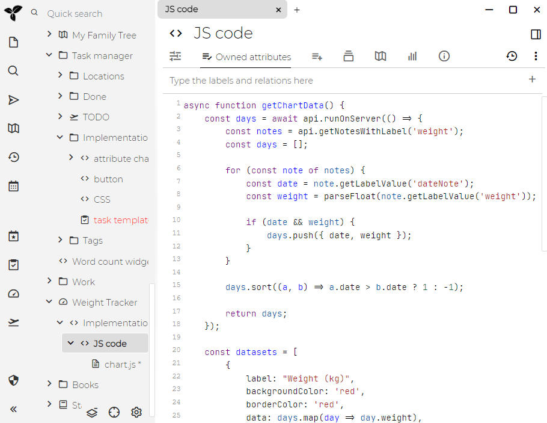

# Code
Trilium supports creating "code" notes, i.e. notes which contain some sort of formal code - be it programming language (C++, JavaScript), structured data (JSON, XML) or other types of codes (CSS etc.).

This can be useful for a few things:

*   computer programmers can store code snippets as notes with syntax highlighting
*   JavaScript code notes can be executed inside Trilium for some extra functionality
    *   we call such JavaScript code notes "scripts" – see <a class="reference-link" href="../Scripting.md">Scripting</a>
*   JSON, XML etc. can be used as storage for structured data (typically used in conjunction with scripting)

For shorter snippets of code that can be embedded in [Text](Text.md) notes, see [Code blocks](Text/Developer-specific%20formatting/Code%20blocks.md).

## Creating a code note

In the [Note Tree](../Basic%20Concepts%20and%20Features/UI%20Elements/Note%20Tree.md), right-click a note and select _Insert child note_ or _Insert note after_, then:

*   To create a plain text code note, select _Code_.
*   To create a code note in a given language, hover _Code_ and select the language. The list shows the languages enabled in the options (see below), and ends with _Configure code notes..._, which opens them.

## Adjusting the language of a code note

To change the language of a code note, look for the  icon in the <a class="reference-link" href="../Basic%20Concepts%20and%20Features/UI%20Elements/Status%20bar.md">Status bar</a>. When clicked it will reveal the list of available languages (which can be customized according to the section below). The menu also features a search bar to quickly filter, and icons to visually distinguish some of the programming languages.

On the <a class="reference-link" href="../Installation%20%26%20Setup/Mobile%20Frontend.md">Mobile Frontend</a>, the same list is available in the <a class="reference-link" href="../Basic%20Concepts%20and%20Features/UI%20Elements/Note%20menu.md">Note menu</a> → _Note settings_ → _Change language mode_.

## Adjusting the list of languages

Trilium supports syntax highlighting for many languages, but by default displays only some of them. To change which languages are offered, go to <a class="reference-link" href="../Basic%20Concepts%20and%20Features/UI%20Elements/Options.md">Options</a> → _Code Notes_ and find _Available MIME types in the dropdown_. Here you can:

*   Add a language by pressing the  _Add another language_ button, which also shows how many languages are left, and then selecting it. While picking, hover a language to see where it is syntax highlighted.
*   Press the  button beside a language, or select it and press <kbd>Delete</kbd>, to remove it from the list. _Plain text_ cannot be removed.
*   See where each language is syntax highlighted: the _Code blocks_ badge stands for code blocks in text notes, the _Code notes_ badge for code notes.

The languages are listed in the same order wherever you choose one: the language menu in the <a class="reference-link" href="../Basic%20Concepts%20and%20Features/UI%20Elements/Status%20bar.md">Status bar</a>, the _Code_ submenu when creating a note, and the language of a code block. By default, the list is sorted alphabetically, with _Plain text_ first. To use an order of your own:

1.  Turn off the _Sort alphabetically_ switch at the top of the section.
2.  Hold the **\=** handle shown beside a language, and then drag it up or down. Alternatively, select a language and press <kbd>Ctrl</kbd>+<kbd>↑</kbd> or <kbd>Ctrl</kbd>+<kbd>↓</kbd>.

Turning _Sort alphabetically_ back on does not discard your order: it is used again the next time the switch is turned off.

Note that the list of languages is not immediately refreshed, you'd have to manually [refresh the application](../Troubleshooting/Refreshing%20the%20application.md).

The list of languages is also shared with the [Code blocks](Text/Developer-specific%20formatting/Code%20blocks.md) feature of [Text](Text.md) notes.

## Word wrap

Long lines can be displayed on multiple lines:

*   Globally for all code notes, from <a class="reference-link" href="../Basic%20Concepts%20and%20Features/UI%20Elements/Options.md">Options</a> → _Code Notes._
*   For a particular note, by going to the menu in <a class="reference-link" href="../Basic%20Concepts%20and%20Features/UI%20Elements/Note%20menu.md">Note menu</a> and selecting _Word wrap_ and selecting the appropriate option:
    *   _Auto_, to respect the global word wrap for code notes.
    *   _On_ or _Off_, to change the state of the word wrap for this note regardless of the global option.

> [!NOTE]
> Word wrapping can also be adjusted at note level through the `#wrapLines` [label](../Advanced%20Usage/Attributes/Labels.md), which can also be inherited.

## Line numbers

The numbers at the start of each line can be hidden from <a class="reference-link" href="../Basic%20Concepts%20and%20Features/UI%20Elements/Options.md">Options</a> → _Code Notes_ → _Editor_ → _Line numbers_. The setting applies to every code editor, such as the source of a [Markdown](Markdown.md) note, and to code shown without its editor (see _Color schemes_ below).

An included code note or an embedded code file can show or hide them on its own through the _Line numbers_ submenu of its _More actions_ menu, see <a class="reference-link" href="Text/Include%20Note.md">Include Note</a>. Its _Auto_ entry follows the setting.

## Adjusting options using the status bar

The status bar at the bottom of the editor shows the position of the cursor, the current indentation settings and language.

The cursor position is shown as _Ln_ (the line) and _Col_ (the column), both counted from 1. A tab counts as many columns as the display width of tabs, so the column matches where the cursor appears on screen. While text is selected, _Selected_ shows the number of selected characters, counting each line break as one.

Clicking on the indentation indicator opens a menu with three sections:

1.  _Indent Using_ — switch between Spaces and Tabs (`#indentWithTabs`). If a per-note override is active, a "Reset to default" option appears.
2.  _Display Width_ — choose from preset widths (1, 2, 3, 4, 6, 8). Changes are saved as a per-note `#tabWidth` label.
3.  _Re-indent Content To_ — convert existing indentation to a different style. For example, re-indent a file from 4 spaces to 2 spaces, or from spaces to tabs. This rewrites the leading whitespace on every line while preserving alignment remainders.

Clicking the language indicator lets you change the note's MIME type. As in the _Note type_ selector, typing narrows the list of languages.

The same two menus are in the toolbar of a code note or a code file included in a text note, see <a class="reference-link" href="Text/Include%20Note.md">Include Note</a>.

### Re-indentation

When you re-indent content, the editor:

*   Measures the visual column width of each line's leading whitespace using the current style
*   Calculates indent levels and any alignment remainder
*   Rebuilds the leading whitespace in the target style
*   Preserves non-leading whitespace, blank lines, and content without indentation

## Transforming text

To change the selected lines or text, right-click the selection and open _Transform_. Its commands come in three groups:

*   _Sort ascending_, _Sort descending_, _Shuffle lines_, _Reverse line order_ and _Deduplicate lines_, which keeps the first copy of each line.
*   _Trim leading_, _Trim trailing_ and _Trim both_ remove the whitespace at the start, at the end or at both ends of each line. _Remove blank lines_ also removes the lines that hold only whitespace.
*   _To uppercase_, _To lowercase_, _To sentence case_, _To title case_ and _Remove diacritics_.

The commands of the first two groups change every line that the selection touches, even partly. Those of the third group change only the selected text. Each change is undone in one step with <kbd>Ctrl</kbd>+<kbd>Z</kbd>.

*   Sorting reads numbers, dates and times by their value, as sorting a table does (see <a class="reference-link" href="Text/Tables.md">Tables</a>), and ignores the case of letters and the indentation. Blank lines go last.
*   _To sentence case_ lowercases the text and capitalizes the first word of each sentence and of each line. _To title case_ capitalizes every word except minor words such as "of" and "the", which stay lowercase unless they start or end a sentence.
*   _Remove diacritics_ turns letters such as `é`, `ș` and `ł` into `e`, `s` and `l`, and removes the vowel points of Hebrew and Arabic. Letters such as `ß` and `æ` stay as they are.
*   Sorting and the case changes follow the language set in <a class="reference-link" href="../Basic%20Concepts%20and%20Features/UI%20Elements/Options.md">Options</a> → _Language & Region_ → _Default content language_. In Turkish, for example, an uppercase `i` is `İ`.

## Color schemes

Since Trilium 0.94.0 the colors of code notes can be customized by going <a class="reference-link" href="../Basic%20Concepts%20and%20Features/UI%20Elements/Options.md">Options</a> → Code Notes and looking for the _Appearance_ section.

A code note or a code file shown without its editor, such as in an <a class="reference-link" href="Text/Include%20Note.md">Include Note</a>, on the cards of <a class="reference-link" href="../Collections.md">Collections</a> or in a tooltip, uses the same colors and line numbers as the editor does. A printout uses the _Light theme_. A [shared page](../Advanced%20Usage/Sharing.md) uses the VS Code light or dark theme, following the mode of the page.

> [!NOTE]
> **Why are there only a few themes whereas the code block themes for text notes have a lot?**  
> The reason is that Code notes use a different technology than the one used in Text notes, and as such there is a more limited selection of themes. If you find a CodeMirror 6 (not 5) theme that you would like to use, let us know and we might consider adding it to the set of default themes. There is no possibility of adding new themes (at least for now), since the themes are defined in JavaScript and not at CSS level.

## Programming ligatures

If you see `!=` displayed as `≠` or `->` as `→` inside a code note, those are _font ligature_: the default monospace font draws certain character pairs as a single symbol. The underlying text is not changed by Trilium (unlike text notes which have <a class="reference-link" href="Text/Automatic%20replacements.md">Automatic replacements</a>), and copying it out gives you back `!=` and `->`.

This can be turned off with <a class="reference-link" href="../Basic%20Concepts%20and%20Features/UI%20Elements/Options.md">Options</a>_→ Appearance → Fonts → Programming ligatures_.

## Virtual keyboard behavior

When using a virtual keyboard, keyboard suggestions and corrections are controlled as follows:

*   For <a class="reference-link" href="Markdown.md">Markdown</a> and plain text code notes, the autocorrect is **on**, as well as automatic capitalization.
*   For all the other code notes, the autocorrect is off in order to avoid issues when typing code.

> [!NOTE]
> Not all browsers and platforms respect this value, so the keyboard suggestions might appear without autocorrecting or the browser might disregard this and autocorrect anyway.