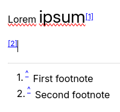

# Footnotes
<figure class="image image-style-align-right"></figure>

Footnotes are a good place to insert references to a paragraph or details that are displayed at the bottom of the note.

## Interaction

*   To insert a new footnote, open the  _Insert_ menu of the <a class="reference-link" href="Formatting%20toolbar.md">Formatting toolbar</a> and choose  _Footnote_ (or select _New footnote_ in its submenu).
*   To insert a reference to an existing footnote, open the submenu of _Footnote_ and select _Insert footnote_, followed by the number of the footnote to insert.
*   Hovering over a reference (e.g. `[1]`) will display the content of the footnote in a tooltip for easy reference.
*   Clicking on a reference in the text (e.g. `[1]`) will navigate to the corresponding footnote.
*   Similarly, clicking on the `^` button of a footnote will navigate to the corresponding reference in the text.