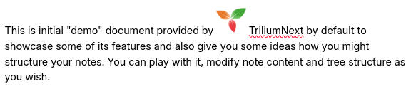

# Images
Trilium supports storing and displaying images. Supported formats are PNG, JPEG, GIF, BMP, WebP, AVIF and SVG.

An image can be uploaded in the form of note's [attachment](../../Basic%20Concepts%20and%20Features/Notes/Attachments.md) or as a standalone [note](../../Basic%20Concepts%20and%20Features/Navigation/Tree%20Concepts.md) placed into the [note tree](../../Basic%20Concepts%20and%20Features/Navigation/Tree%20Concepts.md). Its reference can be copied into a text note, in order to display it in the text itself.

## Uploading images

To add an image to the note:

*   Simply drag it from file explorer onto the note editor inside Trilium and the image will be uploaded.
*   Alternatively, in the <a class="reference-link" href="Formatting%20toolbar.md">Formatting toolbar</a>, press the _Attach file_ button and select _Image_.
*   On the <a class="reference-link" href="../../Installation%20%26%20Setup/Mobile%20Frontend.md">Mobile Frontend</a>, the same menu also offers _Camera_, which takes a photo and inserts it.
*   You can also copy and paste an image from web (see section below).

Where the image goes depends on the cursor. In an empty paragraph, the image is displayed on a line of its own. In a list item, or after some text in a paragraph, the image is inserted _In line_, inside the text. To change it afterwards, use the _Image position_ button described in the alignment section below.

> [!TIP]
> To link a picture instead of displaying it, attach it with _Attach file as a link_, from the _Attach file_ button. See <a class="reference-link" href="../../Basic%20Concepts%20and%20Features/Notes/Attachments.md">Attachments</a>.

## Clipboard & automatic download of images

Trilium has a special handling for images copied to and pasted from the clipboard.

*   For a mix of text and images, the images are downloaded automatically by the server (or desktop app, depending on what is being used).
    *   This means that the image must be publicly accessible and reachable from wherever Trilium is running. Inaccessible images will end up as broken images.
*   If a single image is pasted into Trilium, it will prefer the image that comes in the clipboard. This makes it possible to copy images that Trilium would not otherwise be able to reach, such as Google Chat, Slack, etc.
*   When a text with images is copied from Trilium and pasted in another app (such as Microsoft Word or LibreOffice Writer), the images will be preserved.

The automatic download of images is enabled by default and can be toggled from <a class="reference-link" href="../../Basic%20Concepts%20and%20Features/UI%20Elements/Options.md">Options</a> → _Media_ → _Download images automatically._

## Configuring the images

Clicking on an image will reveal a popup with multiple options:  

### Alignment

The first button of the popup, _Image position_, shows the icon of the image's current position. It opens a menu that groups the positions by how text runs around the image:

| Icon | Option | Preview | Description |
| --- | --- | --- | --- |
|  | _In line_ |  | The image sits inside a paragraph, like a large character, and moves with the text around it. Use drag & drop or cut-paste to move it around. |
|  | _Break text_ → _Align left_, _Align center_ or _Align right_ |   | The image is displayed on a line of its own, at the left, in the center or at the right; text continues above and below it but not beside it. |
|  | _Wrap text_ → _Align left_ or _Align right_ |  | The image is displayed at the left or the right, and the text flows beside it. |

### Drawing over an image

To draw or write over an image, press the  _Convert image to a drawing canvas_ button of its toolbar. The image becomes a drawing canvas that shows all of it, locked in place. See the drawing canvases section of <a class="reference-link" href="Include%20Note.md">Include Note</a>.

## Compression

Since Trilium isn't really meant to be primary storage for image data, it attempts to compress and resize (with pretty aggressive settings) uploaded images before storing them to the database. You may then notice some quality degradation. Basic quality settings is available in <a class="reference-link" href="../../Basic%20Concepts%20and%20Features/UI%20Elements/Options.md">Options</a> → _Media_.

If you want to save images in their original resolution, it is recommended to save them as attachment to note (look for the contextual menu in <a class="reference-link" href="../../Basic%20Concepts%20and%20Features/UI%20Elements/Note%20menu.md">Note menu</a> → _Import files_).

## Aligning images side-by-side

There are generally two ways to display images side by side:

*   If they are roughly the same size, simply make the two images in-line, according to the alignment section above. The images can be dragged & dropped onto the same line.
*   If they are on different size, create a [table](Tables.md) with invisible borders.