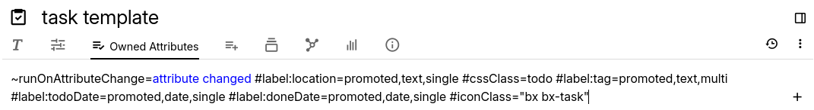

# Атрибуты
<figure class="image"></figure>

В Trilium атрибуты — это пары «ключ-значение», присваиваемые заметкам и дающие дополнительные метаданные или функциональность. Есть два основных типа атрибутов:

1.  <a class="reference-link" href="Attributes/Labels.md">Метки (Labels)</a> можно использовать для различных целей, например для хранения метаданных или настройки поведения заметок. Метки также участвуют в поиске, улучшая извлечение заметок.

    Подробнее, включая предопределённые метки, см. <a class="reference-link" href="Attributes/Labels.md">Метки</a>.
2.  <a class="reference-link" href="Attributes/Relations.md">Отношения (Relations)</a> определяют связи между заметками, похожие на ссылки. Они могут использоваться для метаданных и в скриптах.

    Подробнее, включая список предопределённых отношений, см. <a class="reference-link" href="Attributes/Relations.md">Отношения</a>.

Эти атрибуты играют ключевую роль в организации, категоризации и расширении функциональности заметок.

## Типы атрибутов

Концептуально существует два типа атрибутов (применимо как к меткам, так и к отношениям):

1.  **Системные атрибуты**
    Как следует из названия, эти атрибуты имеют особое значение, так как интерпретируются Trilium. Например, атрибут `color` изменит цвет заметки, отображаемый в <a class="reference-link" href="../Basic%20Concepts%20and%20Features/UI%20Elements/Note%20Tree.md">Дереве заметок</a> и в ссылках, а `iconClass` изменит значок заметки.
2.  **Пользовательские атрибуты**
    Это свободные метки или отношения, которые может использовать пользователь. Их можно использовать чисто для категоризации (особенно в сочетании с <a class="reference-link" href="../Basic%20Concepts%20and%20Features/Navigation/Search.md">Поиском</a>), или можно придать им смысл через <a class="reference-link" href="../Scripting.md">Скриптинг</a>.

На практике Trilium не различает напрямую, является ли атрибут системным или пользовательским. Метка или отношение считается системным атрибутом, если её имя совпадает с одним из встроенных имён (например, с упомянутым выше `iconClass`). Помните об этом при создании <a class="reference-link" href="Attributes/Promoted%20Attributes.md">Продвигаемых атрибутов</a>, чтобы случайно не изменить системный атрибут (если только это не нужно).

## Просмотр списка атрибутов

И метки, и отношения текущей заметки отображаются:

*   В <a class="reference-link" href="../Basic%20Concepts%20and%20Features/UI%20Elements/Right%20Sidebar.md">Правой боковой панели</a>, на <a class="reference-link" href="../Basic%20Concepts%20and%20Features/UI%20Elements/Right%20Sidebar/Attributes%20tab.md">Вкладке атрибутов</a> в виде таблицы.
*   Более продвинутый вариант — в <a class="reference-link" href="../Basic%20Concepts%20and%20Features/UI%20Elements/Status%20bar.md">Строке состояния</a> →  (_Атрибуты_), где атрибуты отображаются текстом, что облегчает их копирование и пакетные изменения.
    *   В списке атрибутов метки имеют префикс `#`, а отношения — префикс `~`.

## Определения атрибутов и продвигаемые атрибуты

<a class="reference-link" href="Attributes/Promoted%20Attributes.md">Продвигаемые атрибуты</a> создают опыт редактирования атрибутов в виде формы, что упрощает организацию и управление атрибутами.

## Кратность

Атрибуты в Trilium могут быть «многозначными», то есть несколько атрибутов с одним именем могут сосуществовать. Это можно сочетать с <a class="reference-link" href="Attributes/Promoted%20Attributes.md">Продвигаемыми атрибутами</a>, чтобы легко их добавлять.

## Наследование атрибутов

Trilium поддерживает наследование атрибутов, позволяя дочерним заметкам наследовать атрибуты родителей. Подробнее см. <a class="reference-link" href="Attributes/Attribute%20Inheritance.md">Наследование атрибутов</a>.
