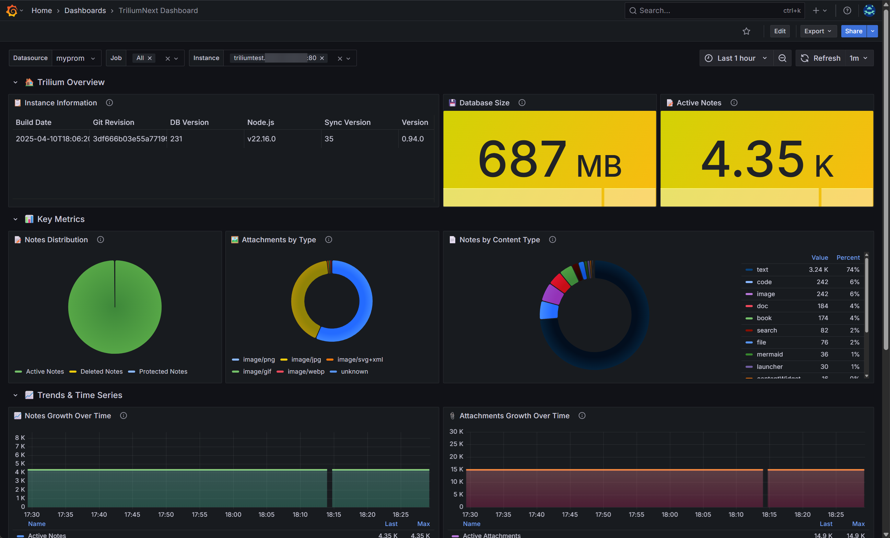
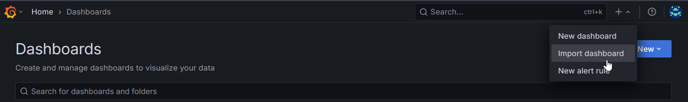
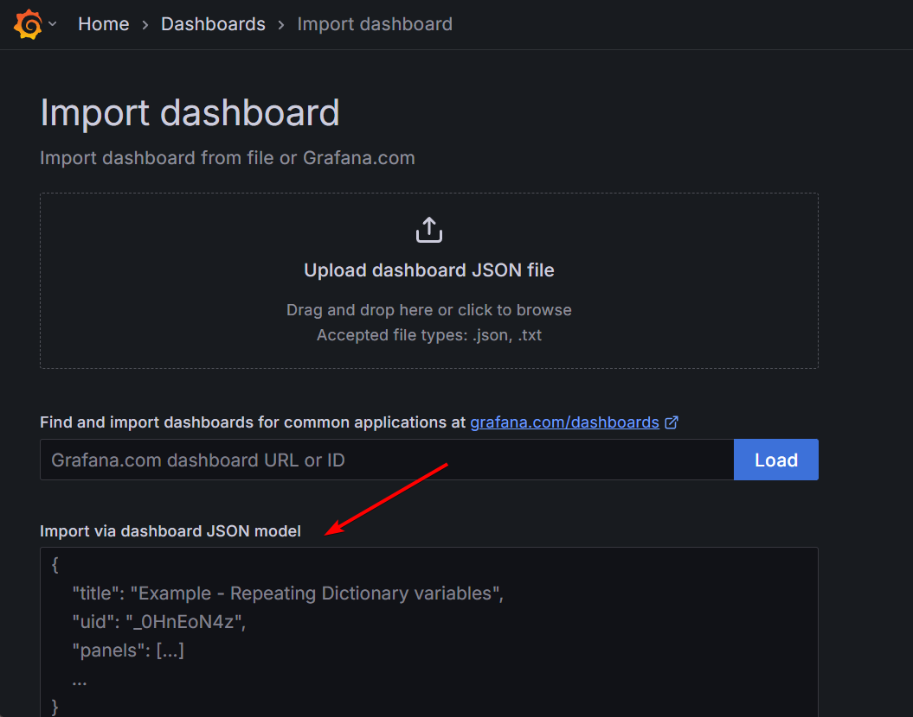

# Метрики
API метрик Trilium предоставляет исчерпывающие данные мониторинга о вашем экземпляре Trilium, предназначенные для внешних систем мониторинга вроде Prometheus.

## Endpoint

*   **URL**: `/etapi/metrics`
*   **Метод**: `GET`
*   **Аутентификация**: требуется ETAPI-токен
*   **Формат по умолчанию**: текстовый формат Prometheus

## Аутентификация

Для доступа к endpoint метрик нужен ETAPI-токен. Получите его так:

```
# Получение ETAPI-токена
curl -X POST http://localhost:8080/etapi/auth/login \
  -H "Content-Type: application/json" \
  -d '{"password": "your_password"}'

```

## Использование

=== "Формат Prometheus (по умолчанию)"

    ```
    curl -H "Authorization: YOUR_ETAPI_TOKEN" \
      http://localhost:8080/etapi/metrics

    ```

    Возвращает метрики в текстовом формате Prometheus:

    ```
    # HELP trilium_info Trilium instance information
    # TYPE trilium_info gauge
    trilium_info{version="0.91.6",db_version="231",node_version="v18.17.0"} 1 1701432000

    # HELP trilium_notes_total Total number of notes including deleted
    # TYPE trilium_notes_total gauge
    trilium_notes_total 1234 1701432000
    ```

=== "Формат JSON"

    ```
    curl -H "Authorization: YOUR_ETAPI_TOKEN" \
      "http://localhost:8080/etapi/metrics?format=json"

    ```

    Возвращает подробные метрики в формате JSON для отладки или пользовательских интеграций.

## Доступные метрики

### Информация об экземпляре

*   `trilium_info` - Информация о версии и сборке с метками

### Метрики базы данных

*   `trilium_notes_total` - Всего заметок (включая удалённые)
*   `trilium_notes_deleted` - Количество удалённых заметок
*   `trilium_notes_active` - Количество активных заметок
*   `trilium_notes_protected` - Количество защищённых заметок
*   `trilium_attachments_total` - Всего вложений
*   `trilium_attachments_active` - Активные вложения
*   `trilium_revisions_total` - Всего ревизий заметок
*   `trilium_branches_total` - Активные ветви
*   `trilium_attributes_total` - Активные атрибуты
*   `trilium_blobs_total` - Всего записей blob
*   `trilium_etapi_tokens_total` - Активные ETAPI-токены
*   `trilium_embeddings_total` - Эмбеддинги заметок (если доступны)

### Категоризированные метрики

*   `trilium_notes_by_type{type="text|code|image|file"}` - Заметки по типу
*   `trilium_attachments_by_type{mime_type="..."}` - Вложения по MIME-типу

### Статистика

*   `trilium_database_size_bytes` - Размер базы данных в байтах
*   `trilium_oldest_note_timestamp` - Отметка времени самой старой заметки
*   `trilium_newest_note_timestamp` - Отметка времени самой новой заметки
*   `trilium_last_modified_timestamp` - Отметка времени последнего изменения

## Конфигурация Prometheus

Добавьте в ваш `prometheus.yml`:

```
scrape_configs:
  - job_name: 'trilium'
    static_configs:
      - targets: ['localhost:8080']
    metrics_path: '/etapi/metrics'
    bearer_token: 'YOUR_ETAPI_TOKEN'
    scrape_interval: 30s

```

## Ответы об ошибках

*   `400` - Недопустимый параметр формата
*   `401` - Отсутствующий или недействительный ETAPI-токен
*   `500` - Внутренняя ошибка сервера

## Дашборд Grafana

<figure class="image"></figure>

Вы также можете использовать дашборд Grafana, созданный для TriliumNext, — просто возьмите JSON из <a class="reference-link" href="Metrics/grafana-dashboard.json">grafana-dashboard.json</a>, а затем импортируйте дашборд, следуя этим снимкам экрана:

<figure class="image"></figure>

Затем вставьте JSON и нажмите «Загрузить» (load):

<figure class="image"></figure>
