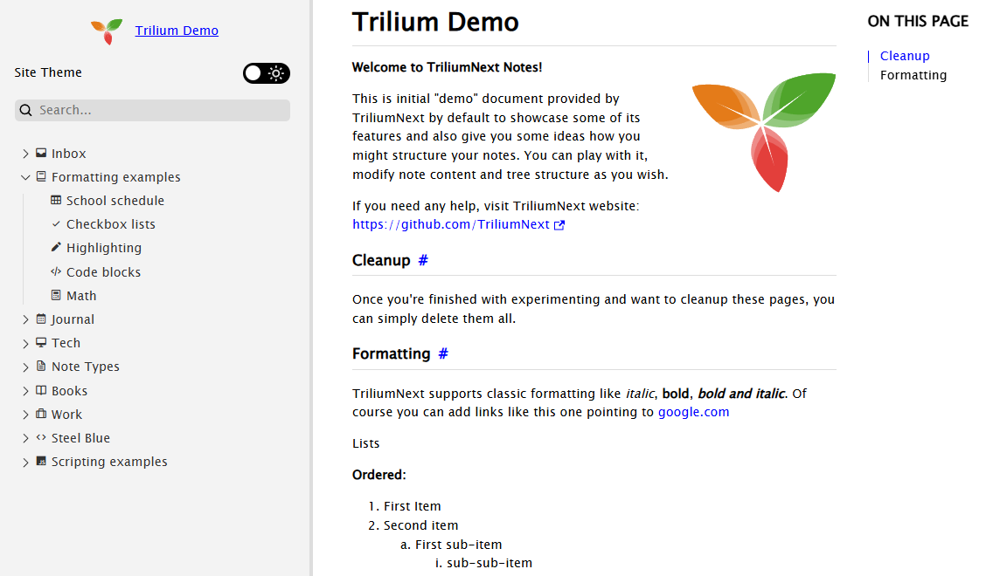
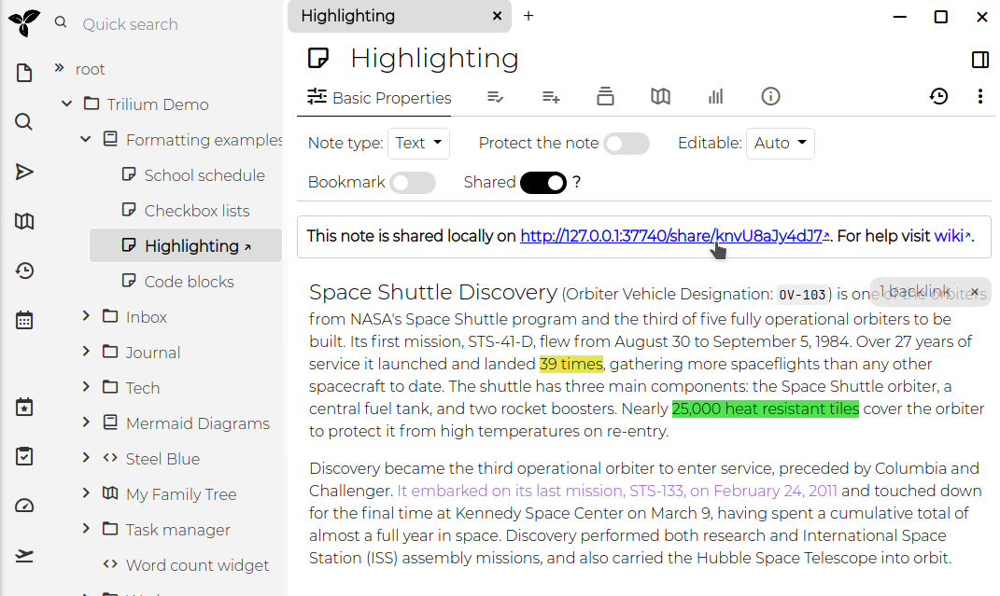

# Публикация (Sharing)
Trilium позволяет публиковать выбранные заметки как **публично доступные** документы только для чтения. Эта возможность особенно полезна для публикации контента прямо из ваших заметок Trilium, делая его доступным другим в интернете.

<figure class="image"></figure>

## Возможности, взаимодействие и ограничения

*   Поиск по заголовку заметки.
*   Светлый и тёмный режим, по умолчанию следующий за системной настройкой посетителя, в том числе пока страница открыта. Посетитель может выбрать _Светлый_, _Тёмный_ или _Системный_ кнопками вверху панели навигации; выбор запоминается браузером.
*   Макет, центрированный на широких экранах, с деревом навигации и оглавлением по обе стороны от содержимого, и мобильный макет на узких. Там дерево навигации выдвигается из кнопки меню в заголовке и перечисляет заголовки текущей страницы под её записью (вверху панели, для страницы, которую дерево не показывает).
*   Сворачиваемое дерево с теми же значками заметок, что и в приложении. Оно сохраняет развёрнутые посетителем разделы и позицию прокрутки при перемещении между страницами сайта и показывает текущую заметку.
*   Настраиваемый логотип.
*   Кнопки быстрой навигации (предыдущая и следующая заметка).
*   Заметки, скрывающие своих потомков из дерева с помощью `#subtreeHidden` (такие как <a class="reference-link" href="../Collections/Kanban%20Board.md">Kanban-доска</a>), показывают значок с их количеством вместо их перечисления. Страница одного из таких потомков показывает только этого потомка под его родителем, а кнопки «предыдущая» и «следующая» пропускают их.
*   Подстраницы текстовой или кодовой заметки показаны под её содержимым как карточки, как в приложении. Каждая карточка показывает значок подстраницы и начало её текста (или её `#shareDescription`), а для подстраницы без текста — ссылки на её собственные первые подстраницы. Карточки можно скрыть с помощью `#hideChildrenOverview`.
*   Отображение даты последнего обновления заметки, прописью на языке приложения.
*   Разметка страницы языком приложения и направлением его текста, а содержимого заметки — её собственным [языком содержимого](../Note%20Types/Text/Content%20language%20%26%20Right-to-left%20support.md), для экранных дикторов и текста справа налево.

### По типам заметок

<table class="ck-table-resized">
    <colgroup>
        <col style="width:19.92%;">
        <col style="width:41.66%;">
        <col style="width:38.42%;">
    </colgroup>
    <thead>
        <tr>
            <th>&nbsp;</th>
            <th>Поддерживаемые возможности</th>
            <th>Ограничения</th>
        </tr>
    </thead>
    <tbody>
        <tr>
            <th><a class="reference-link" href="../Note%20Types/Text.md">Текст</a></th>
            <td><ul><li>Оглавление с сохранением встроенного форматирования заголовков, такого как код или полужирный текст.</li><li>Ссылка рядом с каждым заголовком, показываемая при наведении указателя на заголовок. Щелчок по ней показывает адрес раздела в адресной строке браузера и копирует его, чтобы поделиться ссылкой на раздел.</li><li>Подсветка синтаксиса блоков кода на языке, выбранном для каждого блока, и в цветах светлой или тёмной темы VS Code, следующих за режимом страницы. Для блоков «Автоопределение» язык угадывается среди включённых в <a class="reference-link" href="../Basic%20Concepts%20and%20Features/UI%20Elements/Options.md">Настройках</a> → <em>Заметки с кодом</em>; язык, не включённый там, не подсвечивается.</li><li>Кнопка в правом верхнем углу каждого блока кода, показываемая при наведении указателя на блок, копирующая его код. Страницы, открытые по обычному HTTP, её не имеют, так как браузеры разрешают копирование в буфер обмена только на защищённых (HTTPS) страницах.</li><li>Отрисовка математических формул.</li><li><a href="../Note%20Types/Text/Include%20Note.md">Включение заметок</a> (только если включённые заметки также опубликованы).</li><li>Холсты для рисования, показанные как картинки.</li><li>Диаграммы Mermaid в блоках кода, отрисованные в светлом или тёмном режиме страницы и перерисованные при его переключении посетителем.</li></ul></td>
            <td>&nbsp;</td>
        </tr>
        <tr>
            <th><a class="reference-link" href="../Note%20Types/Code.md">Код</a></th>
            <td><ul><li>Подсветка синтаксиса на языке заметки и в цветах светлой или тёмной темы VS Code, следующих за режимом страницы. Язык, не включённый в <a class="reference-link" href="../Basic%20Concepts%20and%20Features/UI%20Elements/Options.md">Настройках</a> → <em>Заметки с кодом</em>, не подсвечивается. Строки нумеруются, если <em>Номера строк</em> не отключены в том же разделе.</li></ul></td>
            <td>&nbsp;</td>
        </tr>
        <tr>
            <th><a class="reference-link" href="../Note%20Types/Saved%20Search.md">Сохранённый поиск</a></th>
            <td>Не поддерживается.</td>
            <td>&nbsp;</td>
        </tr>
        <tr>
            <th><a class="reference-link" href="../Note%20Types/Relation%20Map.md">Карта отношений</a></th>
            <td>Не поддерживается.</td>
            <td>&nbsp;</td>
        </tr>
        <tr>
            <th><a class="reference-link" href="../Note%20Types/Note%20Map.md">Карта заметок</a></th>
            <td>Не поддерживается.</td>
            <td>&nbsp;</td>
        </tr>
        <tr>
            <th><a class="reference-link" href="../Note%20Types/Render%20Note.md">Render Note</a></th>
            <td>Не поддерживается.</td>
            <td>&nbsp;</td>
        </tr>
        <tr>
            <th><a class="reference-link" href="../Collections.md">Коллекции</a></th>
            <td><ul><li>Дочерние заметки показаны как карточки или списком, когда вид коллекции — <em>Список</em>. Каждая показывает свой значок и начало текста (или свою <code>#shareDescription</code>), а для дочерней заметки без текста — ссылки на её собственные первые дочерние заметки.</li></ul></td>
            <td><ul><li>Виды календаря, таблицы, доски, геокарты, дашборда и презентации показаны как в приложении, но только для чтения.</li></ul></td>
        </tr>
        <tr>
            <th><a class="reference-link" href="../Note%20Types/Mermaid%20Diagrams.md">Диаграммы Mermaid</a></th>
            <td><ul><li>Диаграмма отрисована в светлом или тёмном режиме страницы и перерисована при его переключении посетителем. В браузерах с отключённым JavaScript вместо неё показывается изображение, сохранённое при последнем редактировании заметки, а исходник диаграммы можно развернуть под ним.</li><li>Диаграмма заполняет страницу и может масштабироваться кнопками <span class="tn-icon bx bx-minus-circle"></span> и <span class="tn-icon bx bx-plus-circle"></span> в её углу или колёсиком мыши, между 50% и 1000% вписанного размера, а на сенсорных экранах — щипком. Щелчок по проценту между кнопками или двойной щелчок по диаграмме снова показывает её целиком. Диаграмму можно перетаскивать.</li></ul></td>
            <td>&nbsp;</td>
        </tr>
        <tr>
            <th><a class="reference-link" href="../Note%20Types/Canvas.md">Холст</a></th>
            <td><ul><li>Диаграмма отображается как векторное изображение.</li></ul></td>
            <td><ul><li>Дальнейшее взаимодействие не поддерживается.</li></ul></td>
        </tr>
        <tr>
            <th><a class="reference-link" href="../Note%20Types/Web%20View.md">Веб-представление</a></th>
            <td>Не поддерживается.</td>
            <td>&nbsp;</td>
        </tr>
        <tr>
            <th><a class="reference-link" href="../Note%20Types/Mind%20Map.md">Mind Map</a></th>
            <td>Диаграмма отображается как векторное изображение.</td>
            <td><ul><li>Дальнейшее взаимодействие не поддерживается.</li></ul></td>
        </tr>
        <tr>
            <th><a class="reference-link" href="../Collections/Geo%20Map.md">Геокарта</a></th>
            <td>Не поддерживается.</td>
            <td>&nbsp;</td>
        </tr>
        <tr>
            <th><a class="reference-link" href="../Note%20Types/File.md">Файл</a></th>
            <td>PDF показывается в просмотрщике, видео- или аудиофайл проигрывается в плеере браузера. Любой другой файл можно скачать.</td>
            <td><ul><li>Дальнейшее взаимодействие не поддерживается.</li></ul></td>
        </tr>
    </tbody>
</table>

Хотя возможность публикации мощная, у неё есть некоторые ограничения:

*   **Статичное дерево заметок**
*   **Защищённые заметки**: не могут быть опубликованы.
*   **Включение заметок**: не поддерживается.

Некоторые из этих ограничений могут быть устранены в будущих обновлениях.

## Требования

Чтобы использовать возможность публикации, у вас должна быть <a class="reference-link" href="../Installation%20%26%20Setup/Server%20Installation.md">Установка на сервер</a> Trilium. Это необходимо, так как заметки будут раздаваться с сервера.

## Публикация заметки

1.  **Включение публикации**: чтобы опубликовать заметку, включите переключатель `Опубликована` в интерфейсе заметки. После включения публикации появится URL, по которому можно щёлкнуть для доступа к опубликованной заметке.

    
2.  **Доступ к опубликованной заметке**: предоставленная ссылка откроет заметку в браузере. Если ваш сервер не настроен с публичным IP, URL будет ссылаться на `localhost (127.0.0.1)`.

## Публикация поддерева заметки

Когда вы публикуете заметку, вы на самом деле публикуете всё поддерево заметок под ней. Если у заметки есть дочерние заметки, они также будут включены в опубликованный контент. Например, публикация поддерева «Formatting» покажет страницу с базовой навигацией для изучения всех заметок этого поддерева.

## Просмотр и управление опубликованными заметками

Список всех опубликованных заметок можно увидеть, выбрав _Дополнительно_ → _Опубликованные заметки_ в <a class="reference-link" href="../Basic%20Concepts%20and%20Features/UI%20Elements/Global%20menu.md">Глобальном меню</a>. Это позволяет управлять опубликованными заметками и перемещаться по ним.

## Соображения безопасности

*   Опубликованные заметки размещаются в открытом интернете и могут быть доступны любому, у кого есть URL, если заметки не защищены паролем.
*   Случайность URL не обеспечивает безопасность, поэтому не публикуйте чувствительную информацию через эту возможность.
*   Trilium предпринимает меры предосторожности для защиты вашего публичного экземпляра от утечки информации о неопубликованных заметках, включая открытие отдельного подключения только для чтения к <a class="reference-link" href="Database.md">Базе данных</a>. В зависимости от вашей модели угроз может иметь больше смысла использовать <a class="reference-link" href="Sharing/Exporting%20static%20HTML%20for%20web%20publishing.md">Экспорт статического HTML для веб-публикации</a> и раздавать статический контент проверенными веб-серверами, такими как Nginx или Apache.

### Защита паролем

Чтобы защитить опубликованные заметки именем пользователя и паролем, используйте атрибут `#shareCredentials`. Добавьте эту метку заметке в формате `#shareCredentials="имя:пароль"`. Чтобы защитить всё поддерево, сделайте метку [наследуемой](Attributes/Attribute%20Inheritance.md).

## Продвинутые опции публикации

### Настройка внешнего вида опубликованных заметок

Дизайн по умолчанию должен быть хорошей отправной точкой, но вы можете настроить его собственным CSS:

*   **Пользовательский CSS**: свяжите CSS-<a class="reference-link" href="../Note%20Types/Code.md">кодовую</a> заметку с опубликованной страницей, добавив отношение `~shareCss` заметке. Чтобы этот стиль применялся ко всему поддереву, сделайте метку наследуемой. Можно скрыть CSS-кодовую заметку из навигации по дереву, добавив метку `#shareHiddenFromTree`.
*   **Отключение CSS по умолчанию**: для масштабных изменений стиля используйте метку `#shareOmitDefaultCss`, чтобы избежать конфликтов с [таблицей стилей по умолчанию](../Basic%20Concepts%20and%20Features/Themes.md) Trilium.

### Добавление JavaScript

Можно внедрить пользовательский JavaScript в опубликованную заметку с помощью отношения `~shareJs`. Это позволяет обращаться к атрибутам заметок или обходить дерево заметок с помощью API `fetchNote()`, который извлекает данные заметки по её ID.

### Добавление пользовательского HTML

Можно внедрять пользовательские фрагменты HTML в определённые места опубликованной страницы с помощью отношения `~shareHtml`. HTML-заметка должна содержать исходный HTML-контент, который вы хотите внедрить, а его расположением можно управлять, добавив заметке с HTML-фрагментом метку `#shareHtmlLocation`.

Метка `#shareHtmlLocation` принимает значения в формате `место:позиция`:

*   **Места**: `head`, `body`, `content`
*   **Позиции**: `start`, `end`

Например:

*   `#shareHtmlLocation=head:start` - внедряет HTML в начало секции `<head>`
*   `#shareHtmlLocation=head:end` - внедряет HTML в конец секции `<head>` (по умолчанию)
*   `#shareHtmlLocation=body:start` - внедряет HTML в начало секции `<body>`
*   `#shareHtmlLocation=content:start` - внедряет HTML в начало области содержимого
*   `#shareHtmlLocation=content:end` - внедряет HTML в конец области содержимого

Если место не указано, HTML будет внедрён в `content:end` по умолчанию.

Пример:

```javascript
const currentNote = await fetchNote();
const parentNote = await fetchNote(currentNote.parentNoteIds[0]);

for (const attr of parentNote.attributes) {
    console.log(attr.type, attr.name, attr.value);
}
```

### Пользовательские шаблоны публикации

Чтобы полностью переделать публикацию, можно создать или использовать существующий [пользовательский шаблон публикации](Sharing/Custom%20share%20template.md).

### Создание удобочитаемых URL-псевдонимов

Опубликованные заметки обычно имеют URL вида `http://domain.tld/share/knvU8aJy4dJ7`, где последняя часть — ID заметки. Можно сделать эти URL более удобными, добавив отдельным заметкам метку `#shareAlias` (например, `#shareAlias=highlighting`). Это изменит URL на `http://domain.tld/share/highlighting`. URL с ID заметки продолжает работать и перенаправляет на псевдоним.

**Важно**:

1.  Убедитесь, что псевдонимы уникальны.
2.  Использование слэшей (`/`) внутри псевдонимов для создания подпутей не поддерживается.

> [!TIP]
> *   Чтобы легко находить страницы без псевдонима публикации, выполните <a class="reference-link" href="../Basic%20Concepts%20and%20Features/Navigation/Search.md">Поиск</a> с `#!shareAlias`.
> *   Чтобы быстрее вводить псевдоним публикации, рассмотрите использование <a class="reference-link" href="Attributes/Promoted%20Attributes.md">Продвигаемых атрибутов</a> (например, `#label:shareAlias(inheritable)="promoted,alias=Slug,single,text"`).

### Установка пользовательского favicon

Чтобы настроить favicon для ваших опубликованных страниц, создайте отношение `~shareFavicon`, указывающее на файл-заметку с favicon (например, в формате `.ico`).

### Публикация заметки как корня

Можно назначить конкретную заметку или папку корнем вашего опубликованного контента, добавив метку `#shareRoot`. На эту заметку будет вести ссылка при посещении `[http://domain.tld/share](http://domain/share)`, что упрощает использование Trilium как полноценного сайта.

> [!TIP]
> Рассмотрите сочетание этого с меткой `#shareIndex`, которая покажет список всех опубликованных заметок.

### Отображение индекса опубликованных заметок

При доступе к публикации подзаметки отображаются в дереве слева. Но поскольку можно опубликовать несколько деревьев заметок, может быть полезно показать список всех разных деревьев публикаций.

Для этого создайте опубликованную текстовую заметку и примените метку `shareIndex`. При просмотре список корней публикаций будет показан внизу заметки.

### Ссылка на внешний сайт

Иногда полезно включить ссылку на внешний сайт рядом с вашими опубликованными заметками — например, в опубликованной навигации или в индексе. Для этого добавьте заметке метку `#shareExternalLink` со значением URL цели (например, `#shareExternalLink="https://example.com"`).

Любая ссылка, указывающая на эту заметку, затем будет перенаправлять на внешний сайт и открываться в новой вкладке браузера вместо открытия собственной опубликованной страницы заметки. Открытие опубликованного URL заметки по её ID также перенаправляет на внешний сайт. Это применяется к:

*   списку, создаваемому меткой `#shareIndex`;
*   дереву навигации опубликованного сайта;
*   списку «Подстраницы», показываемому под родительской заметкой;
*   встроенным ссылкам на эту заметку из других опубликованных заметок.

URL должен быть абсолютным и включать схему (например, `https://`).

> [!NOTE]
> Заметка по-прежнему существует в дереве публикации, и её собственная страница остаётся доступна по прямому URL — метка лишь меняет поведение ссылок на неё.

## Справочник атрибутов

<table class="ck-table-resized">
    <colgroup>
        <col style="width:18.38%;">
        <col style="width:81.62%;">
    </colgroup>
    <thead>
        <tr>
            <th>Атрибут</th>
            <th>Описание</th>
        </tr>
    </thead>
    <tbody>
        <tr>
            <td><code>#shareHiddenFromTree</code></td>
            <td>эта заметка скрыта из левого дерева навигации, из списка подстраниц её родителя, из карт опубликованных заметок и из поиска публикации, но остаётся доступной по своему URL</td>
        </tr>
        <tr>
            <td><code>#shareExternalLink</code></td>
            <td>когда ссылка указывает на эту заметку (из индекса публикации, списка подстраниц или встроенной ссылки в другой опубликованной заметке), она перенаправляет на заданный внешний URL в новой вкладке вместо опубликованной страницы заметки. Значение — абсолютный URL, например <code>https://example.com</code>.</td>
        </tr>
        <tr>
            <td><code>#shareAlias</code></td>
            <td>задаёт псевдоним, по которому заметка будет доступна под <code>https://your_trilium_host/share/[ваш_псевдоним]</code></td>
        </tr>
        <tr>
            <td><code>#shareOmitDefaultCss</code></td>
            <td>CSS страницы публикации по умолчанию будет опущен. Используйте при масштабных изменениях стиля.</td>
        </tr>
        <tr>
            <td><code>#shareRoot</code></td>
            <td>помечает заметку, которая отдаётся на корне /share.</td>
        </tr>
        <tr>
            <td><code>#shareDescription</code></td>
            <td>задаёт текст, добавляемый в HTML-метатег description. Также описывает заметку в списке подстраниц её родителя вместо начала её текста.</td>
        </tr>
        <tr>
            <td><code>#shareRaw</code></td>
            <td>Заметка будет отдаваться в исходном формате без HTML-обёртки. См. также <a class="reference-link" href="Sharing/Serving%20directly%20the%20content%20of%20a%20note.md">Отдача содержимого заметки напрямую</a> — альтернативный способ без задания атрибута.</td>
        </tr>
        <tr>
            <td><code>#shareDisallowRobotIndexing</code></td>
            <td><p>Указывает веб-краулерам, что страница этой заметки не должна индексироваться:</p><ul><li>установкой HTTP-заголовка <code>X-Robots-Tag: noindex</code>.</li><li>установкой метатега <code>noindex, follow</code>.</li></ul></td>
        </tr>
        <tr>
            <td><code>#shareCredentials</code></td>
            <td>требует учётных данных для доступа к этой опубликованной заметке. Значение должно быть в формате <code>имя:пароль</code>. Не забудьте сделать его наследуемым, чтобы применить к дочерним заметкам/изображениям.</td>
        </tr>
        <tr>
            <td><code>#shareIndex</code></td>
            <td>Заметка с этой меткой перечислит все корни опубликованных заметок.</td>
        </tr>
        <tr>
            <td><code>#shareHtmlLocation</code></td>
            <td>определяет, где должен размещаться пользовательский HTML, внедряемый через отношение <code>~shareHtml</code>. Применяется к самой заметке с HTML-фрагментом. Формат: <code>место:позиция</code>, где место — <code>head</code>, <code>body</code> или <code>content</code>, а позиция — <code>start</code> или <code>end</code>. По умолчанию <code>content:end</code>.</td>
        </tr>
    </tbody>
</table>

### Настройка логотипа

Можно настроить логотип, который отображается над деревом навигации (в заголовке на узком экране).

| Атрибут | Описание |
| --- | --- |
| `~shareLogo` | Отношение, установленное в изображение, используемое как логотип. Изображение должно быть частью дерева публикации (при необходимости его можно скрыть). Без него логотипом служит значок корневой заметки публикации. |
| `#shareLogoWidth` | Ширина логотипа как число без единицы. Вместе с `#shareLogoHeight` задаёт пропорции логотипа, который показывается шириной 32 пикселя. По умолчанию `53`. |
| `#shareLogoHeight` | Высота логотипа как число без единицы. Вместе с `#shareLogoWidth` задаёт пропорции логотипа. По умолчанию `40`. |
| `#shareRootLink` | URL для перехода при нажатии на логотип. |

### Настройка OpenGraph

Мета-свойство опускается на странице, если его атрибут не задан. Без изображения превью ссылок используют небольшую карточку.

| Атрибут | Описание |
| --- | --- |
| `#shareOpenGraphColor` | Настраивает мета-свойство `theme-color`. |
| `#shareOpenGraphURL` | Настраивает мета-свойства `og:url` и `twitter:url`. Это также адрес, с которым дополняется относительный `og:image`, поэтому им должен быть публичный адрес опубликованного сайта, например `https://example.com/share/`. |
| `#shareOpenGraphDomain` | Настраивает мета-свойство `twitter:domain`. |
| `#shareOpenGraphImage`  <br>`~shareOpenGraphImage` | Может быть как меткой с адресом изображения, так и отношением к изображению-<a class="reference-link" href="../Note%20Types/File.md">файлу</a>. Управляет мета-свойством `og:image`. Сайты, показывающие превью ссылки, загружают изображение со своих серверов, поэтому относительный адрес, который всегда даёт отношение, дополняется `#shareOpenGraphURL`; без него изображение не показывается в таких превью. |

## Благодарности

Начиная с v0.95.0 представлена новая тема (включена по умолчанию), которая значительно улучшает визуальный аспект возможности публикации, а также её функциональность (такую как поддержка мобильных устройств, тёмный/светлый режим, сворачиваемое дерево и т.д.). Эта тема — адаптация [Trilium Rocks!](https://github.com/zerebos/trilium.rocks) от [zerebos](https://github.com/zerebos).
