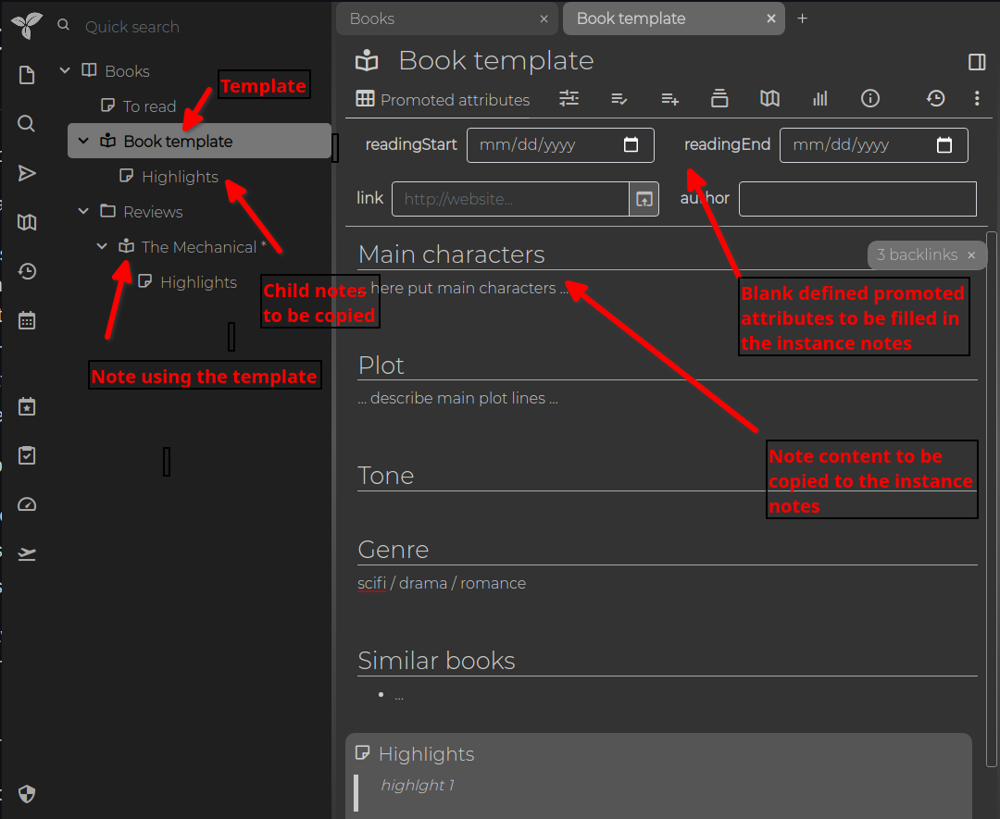
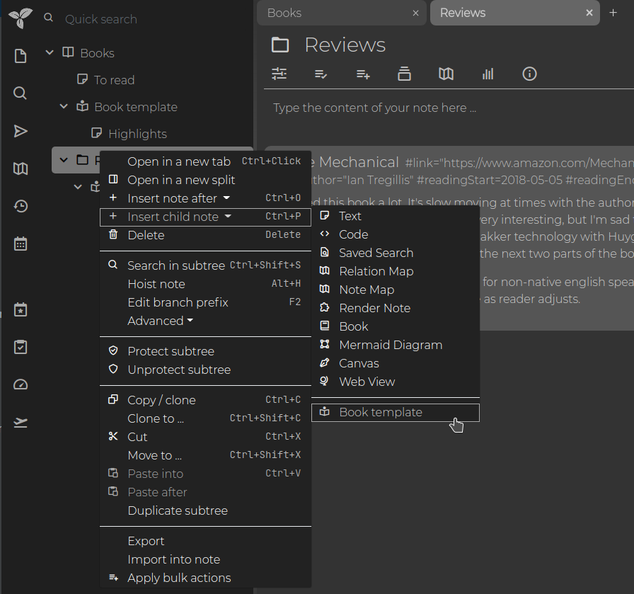

# Шаблоны
Шаблон в Trilium служит предопределённой структурой для других заметок, называемых заметками-экземплярами. Назначение шаблона заметке приносит три основных эффекта:

1.  **Наследование атрибутов**: Все атрибуты из заметки-шаблона [наследуются](Attributes/Attribute%20Inheritance.md) заметками-экземплярами. Даже атрибуты с `#isInheritable=false` наследуются заметками-экземплярами, хотя только наследуемые атрибуты далее наследуются детьми заметок-экземпляров.
2.  **Дублирование содержимого**: Содержимое заметки-шаблона копируется в заметку-экземпляр, если заметка-экземпляр пуста на момент назначения шаблона.
3.  **Дублирование дочерних заметок**: Все дочерние заметки шаблона глубоко дублируются в заметку-экземпляр.

## Пример

Типичный пример — шаблон-заметка «Книга», которая может включать:

*   **Продвигаемые атрибуты**: такие как год издания, автор и т.д. (см. [продвигаемые атрибуты](Attributes/Promoted%20Attributes.md)).
*   **План**: план рецензии на книгу, включая разделы вроде тем, заключения и т.д.
*   **Дочерние заметки**: дополнительные заметки для цитат, краткого содержания и т.д.

## Заметка-экземпляр

Заметка-экземпляр — это заметка, связанная с заметкой-шаблоном. Эта связь означает, что содержимое заметки-экземпляра инициализируется из шаблона, а все атрибуты из шаблона наследуются.

Чтобы создать заметку-экземпляр через интерфейс:

Чтобы шаблон появился в меню, заметка-шаблон должна иметь метку `#template`. Не путайте это с отношением `~template`, которое связывает заметку-экземпляр с заметкой-шаблоном. Если вы используете [рабочие области](../Basic%20Concepts%20and%20Features/Navigation/Workspaces.md), вы также можете помечать шаблоны `#workspaceTemplate`, чтобы показывать их только в рабочей области.

Шаблоны также можно добавлять или менять после создания заметки, создав отношение `~template`, указывающее на нужную заметку-шаблон.

Чтобы задать шаблон для дочерних заметок, можно использовать отношение `~child:template`, указывающее на соответствующую заметку-шаблон. Глубина иерархии не ограничена — можно использовать `~child:child:template`, `~child:child:child:template` и так далее.

> [!IMPORTANT]
> Изменение иерархии шаблонов после создания родительской заметки не применяется задним числом к вновь создаваемым дочерним заметкам.
> Например, если вы сначала использовали `~child:template`, а позже перешли на `~child:child:template`, новый шаблон не будет автоматически применён к заметкам-внукам. Учитывается только структура, присутствующая на момент создания заметки.

## Родитель по умолчанию для новых заметок

Шаблон может собирать создаваемые из него заметки в одном месте вместо того, чтобы они попадали куда придётся. Для этого добавьте заметке-шаблону отношение `~template:newNoteDefaultParent`, указывающее на заметку, которая должна содержать экземпляры, например шаблон _Персона_, указывающий на заметку _Люди_. Отношение также можно задать, нажав значок шаблона рядом с заголовком заметки и выбрав _Свойства шаблона…_, а затем выбрав заметку в поле _Местоположение создаваемых заметок по умолчанию_.

Несколько добавлений отношения размещают новую заметку в каждой цели, как при <a class="reference-link" href="../Basic%20Concepts%20and%20Features/Notes/Cloning%20Notes.md">Клонировании заметок</a>. Отношение также может наследоваться (например, от папки с несколькими шаблонами), при этом отношение, принадлежащее самому шаблону, заменяет наследуемое. Родитель по умолчанию наследуется только от предков шаблона в дереве: шаблон, созданный из другого шаблона, не наследует родителя по умолчанию того шаблона.

Родитель по умолчанию используется всякий раз, когда заметка создаётся из шаблона через диалог _Выбрать тип заметки_:

*   Через опцию _Создать заметку_ дополнения `@` в заметке <a class="reference-link" href="../Note%20Types/Text.md">Текст</a>
*   Через опции _Создать заметку_ или _Создать дочернюю заметку_ поиска по заметкам (новая вкладка или <a class="reference-link" href="../Note%20Types/Text/Links/Internal%20(reference)%20links.md">внутренние (ссылочные) ссылки</a>), но только если поле _Местоположение_ диалога оставлено пустым.

Создание заметки-экземпляра из контекстного меню <a class="reference-link" href="../Basic%20Concepts%20and%20Features/UI%20Elements/Note%20Tree.md">Дерева заметок</a> (_Вставить дочернюю заметку_, _Вставить заметку после_) по-прежнему создаёт её в выбранном месте.

В отличие от <a class="reference-link" href="../Basic%20Concepts%20and%20Features/Notes/Note%20Inbox.md">Входящих заметок</a>, которые хранят быстро захваченные заметки, пока их не рассортировали, родитель по умолчанию предназначен как постоянное местоположение экземпляров.

## О типах заметок

По умолчанию вновь создаваемые заметки — заметки <a class="reference-link" href="../Note%20Types/Text.md">Текст</a>. Если родительская заметка определяет `child:template`, указывающий на шаблон другого типа (например, заметку Код), поведение зависит от того, как создаётся новая заметка:

*   Если тип заметки явно не выбран (например, кнопка + в <a class="reference-link" href="../Basic%20Concepts%20and%20Features/UI%20Elements/Note%20Tree.md">Дереве заметок</a>), шаблон применяется, и новая заметка принимает тип и содержимое шаблона.
*   Если тип заметки выбран явно (<a class="reference-link" href="../Basic%20Concepts%20and%20Features/UI%20Elements/Note%20Tree.md">Дерево заметок</a> → _Вставить заметку после_ / _Вставить дочернюю заметку_):
    *   Если выбранный тип совпадает с типом шаблона, шаблон применяется.
    *   Если выбранный тип отличается, шаблон полностью игнорируется — новая заметка является пустой заметкой выбранного типа.

Выбор конкретного шаблона из меню создания всегда имеет приоритет над `child:template`.

## Заголовок по умолчанию для новых заметок

Шаблон также может давать своим экземплярам заголовок по умолчанию с помощью метки `#template:titleTemplate`. Чтобы задать её без ручного редактирования метки, нажмите значок шаблона рядом с заголовком заметки и выберите _Свойства шаблона…_, что проверяет выражения по мере ввода и показывает превью итогового заголовка. Подробности см. <a class="reference-link" href="Default%20Note%20Title.md">Заголовок заметки по умолчанию</a>.

## Дополнительные заметки

С визуальной точки зрения шаблоны могут определять атрибуты `#iconClass` и `#cssClass`, позволяя всем заметкам-экземплярам (например, книгам) отображать определённый значок и стиль CSS.

Изучите концепцию дальше в <a class="reference-link" href="Database/Demo%20Notes.md">Демонстрационных заметках</a>, включая примеры вроде <a class="reference-link" href="../Note%20Types/Relation%20Map.md">Карты отношений</a>, <a class="reference-link" href="Advanced%20Showcases/Task%20Manager.md">Менеджера задач</a> и <a class="reference-link" href="Advanced%20Showcases/Day%20Notes.md">Заметок дня</a>.

Дополнительно см. <a class="reference-link" href="Default%20Note%20Title.md">Заголовок заметки по умолчанию</a> для создания шаблонов заголовков. `#titleTemplate` на заметке-шаблоне передаётся её экземплярам как любая другая метка, поэтому она называет дочерние заметки каждого экземпляра, а не сами экземпляры; чтобы называть экземпляры, используйте `#template:titleTemplate`.
