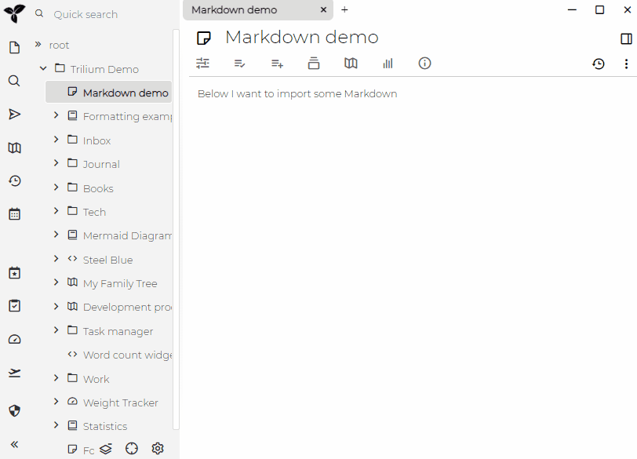
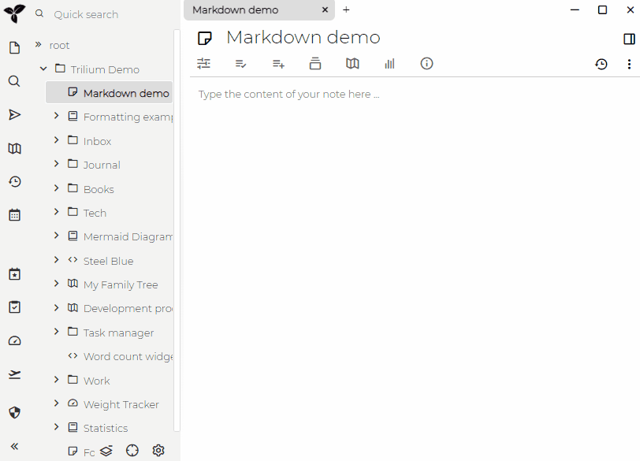
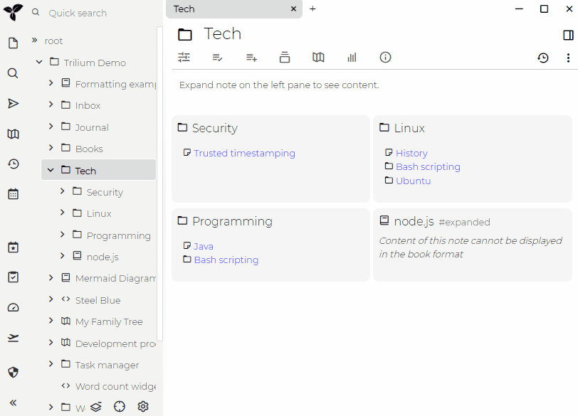
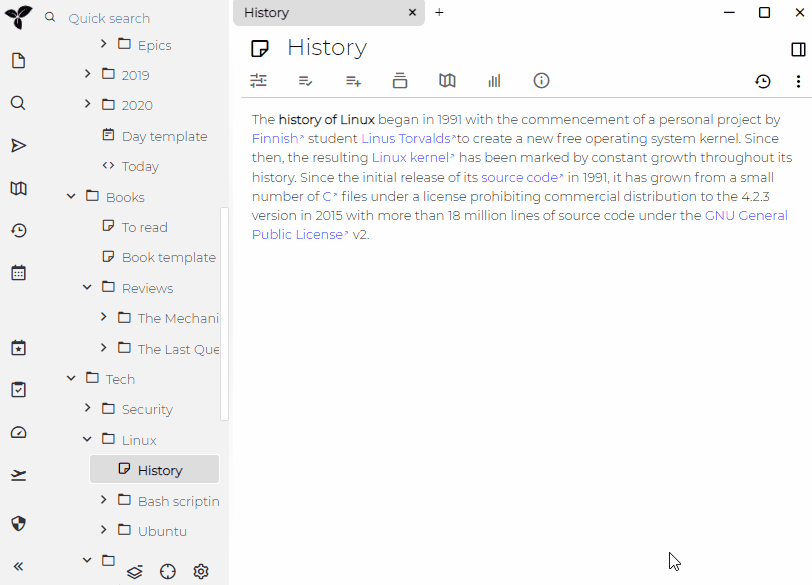

# Markdown
Trilium поддерживает Markdown как для импорта, так и для экспорта, стремясь к максимально высокой совместимости.

## Импорт

### Импорт из буфера обмена

Если вы хотите импортировать кусок markdown из буфера обмена, вы можете сделать это из меню блока редактора:

### Импорт файла

Вы также можете импортировать Markdown-файлы из файлов:

*   одиночный markdown-файл (с расширением .md)
*   целое дерево markdown-файлов (упакованное в [.zip](https://en.wikipedia.org/wiki/Tar_\(computing\))-архив)
    *   Markdown-файлы нужно упаковывать в ZIP-архив, так как браузер не может читать каталоги, только отдельные файлы.
    *   Можно использовать, например, [7-zip](https://www.7-zip.org) для упаковки каталога markdown-файлов в ZIP-файл

## Экспорт

### Экспорт поддерева

Вы можете экспортировать целое поддерево в ZIP-архив, который будет иметь структуру каталогов, моделирующую структуру поддерева:

### Экспорт одной заметки

Если вы хотите экспортировать только одну заметку без её поддерева, вы можете сделать это из меню действий заметки:

### Экспорт защищённых заметок

Если вы хотите экспортировать защищённые заметки, сначала войдите в защищённую сессию! Это экспортирует заметки в незашифрованном виде, поэтому если вы повторно импортируете в Trilium, не забудьте снова защитить эти заметки.

## Поддерживаемый синтаксис

См. отдельную страницу: <a class="reference-link" href="Markdown/Supported%20syntax.md">Поддерживаемый синтаксис</a>
