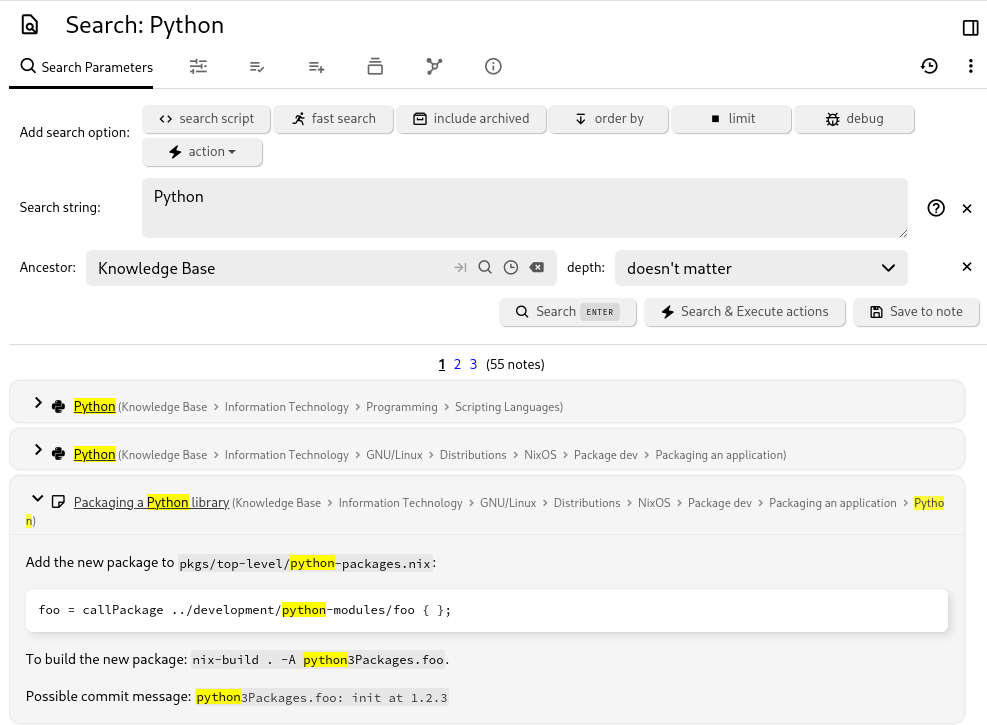

# Поиск
<figure class="image"></figure>

Поиск заметок позволяет находить заметки по тексту в заголовке, содержимом или [атрибутах](../../Advanced%20Usage/Attributes.md) заметок. Вы также можете сохранять свои поиски, что создаст специальную заметку поиска, видимую в дереве навигации и содержащую результаты поиска как подэлементы.

## Типы поиска

Есть несколько типов поиска, все использующие один и тот же механизм поиска и язык запросов:

*   <a class="reference-link" href="Quick%20search.md">Быстрый поиск</a>, который можно найти в <a class="reference-link" href="../UI%20Elements/Launch%20Bar.md">Панели запуска</a> для небольших разовых поисков.
    *   Результаты показываются во всплывающем окне и имеют бесконечную прокрутку.
*   _Полный поиск_ — более продвинутый механизм поиска.
    *   Результаты отображаются на отдельной странице и имеют несколько продвинутых возможностей (скрипт поиска, быстрый поиск, включая архивные заметки, сортировка, лимит).
    *   <a class="reference-link" href="../../Advanced%20Usage/Bulk%20Actions.md">Массовые действия</a>, такие как добавление метки/отношения, могут применяться к результатам.
    *   Результаты разбиты на страницы и могут отображаться в любом виде <a class="reference-link" href="../../Collections.md">Коллекций</a> (например, сетка, список, календарь, таблица).
*   Некоторые <a class="reference-link" href="../../Collections.md">Коллекции</a>, такие как вид доски, имеют выделенную строку поиска, применяемую к этой коллекции.
    *   В этом случае результаты отображаются непосредственно в коллекции вместо всплывающего окна и ограничены коллекцией, но язык запросов остаётся тем же.

> [!NOTE]
> [Переход к заметке](Jump%20to%20%26%20command%20palette.md) — схожая концепция, но она используется в основном для поиска заметок по заголовку, а не по содержимому. Тем не менее, она также имеет способ поиска по полному тексту, если результаты неудовлетворительны.

## Доступ к поиску

*   В <a class="reference-link" href="../UI%20Elements/Launch%20Bar.md">Панели запуска</a> найдите выделенную кнопку поиска <span class="tn-icon bx bx-search"></span>.
*   Чтобы ограничить поиск заметкой и её потомками, выберите _Искать в поддереве_ (<span class="tn-icon bx bx-search"></span>) из <a class="reference-link" href="../UI%20Elements/Note%20Tree/Note%20tree%20contextual%20menu.md">Контекстного меню дерева заметок</a> или нажмите <kbd>Ctrl</kbd>+<kbd>Shift</kbd>+<kbd>S</kbd>.
*   Откройте <a class="reference-link" href="Jump%20to%20%26%20command%20palette.md">«Переход к» и палитру команд</a>, найдите что-то, затем нажмите _Показать в полном поиске_ под результатами (или <kbd>Ctrl</kbd>+<kbd>Enter</kbd>).

## Взаимодействие

Чтобы искать заметки, нажмите значок <span class="tn-icon bx bx-search"></span> в <a class="reference-link" href="../UI%20Elements/Launch%20Bar.md">Панели запуска</a> или нажмите [сочетание клавиш](../Keyboard%20Shortcuts.md).

1.  Задайте текст для поиска в поле _Строка поиска_.
    1.  Помимо буквального поиска слов, также есть возможность искать по атрибутам или свойствам заметок.
    2.  Примеры см. ниже.
2.  Чтобы ограничить поиск заметкой и её подпотомками, задайте заметку в поле _Предок_.
    1.  Это значение также предзаполняется, если поиск запущен из [поднятой заметки](Note%20Hoisting.md) или [рабочей области](Workspaces.md).
    2.  Чтобы искать по всей базе данных, оставьте значение пустым.
3.  Чтобы ограничить поиск лишь несколькими уровнями иерархии (например, искать в подпотомках, но не в под-подпотомках заметки), задайте поле _глубина_ в одно из предложенных значений.
4.  Кроме того, поиск можно настроить через меню _Добавить опцию поиска_, как описано в следующем разделе.
5.  Нажмите _Искать_ (<span class="tn-icon bx bx-search"></span>), чтобы запустить поиск. Результаты отображаются под панелью настройки поиска.
6.  Пункт _Искать и выполнить действия_ (<span class="tn-icon bx bxs-zap"></span>) в меню рядом с _Искать_ актуален, только если добавлено хотя бы одно действие (как описано в разделе ниже).
7.  Пункт _Сохранить в заметку_ (<span class="tn-icon bx bx-save"></span>) в том же меню создаст новую заметку с конфигурацией поиска. Подробнее см. <a class="reference-link" href="../../Note%20Types/Saved%20Search.md">Сохранённый поиск</a>.

## Возможности

### Автодополнение

Чтобы помочь с синтаксисом, Trilium предлагает функциональность автодополнения, которая вызывается нажатием <kbd>Ctrl</kbd>+<kbd>Пробел</kbd>.

Некоторые предложения также открываются сами по мере ввода: имена меток и отношений после `#` и `~`, поля после `.`, операторы, значения и заметки после `@`. Ключевые слова, такие как `and`, `or`, `not`, `orderBy` и `limit`, появляются только по <kbd>Ctrl</kbd>+<kbd>Пробел</kbd>, так как обычное слово — обычно поисковый термин.

Ни одно предложение не выбрано, когда список открывается сам, поэтому <kbd>Enter</kbd> выполняет поиск как набрано. Чтобы вставить предложение, выберите его клавишей <kbd>↓</kbd> и нажмите <kbd>Enter</kbd>. Список, открытый через <kbd>Ctrl</kbd>+<kbd>Пробел</kbd>, и заметки после `@` открываются на наилучшем совпадении, поэтому <kbd>Enter</kbd> вставляет его.

Автодополнение предлагает:

*   Базовые операторы, такие как `*=`, и ключевые слова (`limit`, `not`).
*   Поля для объектоподобных полей, таких как `note` или `~relation`, вызываемые вводом `.`.
*   Контекстные перечисления, такие как `note.type = "` или `note.mime = "`.
*   Имена [Меток](../../Advanced%20Usage/Attributes/Labels.md) вводом `#`.
    *   Маленькая шестерёнка на значке имени указывает системный атрибут.
    *   После ввода имени метки значение также дополняется значениями, присутствующими в базе данных.
*   Имена [Отношений](../../Advanced%20Usage/Attributes/Relations.md) вводом `~`.
*   [ID заметок](../../Advanced%20Usage/Note%20ID.md) можно легко вставить, введя `@` и найдя заметку.
    *   Если ID заметки имеет корректный синтаксис, он будет показан как плашка заметки вместо сырого ID.
    *   Это особенно полезно для запросов, использующих ID заметки, таких как поиск по шаблону: `~template.noteId = @`

### Подсветка синтаксиса

Поле поиска имеет подсветку синтаксиса, выделяющую распознанные поля, такие как `note.`, и операторы вроде `NOT`.

Та же подсветка доступна в заметках <a class="reference-link" href="../../Note%20Types/Code.md">Код</a>, например чтобы вести коллекцию запросов: установите язык заметки на _Trilium Search Query_. Язык не включён по умолчанию; добавьте его в <a class="reference-link" href="../UI%20Elements/Options.md">Настройках</a> → _Заметки с кодом_ → _Доступные MIME-типы в выпадающем списке_.

### Подсветка ошибок и линтинг

Поиск также проверяется на ошибки в две фазы, которые отображаются красным волнистым подчёркиванием:

*   Ошибки линтера, выявляющие распространённые шаблоны ошибок, а также предоставляющие способ их исправить.
*   Ошибки поиска, проверяемые сервером без указания точного места возникновения ошибки.

Ошибка, с которой поиск сталкивается только при выполнении, такая как оператор, с которым нельзя искать по содержимому заметки, показывается в карточке _Ошибка поиска_: под строкой поиска или вверху результатов <a class="reference-link" href="Quick%20search.md">Быстрого поиска</a>.

### Многострочность

Длинные или сложные поиски можно форматировать с помощью новых строк, аналогично SQL-запросам. Новые строки обрабатываются так же, как пробелы.

Чтобы добавить новую строку, нажмите <kbd>Shift</kbd>+<kbd>Enter</kbd>.

> [!NOTE]
> Многострочность доступна только для полного поиска; другие поля, такие как быстрый поиск или фильтр коллекции, однострочные.

## Опции поиска

Нажмите _Добавить опцию поиска_, чтобы выбрать применяемую опцию.

*   Для каждой выбранной опции поиска конфигурация поиска обновится, раскрыв запись. Каждая опция поиска будет иметь собственную конфигурацию.
*   Чтобы удалить опцию поиска, просто нажмите кнопку <span class="tn-icon bx bx-x"></span> справа от неё.

Доступные опции:

1.  <span class="tn-icon bx bx-code"></span> Скрипт поиска
    1.  Эта возможность позволяет написать <a class="reference-link" href="../../Note%20Types/Code.md">Кодовую</a> заметку, которая будет обрабатывать поиск самостоятельно.
2.  <span class="tn-icon bx bx-run"></span> Быстрый поиск
    1.  Поиск не будет заглядывать в содержимое заметок, но по-прежнему будет искать по заголовкам заметок и атрибутам, отношениям (в зависимости от поискового запроса).
    2.  Этот метод может значительно ускорить поиск для больших [баз данных](../../Advanced%20Usage/Database.md).
3.  <span class="tn-icon bx bx-archive"></span> Включая архивные
    1.  <a class="reference-link" href="../Notes/Archived%20Notes.md">Архивные заметки</a> также будут включены в результаты, тогда как иначе они игнорировались бы.
4.  <span class="tn-icon bx bx-arrow-from-top"></span> Сортировка
    1.  Позволяет изменить критерий упорядочивания результатов, например сортировать по дате создания или по алфавиту вместо по релевантности (по умолчанию).
    2.  Также возможно изменить порядок (по возрастанию или убыванию) результатов.
5.  <span class="tn-icon bx bx-stop"></span> Лимит
    1.  Ограничивает результаты заданным максимумом.
    2.  Это может помочь, если число результатов было бы иначе велико, ценой невозможности просмотреть все результаты.
6.  <span class="tn-icon bx bx-bug"></span> Отладка
    1.  Выводит дополнительную информацию в журнал сервера (см. <a class="reference-link" href="../../Troubleshooting/Error%20logs.md">Журналы ошибок</a>) относительно того, как был разобран поисковый запрос.
    2.  Эта функция особенно полезна после детального понимания функциональности поиска, чтобы определить, почему сложный поисковый запрос работает не так, как ожидалось.

То же меню заканчивается разделом _Массовые действия_ для применения изменений, таких как добавление метки или отношения, к совпавшим заметкам. Его группы — _Метки_, _Отношения_, _Заметки_ и _Прочее_ — каждая открывают список действий в соответствующей группе диалога <a class="reference-link" href="../../Advanced%20Usage/Bulk%20Actions.md">Массовых действий</a>, который является альтернативой для работы непосредственно с заметками в <a class="reference-link" href="../UI%20Elements/Note%20Tree.md">Дереве заметок</a>. Выбор одного добавляет его в поиск; в отличие от других опций, одно и то же действие можно добавить более одного раза (например, чтобы применить несколько меток). Определив действия, сначала нажмите _Искать_, чтобы проверить совпавшие заметки, а затем выберите _Искать и выполнить действия_ из меню рядом, чтобы запустить действия.

## Просмотр результатов поиска

Результаты появляются под панелью поиска, по умолчанию в виде _Предпросмотра поиска_. Каждый результат отрисован как **карточка-фрагмент** с заголовком заметки, путём к ней, короткой выдержкой совпадающего текста и атрибутами, которые совпали. Выдержка кодовой заметки сохраняет её отступы и показывается кодовым шрифтом.

Чтобы показать результаты как обычный список заметок, выберите _Список_ в панели <a class="reference-link" href="../../Collections/Collection%20Properties.md">Свойства коллекции</a>. Вид _Список_ показывает одну строку на заметку с заголовком заметки и предпросмотром содержимого.

Поиск также подсвечивает слова из заголовка или содержимого, которые совпали:

*   Сплошным подчёркиванием зелёным для прямого совпадения;
*   Пунктирным подчёркиванием оранжевым для частичного совпадения (совпавшего по нечёткому поиску).

Кроме того, вид _Предпросмотр поиска_ предлагает:

*   **Общее число результатов** всегда показано, так что вы сразу видите, насколько широк запрос.
*   **Выбор размера страницы** позволяет выбрать, сколько результатов отображать на странице. Ваш выбор запоминается и синхронизируется между устройствами (хранится в опции `searchResultsPageSize`), так что вам не нужно сбрасывать его на каждом устройстве.
*   **Щелчок по заголовку результата** открывает заметку и сразу переходит к первому совпадению. Панель поиска в заметке открывается с первым словом вашего поиска, чтобы вы могли перемещаться по его совпадениям элементами поиска. Чтобы панель поиска искала целую фразу, заключите фразу в кавычки в поиске, например `"The Lord of the Rings"`. В заметках только для чтения остальные слова поиска также подсвечиваются. Выдержку и атрибуты можно выделять, не открывая заметку.
*   _Открыть все результаты в новых вкладках_ (<span class="tn-icon bx bx-window-open"></span>, кнопка над результатами) открывает каждый результат в собственной вкладке, до 50. Каждая вкладка открывается на первом совпадении с предзаполненной панелью поиска, как при щелчке по результату.
*   Если совпадение находится внутри **свёрнутого раздела** (например, свёрнутого заголовка), этот раздел разворачивается автоматически, чтобы совпадение было видно.
*   Когда выдержка обрезана, кнопка _Показать больше_ разворачивает карточку до полного содержимого заметки с подсвеченными поисковыми терминами. _Показать меньше_ возвращает к выдержке.

Сохранённый поиск также можно <a class="reference-link" href="../Notes/Printing%20%26%20Exporting%20as%20PDF.md">распечатать или экспортировать в PDF</a> из пункта _Печать/экспорт в PDF…_ <a class="reference-link" href="../UI%20Elements/Note%20menu.md">Меню заметки</a> в виде _Предпросмотр поиска_ или _Список_. Результаты размещаются списком в том виде, в каком они находились на момент начала печати.

## Простые примеры поиска заметок

*   `rings tolkien`: Полнотекстовый поиск для нахождения заметок, содержащих и «rings», и «tolkien».
*   `"The Lord of the Rings" Tolkien`: Полнотекстовый поиск, где «The Lord of the Rings» должен совпасть точно.
*   `note.content *=* rings OR note.content *=* tolkien`: Найти заметки, содержащие «rings» или «tolkien» в содержимом.
*   `towers #book`: Сочетание полнотекстового поиска и поиска по атрибутам для нахождения заметок, содержащих «towers» и имеющих метку «book». Запись `towers AND #book` делает то же самое; чтобы искать само слово «and», заключите его в кавычки.
*   `c#` или `towers#book`: `#` или `~` внутри слова является частью текста, поэтому они находят заметки, содержащие «c#» или «towers#book». Чтобы начать метку или отношение, поставьте перед ними пробел.
*   `towers #book or #author`: Поиск заметок, содержащих «towers» и имеющих либо метку «book», либо «author».
*   `towers #!book`: Поиск заметок, содержащих «towers» и не имеющих метку «book».
*   `#book #publicationYear = 1954`: Найти заметки с меткой «book» и «publicationYear», равным 1954.
*   `#genre *=* fan`: Найти заметки с меткой «genre», содержащей подстроку «fan». Дополнительные операторы включают `*=` для «начинается с», `*=` для «заканчивается на» и `!=` для «не равно».
*   `#book #publicationYear >= 1950 #publicationYear < 1960`: Использовать числовые операторы, чтобы найти все книги, изданные в 1950-х.
*   `#dateNote >= TODAY-30`: Найти заметки с меткой «dateNote» за последние 30 дней. Поддерживаемые значения дат включают NOW +- секунды, TODAY +- дни, MONTH +- месяцы, YEAR +- годы.
*   `~author.title *=* Tolkien`: Найти заметки, относящиеся к автору, чей заголовок содержит «Tolkien».
*   `#publicationYear %= '19[0-9]{2}'`: Использовать оператор `%=` для совпадения с регулярным выражением (regex). Эта возможность доступна начиная с Trilium 0.52.
*   `note.content %= '\\d{2}:\\d{2} (PM|AM)'`: Найти заметки, упоминающие время. Обратные слеши в regex должны быть экранированы.

## Продвинутые сценарии использования

*   `~author.relations.son.title = 'Christopher Tolkien'`: Поиск заметок с отношением «author» к заметке, которая имеет отношение «son» к «Christopher Tolkien». Это можно смоделировать следующей структурой заметок:
    *   Книги
        *   Властелин колец
            *   метка: «book»
            *   отношение: «author» указывает на заметку «J. R. R. Tolkien»
    *   Люди
        *   J. R. R. Tolkien
            *   отношение: «son» указывает на заметку "Christopher Tolkien"
            *   Christopher Tolkien
*   `~author.title *= Tolkien OR (#publicationDate >= 1954 AND #publicationDate <= 1960)`: Использовать булевы выражения и скобки для группировки выражений.
*   `towers (#genre = fantasy OR #genre = scifi)`: Группа может открывать часть выражения напрямую, без `#` или `~` перед скобкой. Здесь она находит заметки, содержащие «towers», чей жанр — фэнтези или фантастика.
*   `note.parents.title = 'Books'`: Найти заметки с родителем по имени «Books».
*   `note.parents.parents.title = 'Books'`: Найти заметки с дедом по имени «Books».
*   `note.ancestors.title = 'Books'`: Найти заметки с предком по имени «Books».
*   `note.children.title = 'sub-note'`: Найти заметки с дочерней заметкой по имени «sub-note».
*   `note.links.title = 'Tolkien'`: Найти заметки, ссылающиеся на заметку по имени «Tolkien».
*   `note.backlinks.title = 'Reading list'`: Найти заметки, на которые ссылается «Reading list».
*   Ссылка — это отношение, созданное вами, такое как `~author`, или созданное содержимым: внутренняя ссылка (`~internalLink`), изображение (`~imageLink`), включённая заметка (`~includeNoteLink`) или соединение карты отношений (`~relationMapLink`). Отношения, настраивающие заметку, такие как `~template` или `~ancestor` сохранённого поиска, не являются ссылками.

См. также <a class="reference-link" href="Search/Under%20the%20hood.md">Внутреннее устройство</a> для дополнительных справочных материалов по синтаксису.

### Поиск по свойствам заметок

Заметки имеют свойства, которые можно использовать в поиске, такие как `noteId`, `dateModified`, `dateCreated`, `isProtected`, `type`, `title`, `text`, `content`, `rawContent`, `ownedLabelCount`, `labelCount`, `ownedRelationCount`, `relationCount`, `ownedRelationCountIncludingLinks`, `relationCountIncludingLinks`, `ownedAttributeCount`, `attributeCount`, `targetRelationCount`, `targetRelationCountIncludingLinks`, `parentCount`, `childrenCount`, `isArchived`, `contentSize`, `contentAndAttachmentsSize`, `contentAndAttachmentsAndRevisionsSize` и `revisionCount`.

Эти свойства доступны через префикс `note.`, например `note.type = code AND note.mime = 'application/json'`.

### Сортировка и лимит

```
#author=Tolkien orderBy #publicationDate desc, note.title limit 10
```

Этот пример:

1.  Найдёт заметки с меткой автора «Tolkien».
2.  Упорядочит результаты по `publicationDate` в порядке убывания.
3.  Использует `note.title` как вторичную сортировку, если даты публикации равны.
4.  Ограничит результаты первыми 10 заметками.

### Отрицание

Некоторые запросы можно выразить только с отрицанием:

```
#book AND not(note.ancestors.title = 'Tolkien')
```

Этот запрос находит все заметки-книги не в поддереве «Tolkien».

## Внутреннее устройство

См. [отдельную страницу](Search/Under%20the%20hood.md), чтобы понять, как работает прогрессивный поиск в Trilium, а также некоторые продвинутые сценарии использования.

## Автоматический запуск поиска из URL

Вы можете открыть Trilium и автоматически запустить поиск, включив [URL-кодированную](https://meyerweb.com/eric/tools/dencoder/) строку поиска в URL:

`http://localhost:8080/#?searchString=abc`

## Конфигурация поиска

### Параметры

| Параметр | Значение | Описание |
| --- | --- | --- |
| `MIN_FUZZY_TOKEN_LENGTH` | 3 | Минимум символов, которые принимают операторы `~=` и `~*` |
| `MAX_EDIT_DISTANCE` | 2 | Потолок изменений символов, достигаемый только терминами из 7+ символов; более короткие термины допускают меньше. См. раздел _Нечёткая толерантность_ выше |
| `RESULT_SUFFICIENCY_THRESHOLD` | 5 | Минимум точных результатов перед нечётким запасным вариантом |
| `MAX_CONTENT_SIZE` | 10MB | Максимальный размер содержимого заметки для обработки поиском |

### Лимиты

*   Искомое содержимое заметки ограничено 10 МБ на заметку для предотвращения проблем с производительностью
*   Заметки, превышающие этот лимит, всё равно будут включены в поиск по заголовкам и атрибутам
*   Термины из 3 и менее символов совпадают точно; толерантность к опечаткам начинается с 4 символов
