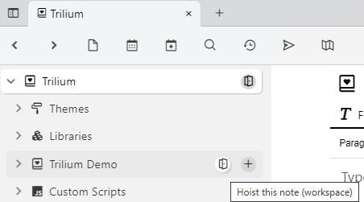
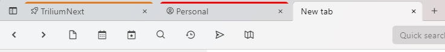

# Рабочие области
Рабочая область — концепция, построенная поверх [поднятия заметок](Note%20Hoisting.md). Она основана на идее, что у пользователя есть несколько различных сфер интересов. Примером могут служить «Личное» и «Работа» — эти две сферы весьма различны и не взаимодействуют друг с другом. Когда я фокусируюсь на Работе, мне не очень важны личные заметки.

Пока рабочая область состоит из следующих возможностей:

*   [поднятие заметок](Note%20Hoisting.md) - вы можете «приблизиться» к поддереву рабочей области, чтобы сфокусироваться только на относящихся заметках
*   лёгкий вход в рабочую область:

    
*   открытие рабочей области в новой вкладке: щёлкните правой кнопкой по кнопке  панели <a class="reference-link" href="../UI%20Elements/Tabs.md">Вкладок</a> и выберите рабочую область.
*   на телефоне рабочие области перечислены вверху <a class="reference-link" href="../UI%20Elements/Note%20Tree.md">Дерева заметок</a>, пока оно показывает корень вкладки, которая не поднята, такой как новая вкладка. Нажмите на одну, чтобы войти в неё, и нажмите кнопку  вверху дерева рабочей области, чтобы покинуть её.
*   визуальное опознание рабочей области во вкладках:
    

### Конфигурация

| Метка | Описание |
| --- | --- |
| `workspace` | Помечает эту заметку как рабочую область; кнопка входа в рабочую область управляется этим |
| `workspaceIconClass` | определяет CSS-класс значка box icon, который будет использоваться во вкладке при хостинге на эту заметку и в меню кнопки  панели вкладок |
| `workspaceTabBackgroundColor` | CSS-цвет, используемый во вкладке заметки при хостинге на эту заметку, для значка рабочей области в меню кнопки  панели вкладок и для кнопки , покидающей рабочую область на телефоне; используйте любой формат CSS-цвета, например «lightblue» или «#ddd». См. [https://www.w3schools.com/cssref/css\_colors.asp](https://www.w3schools.com/cssref/css_colors.asp). |
| `workspaceCalendarRoot` | Пометка заметки этой меткой определит новый календарь для каждой рабочей области для <a class="reference-link" href="../../Advanced%20Usage/Advanced%20Showcases/Day%20Notes.md">Заметок дня</a>. Если такой заметки нет, будет использоваться глобальный календарь. |
| `workspaceTemplate` | Эта заметка появится в выборе доступных шаблонов при создании новой заметки, но только при хостинге в рабочую область, содержащую этот шаблон |
| `workspaceSearchHome` | новые заметки поиска будут созданы как дочерние этой заметки при хостинге на какого-либо предка этой заметки рабочей области |
| `workspaceInbox` | Местоположение входящих заметок по умолчанию для новых заметок при хостинге на какого-либо предка этой заметки рабочей области. Подробнее см. <a class="reference-link" href="../Notes/Note%20Inbox.md">Входящие заметки</a>. |
