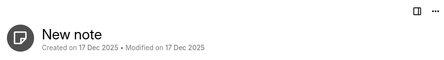
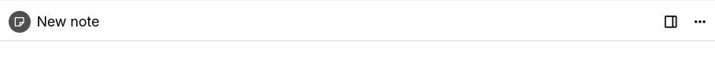

# Заголовок
Наряду с содержимым, **заголовок** — один из двух основных атрибутов [заметки](../Notes.md). Это короткое, читаемое человеком имя, показываемое в редактируемом поле вверху каждой заметки, и именно оно опознаёт заметку по всему интерфейсу (в <a class="reference-link" href="../UI%20Elements/Note%20Tree.md">Дереве заметок</a>, во вкладках, в <a class="reference-link" href="../UI%20Elements/Breadcrumb.md">«Хлебных крошках»</a> и в <a class="reference-link" href="../../Note%20Types/Text/Links/Internal%20(reference)%20links.md">Внутренних (ссылочных) ссылках</a>).

Внутренне заметки опознаются по уникальному <a class="reference-link" href="../../Advanced%20Usage/Note%20ID.md">ID заметки</a>, а не по заголовку, поэтому заголовок существует чисто для вашего удобства. Это имеет несколько следствий:

*   **Заголовки не обязаны быть уникальными.** Вы можете иметь любое число заметок, разделяющих один и тот же заголовок, без конфликта.
*   **Переименование заметки никогда не ломает ссылки на неё.** Ссылки между заметками указывают на лежащую в основе заметку, поэтому изменение заголовка оставляет существующие ссылки нетронутыми (они просто покажут новый заголовок).
*   **Заголовок можно оставить пустым.** Заметки без заголовка показывают заполнитель (_введите заголовок заметки…_), но в остальном совершенно корректны.

Кроме того:

*   Ограничения на длину заголовка нет, однако при экспорте заголовок может быть обрезан.
*   Запрещённых символов нет; неподдерживаемые символы будут обрезаны при экспорте.
*   При экспорте в ZIP-файл метафайл будет содержать полный заголовок, который будет распознан Trilium при повторном импорте.

## Встроенный заголовок

Заметки <a class="reference-link" href="../../Note%20Types/Text.md">Текст</a> имеют особое поведение строки заголовка, при котором [заголовок заметки](Title.md) изначально отображается более крупным шрифтом, а также показывает дополнительную информацию, такую как дата создания и дата изменения.

Когда заголовок прокручивается мимо, вместо него показывается фиксированный заголовок.

Типы заметок, занимающие весь экран, такие как <a class="reference-link" href="../../Note%20Types/Code.md">Код</a> и <a class="reference-link" href="../../Note%20Types/Canvas.md">Холст</a>, всегда имеют только фиксированную строку заголовка.

Под заголовком заметки появляется <a class="reference-link" href="New%20note%20type%20switcher.md">Переключатель типа новой заметки</a>, если заметка пуста.

Чтобы использовать фиксированную строку заголовка и для текстовых заметок, перейдите в <a class="reference-link" href="../UI%20Elements/Options.md">Настройки</a> → _Внешний вид_ → _Пользовательский интерфейс_ и установите _Заголовок заметки_ в _Компактный_. Заголовок тогда остаётся в фиксированной строке заголовка, а содержимое начинается прямо под ним; даты создания и изменения не показываются. <a class="reference-link" href="New%20note%20type%20switcher.md">Переключатель типа новой заметки</a> пустой заметки появляется внизу заметки. Настройка применяется только к текущему устройству.

<figure class="image"><figcaption><em>Встроенный заголовок</em>, который отображается вверху заметки и может быть прокручен мимо.</figcaption></figure><figure class="image"><figcaption>Фиксированная строка заголовка. Заголовок появляется только после прокрутки мимо <em>Встроенного заголовка</em>.</figcaption></figure>

### Редактирование заголовка

Чтобы переименовать заметку, просто нажмите в поле заголовка и введите текст. Изменения сохраняются автоматически по мере ввода.

Вы также можете начать редактировать заголовок прямо из <a class="reference-link" href="../UI%20Elements/Note%20Tree.md">Дерева заметок</a>, выбрав заметку и нажав <kbd>Enter</kbd> (см. _Редактировать заголовок заметки_ в <a class="reference-link" href="../Keyboard%20Shortcuts.md">Сочетаниях клавиш</a>), что фокусирует поле заголовка для активной заметки.

> [!NOTE]
> Заголовки могут содержать любые символы, включая Unicode и эмодзи. В целях безопасности любой HTML в заголовке автоматически удаляется, поэтому заголовок всегда трактуется как простой текст.

### Лёгкая навигация между заголовком и содержимым

Когда курсор находится в поле заголовка, нажатие <kbd>Enter</kbd> перемещает фокус в содержимое заметки. Для заметок <a class="reference-link" href="../../Note%20Types/Text.md">Текст</a> это также вставляет свежий пустой абзац в самый верх документа, так что вы можете начать писать сразу — как и в других приложениях для заметок.

Это позволяет создать заметку, ввести её заголовок, нажать <kbd>Enter</kbd> и продолжить прямо в теле, не тянувшись к мыши.

### Работа с новыми заметками

Когда вы создаёте новую заметку, ей даётся заголовок по умолчанию (_new note_), который предварительно выделен, так что вы можете сразу ввести имя, чтобы заменить его. Заголовок по умолчанию для новых заметок можно настроить по разделам — см. <a class="reference-link" href="../../Advanced%20Usage/Default%20Note%20Title.md">Заголовок заметки по умолчанию</a>.

Если вы решите, что заметка вам всё же не нужна, нажатие <kbd>Escape</kbd>, пока заголовок свежесозданной заметки ещё в фокусе, отменит её создание.

### Автоматически генерируемые заголовки

Некоторые заметки получают свои заголовки автоматически, а не набираются вручную:

*   **Заметки дня, недели, месяца и года** в <a class="reference-link" href="../../Advanced%20Usage/Advanced%20Showcases/Day%20Notes.md">Заметках дня</a> называются по настраиваемому шаблону даты.
*   Заметки <a class="reference-link" href="../../Note%20Types/Saved%20Search.md">Сохранённого поиска</a> называются по выполняемому ими поиску.
*   Когда заметка дублируется, к заголовку копии добавляется суффикс, чтобы отличить её от оригинала.

### Защищённые заметки

Заголовки <a class="reference-link" href="Protected%20Notes.md">Защищённых заметок</a> шифруются вместе с их содержимым. До ввода вашего пароля Trilium не может расшифровать заголовок: дерево заметок, поле заголовка, меню «хлебных крошек» и вкладки помечают заметку как _Защищённая_, и заголовок нельзя изменить.

После ввода вашего пароля и активации защищённой сессии настоящий заголовок расшифровывается и отображается, а также снова становится редактируемым.
