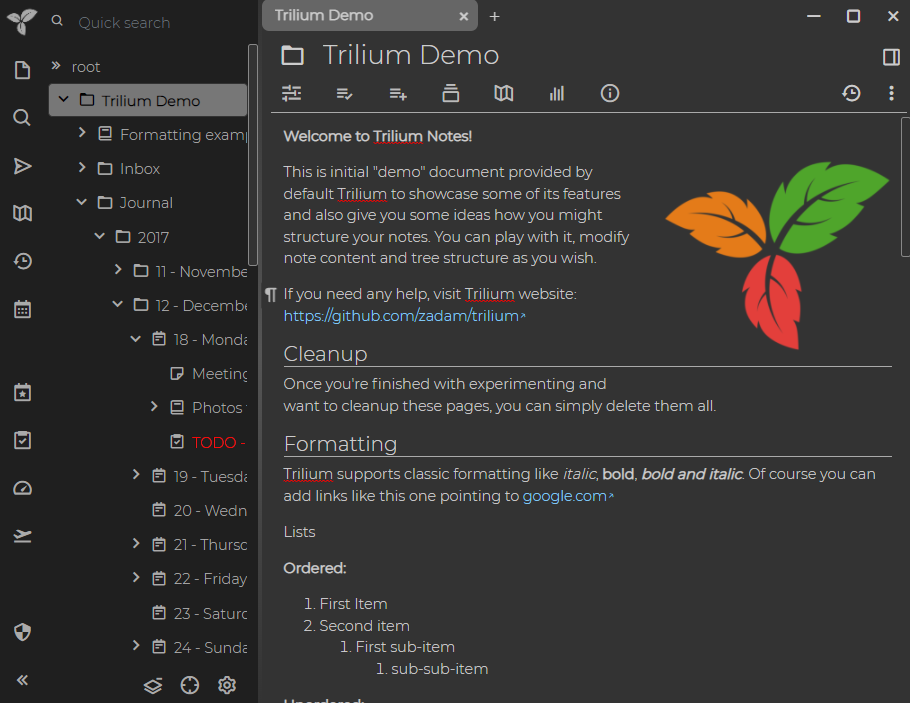
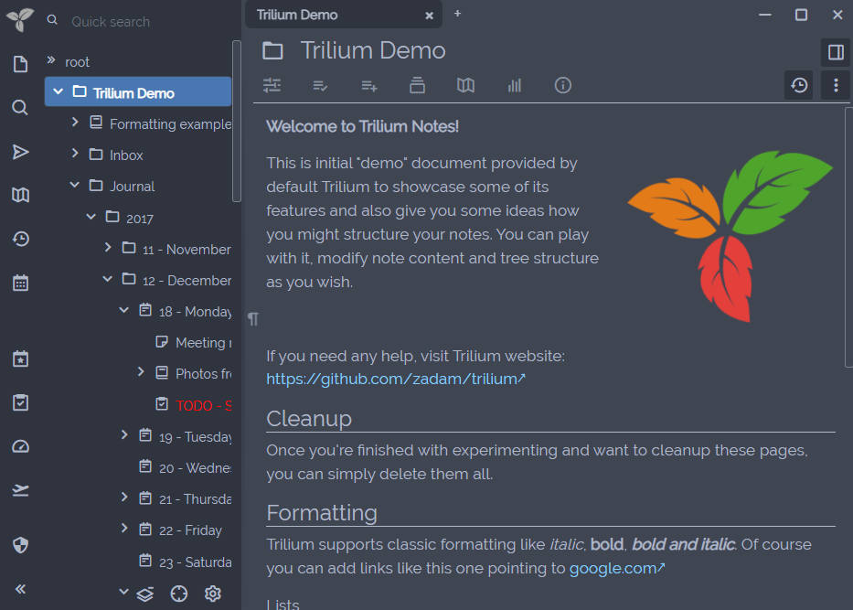
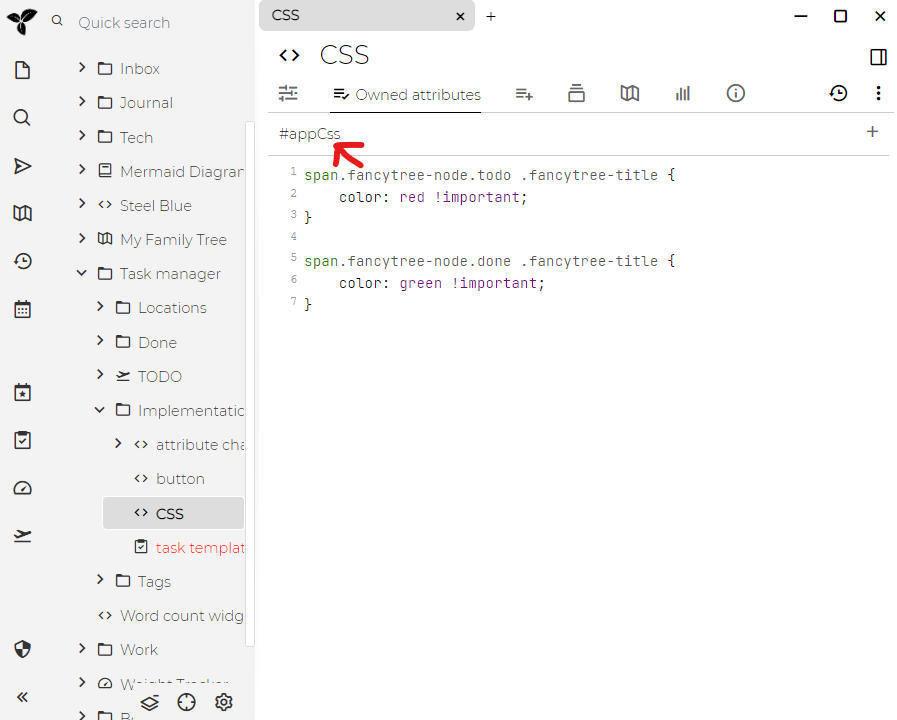

# Темы
## Темы по умолчанию

Trilium поставляется с парой предустановленных цветовых тем, по умолчанию — светлой. Чтобы переключиться на тёмную тему или любую другую доступную, перейдите в меню Настройки <span class="tn-icon bx bx-cog"></span> (доступно через значок приложения в левом верхнем углу), выберите вкладку «Внешний вид» и выберите предпочитаемую тему. Подменю _Тема_ <a class="reference-link" href="UI%20Elements/Global%20menu.md">Глобального меню</a> также переключает тему и цветовую схему.



Пока активна тёмная тема, Trilium просит расширение браузера Dark Reader не затемнять страницу повторно. Dark Reader по-прежнему затемняет светлые темы. После переключения с тёмной темы на светлую перезагрузите страницу (<kbd>Ctrl</kbd>+<kbd>R</kbd>), чтобы Dark Reader снова вступил в силу.

## Создание пользовательских CSS-тем

Trilium поддерживает пользовательские темы, позволяющие персонализировать внешний вид приложения. Чтобы создать пользовательскую тему, выполните следующие шаги:

1.  **Создайте кодовую заметку с CSS**: начните с создания новой [кодовой заметки](../Note%20Types/Code.md) с типом `CSS`.
2.  **Пометьте `#appTheme`**: добавьте заметке [атрибут](../Advanced%20Usage/Attributes.md) `#appTheme=my-theme-name`, где `my-theme-name` — имя вашей пользовательской темы.
3.  **Определите свои стили**: напишите свой пользовательский CSS в заметке.

<details open="">
    <summary>Пример пользовательской темы</summary>
    <pre><code class="language-text-x-trilium-auto">@font-face {
  font-family: 'Raleway';
  font-style: normal;
  font-weight: 400;
  src: url('/custom/fonts/raleway.woff2') format('woff2');
}&#10;
:root {
    --main-font-family: 'Raleway' !important;
    --main-font-size: normal;
    --tree-font-family: inherit;
    --tree-font-size: normal;
    --detail-font-family: inherit;
    --detail-font-size: normal;
    --detail-text-font-family: 'Garamond' !important;&#10;
    --main-background-color: #404552;
    --main-text-color: #AFB8C6;
    --main-border-color: #AFB8C6;
    --accented-background-color: #383C4A;
    --more-accented-background-color: #2F343F;
    --header-background-color: #383C4A;
    --button-background-color: #2F343F;
    --button-disabled-background-color: #404552;
    --button-border-color: #333;
    --button-text-color: #AFB8C6;
    --button-border-radius: 2px;
    --primary-button-background-color: #6c757d;
    --primary-button-text-color: white;
    --primary-button-border-color: #6c757d;
    --muted-text-color: #86919F;
    --input-text-color: #AFB8C6;
    --input-background-color: #404552;
    --hover-item-text-color: white;
    --hover-item-background-color: #4877B1;
    --active-item-text-color: white;
    --active-item-background-color: #4877B1;
    --menu-text-color: #AFB8C6;
    --menu-background-color: #383C4A;
    --tooltip-background-color: #383C4A;
    --link-color: lightskyblue;
    --modal-background-color: #404552;
    --modal-backdrop-color: black;
    --scrollbar-thumb-color: rgba(175, 184, 198, 0.5);
}&#10;
body .note-detail-text {
    font-size: 120%;
}&#10;
body .CodeMirror {
    filter: invert(100%) hue-rotate(180deg);
}</code></pre>
    <p>&nbsp;</p>
</details>

### Активация вашей пользовательской темы

После создания пользовательской темы:

1.  Перейдите в «Меню» -> «Настройки» (<span class="tn-icon bx bx-cog"></span>) -> «Внешний вид».
2.  В выпадающем списке выбора темы вы должны увидеть вашу пользовательскую тему, перечисленную под именем, заданным с помощью [метки](../Advanced%20Usage/Attributes.md) `#appTheme`.
3.  Выберите вашу пользовательскую тему, чтобы активировать её.

Ваша пользовательская тема также перечислена в <a class="reference-link" href="UI%20Elements/Global%20menu.md">Глобальном меню</a> → _Тема_, со значком её заметки.

Если вы вносите изменения в свою тему, нажмите Ctrl + R, чтобы перезагрузить клиент и применить обновления.

### Обмен и импорт тем

Пользовательские темы можно экспортировать как `.tar`-архивы, которыми можно делиться с другими пользователями. Однако будьте осторожны при импорте тем из недоверенных источников, так как они могут содержать исполняемые скрипты, представляющие угрозу безопасности.

Пример пользовательской темы _Steel Blue_ доступен в демонстрационном документе.



### Использование пользовательского CSS для конкретных целей

Помимо полных тем, Trilium позволяет пользовательский CSS, не привязанный к теме. Это может быть особенно полезно в контексте скриптинга, когда вы хотите изменить конкретные элементы интерфейса, например изменить цвета заметок в виде дерева.

### Применение пользовательского CSS

Чтобы использовать пользовательский CSS:

1.  **Создайте кодовую заметку с CSS**: создайте новую <a class="reference-link" href="../Note%20Types/Code.md">кодовую заметку</a> с типом `CSS`.
2.  **Добавьте метку `appCss`**: пометьте заметку [меткой](../Advanced%20Usage/Attributes.md) `#appCss`.
3.  **Напишите свой CSS**: добавьте ваши пользовательские CSS-правила в заметку.

Например:

```
/* Пользовательский CSS для стилизации конкретных элементов */
.tree-item {
    color: #ff6347; /* Изменить цвет элемента дерева */
}
```

При запуске клиента Trilium все заметки, помеченные `appCss`, автоматически включаются в элемент стиля HTML-страницы.

После внесения изменений нажмите Ctrl + R, чтобы перезагрузить клиент и применить новые стили.



### Стилизация конкретных заметок в дереве

Чтобы применить определённые стили к определённым заметкам в дереве:

*   **Используйте атрибут `cssClass`**: добавьте заметке [атрибут](../Advanced%20Usage/Attributes.md) `cssClass` и присвойте ему значение, представляющее нужный CSS-класс.
*   **Определите `iconClass`**: вы также можете определить пользовательский значок для заметки с помощью атрибута `iconClass`, выбирая из [Box Icons](https://boxicons.com) или собственных классов.

Например, если вы хотите стилизовать заметки определённого типа, такие как заметки, содержащие PNG-изображения, вы можете нацелиться на них классами вроде `type-image mime-image-png`.

### Темы от пользователей

Доступна галерея тем, созданных пользователями, демонстрирующая разнообразие настроек, которые разработало сообщество Trilium. Подробнее см. <a class="reference-link" href="Themes/Theme%20Gallery.md">Галерея тем</a>.

### Управление путями к ресурсам

При ссылках на встроенные ресурсы, такие как изображения, в ваших пользовательских темах или CSS, вы можете избежать жёсткого кодирования номеров версий, используя псевдоним `vX`. Например, вместо указания `/assets/v0.57.0-beta/images/icon-grey.png` можно использовать `/assets/vX/images/icon-grey.png`, чтобы ваша тема оставалась совместимой с будущими версиями Trilium.
