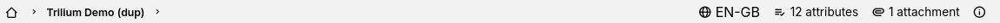

# Навигационная цепочка
<figure class="image"></figure>

Навигационная цепочка (breadcrumb) позволяет быстро просматривать иерархию текущей заметки и перемещаться по ней.

Она является частью <a class="reference-link" href="Status%20bar.md">строки состояния</a> и отображается в левом нижнем углу экрана.

## Расположение и взаимодействие

*   Если заметка или рабочее пространство закреплены (hoisted), слева появится соответствующий значок.
    *   Нажатие на этот значок отменяет закрепление заметки или рабочего пространства.
*   Самый левый значок обозначает корневую заметку либо закреплённую заметку или рабочее пространство.
    *   Нажатие на значок переходит к корневой заметке.
    *   Нажатие правой кнопкой мыши открывает меню, позволяющее открыть заметку в новой вкладке, в разделённой области и т. д.
*   Каждый сегмент показывает заголовок заметки в текущей иерархии.
    *   Нажатие на сегмент переходит к этой заметке.
    *   Нажатие правой кнопкой мыши открывает меню с различными действиями: открыть заметку в другой вкладке/разделённой области/окне, закрепить (hoist), переместить/клонировать заметку, дублировать её, а также изменить цвет заметки.
*   Нажатие на стрелку рядом с каждым сегментом раскрывает дочерние заметки этого сегмента.
    *   Нажатие на элемент списка переходит к выбранной заметке.
    *   Чтобы найти дочернюю заметку по заголовку, просто начните вводить текст: поле в нижней части меню отфильтрует список.
    *   Отсюда же можно создать новую дочернюю заметку.
    *   В меню можно при желании скрыть архивированные заметки.
*   Если текущая заметка находится глубоко в иерархии, сегменты сворачиваются в кнопку \[…\], чтобы не занимать слишком много места.
    *   Нажатие на эту кнопку показывает все свёрнутые элементы в виде пунктов меню. Нажатие на пункт переходит к соответствующей заметке.
*   Нажатие правой кнопкой мыши на пустом пространстве справа от навигационной цепочки (до остальных элементов строки состояния) открывает дополнительное меню, позволяющее:
    *   Переключать отображение архивированных заметок в навигационной цепочке и в дереве заметок.
    *   Копировать путь к текущей заметке в буфер обмена.
