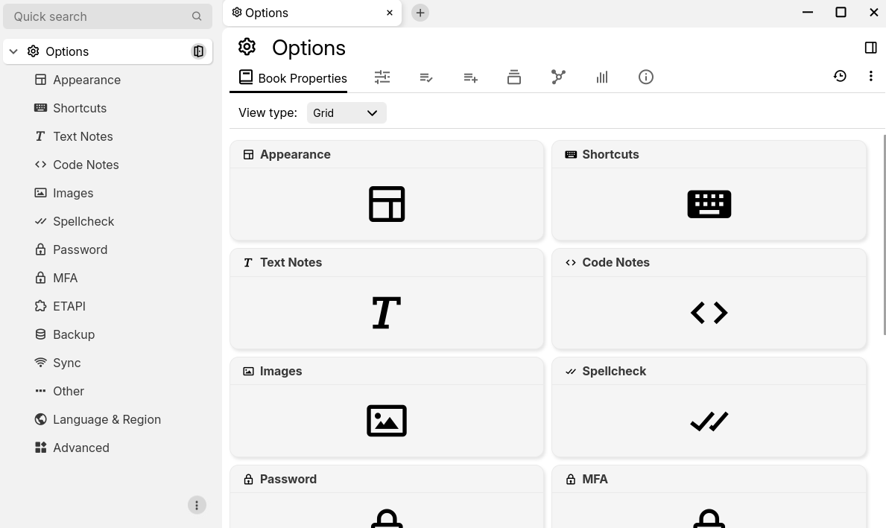

# Настройки
<figure class="image image-style-align-center"></figure>

Раздел Настроек позволяет конфигурировать клиент и сервер TriliumNext.

## Вход в настройки

К Настройкам можно получить доступ через:

*   [Глобальное меню](Global%20menu.md), выбрав пункт _Настройки_.
*   Кнопку  в [Панели запуска](Launch%20Bar.md), которую можно по желанию скрыть.
*   Опционально можно задать сочетание клавиш, но оно не назначено по умолчанию.
*   Щёлкнув по этой ссылке: <a class="reference-link" href="#root/_hidden/_options">Настройки</a>.

Оказавшись в разделе настроек, просто выберите одну из категорий настроек с помощью <a class="reference-link" href="Note%20Tree.md">Дерева заметок</a>.

## Выход из настроек

При входе в настройки они открываются в новой [вкладке](Tabs.md). Чтобы закрыть их, просто закройте вкладку.

## Настройки при использовании синхронизации

При использовании <a class="reference-link" href="../../Installation%20%26%20Setup/Synchronization.md">Синхронизации</a> некоторые настройки будут синхронизироваться между всеми устройствами, а другие можно изменять независимо.

Как правило, настройки, относящиеся к внешнему виду, намеренно не синхронизируются, чтобы позволить настройку для каждого клиента отдельно (ориентация макета, тема, вертикальное/горизонтальное расположение, темы блоков кода).
