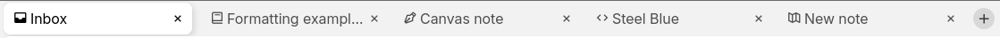
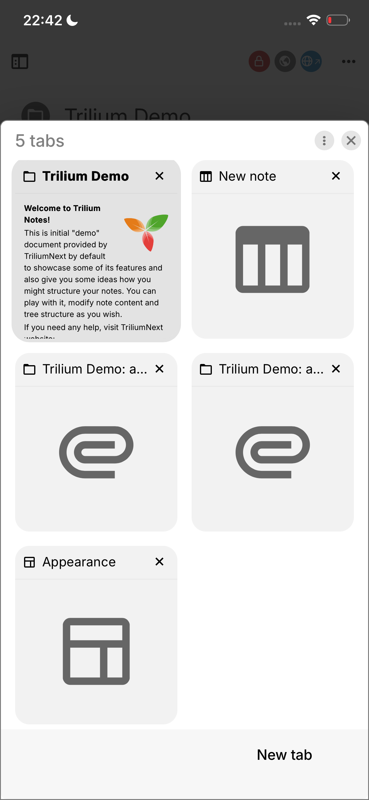

# Вкладки
<figure class="image image-style-align-center"></figure>

В Trilium вкладки позволяют легко переключаться между заметками.

## Расположение

В зависимости от <a class="reference-link" href="Vertical%20and%20horizontal%20layout.md">Вертикального и горизонтального расположения</a>:

*   При вертикальном расположении вкладки размещаются вверху, но справа от <a class="reference-link" href="Note%20Tree.md">Дерева заметок</a>.
*   При горизонтальном расположении вкладки размещаются вверху на всю ширину над [деревом заметок](Note%20Tree.md), позволяя комфортно отображать больше вкладок.

## Взаимодействие

*   Чтобы создать новую вкладку, нажмите кнопку  справа от последней вкладки.
*   Правый щелчок или нажатие и удерживание кнопки  показывает меню с:
    *   _Новая вкладка_.
    *   Если есть какие-либо <a class="reference-link" href="../Navigation/Workspaces.md">Рабочие области</a>, по одной записи на рабочую область, которая открывает рабочую область в новой вкладке, поднятой в неё.
    *   _Недавно изменённые заметки_: до 15 заметок, сначала недавно изменённые, с путём каждой заметки справа. Заметки, уже открытые во вкладке, не перечислены, а в [поднятой заметке](../Navigation/Note%20Hoisting.md) перечислены только её потомки. Выбор заметки открывает её в новой вкладке.
    *   _Все последние изменения_, которая открывает диалог <a class="reference-link" href="Recent%20Changes.md">Последние изменения</a>.
*   Чтобы закрыть вкладку, нажмите соответствующую кнопку .
*   Для многозадачности вкладки можно использовать вместе с <a class="reference-link" href="Split%20View.md">Разделённым видом</a>. Каждая вкладка может иметь одну или несколько заметок, отображённых горизонтально.
*   Вкладки можно менять местами перетаскиванием на новую позицию.
*   Существующую вкладку можно отобразить в новом окне, перетащив вкладку вверх или вниз; новое окно открывается под курсором мыши с вкладкой под указателем. Объединить вкладки обратно в другое окно невозможно.

## Взаимодействие с клавиатурой

Поскольку вкладки — часто используемая возможность, есть несколько сочетаний клавиш, которые можно использовать:

*   <kbd>Ctrl</kbd>+<kbd>T</kbd>, чтобы открыть новую вкладку.
*   <kbd>Ctrl</kbd>+<kbd>W</kbd>, чтобы закрыть текущую вкладку.
*   <kbd>Ctrl</kbd>+<kbd>Shift</kbd>+<kbd>T</kbd>, чтобы повторно открыть последнюю закрытую вкладку.
*   <kbd>Ctrl</kbd>+<kbd>Tab</kbd> и <kbd>Ctrl</kbd>+<kbd>Shift</kbd>+<kbd>Tab</kbd>, чтобы перейти к следующей или предыдущей вкладке.
*   <kbd>Ctrl</kbd>+<kbd>1</kbd>, <kbd>Ctrl</kbd>+<kbd>2</kbd> до <kbd>Ctrl</kbd>+<kbd>9</kbd>, чтобы активировать первую, вторую и до девятой вкладки.
*   Также есть сочетание для перехода к последней вкладке, но ему по умолчанию не назначена клавиша.

## Полноэкранный режим

Чтобы показать Trilium в полноэкранном режиме, нажмите <kbd>F11</kbd> или кнопку  _Во весь экран_ в <a class="reference-link" href="Global%20menu.md">Глобальном меню</a>. В полноэкранном режиме панель вкладок показывает кнопку  _Выйти из полноэкранного режима_ перед переключателем <a class="reference-link" href="Right%20Sidebar.md">Правой боковой панели</a>; нажмите её, чтобы вернуться в обычное окно.

## Фоновые вкладки

При запуске Trilium повторно открывает вкладки предыдущей сессии. Только активная вкладка загружает свою заметку сразу; каждая другая вкладка загружает свою заметку при первом переключении на неё. Это ускоряет запуск, когда открыто много вкладок, особенно вкладок, показывающих коллекции.

То же относится к вкладке, открытой в фоне, например средним щелчком или <kbd>Ctrl</kbd>+щелчком по ссылке.

## Мобильные устройства

<figure class="image image-style-align-right image_resized" style="width:34.12%;"></figure>

Вкладки также поддерживаются в <a class="reference-link" href="../../Installation%20%26%20Setup/Mobile%20Frontend.md">Мобильном интерфейсе</a>.

Начиная с v0.102.0, вкладки отображаются нажатием выделенной кнопки переключения вкладок в <a class="reference-link" href="Launch%20Bar.md">Панели запуска</a>. В этом виде вкладки расположены сеткой с предпросмотром содержимого заметки. На телефоне вкладка, оставленная на дереве заметок, показывает вместо этого папку, на которой она была, с заметкой вкладки, подсвеченной. Смахивание влево или вправо по панели запуска переходит напрямую к следующей или предыдущей вкладке, пока все её кнопки помещаются на экране, при этом страница следует за пальцем, пока тот не отпустит.

Кнопка контекстного меню в правом верхнем углу всплывающего окна позволяет создать новую вкладку, повторно открыть последнюю закрытую вкладку и закрыть все вкладки.

<a class="reference-link" href="Split%20View.md">Разделённые виды</a> также указаны в переключателе вкладок, с двумя заголовками, отображёнными во вкладке.

> [!NOTE]
> Версии до v0.102.0 также поддерживали вкладки, но они отображались прямо над <a class="reference-link" href="Launch%20Bar.md">Панелью запуска</a>. Решение использовать более похожий на мобильные переключатель вкладок было принято, потому что исходная панель вкладок не могла поддерживать много вкладок одновременно, а новый дизайн лучше соответствует тому, как мобильные приложения обрабатывают вкладки.
