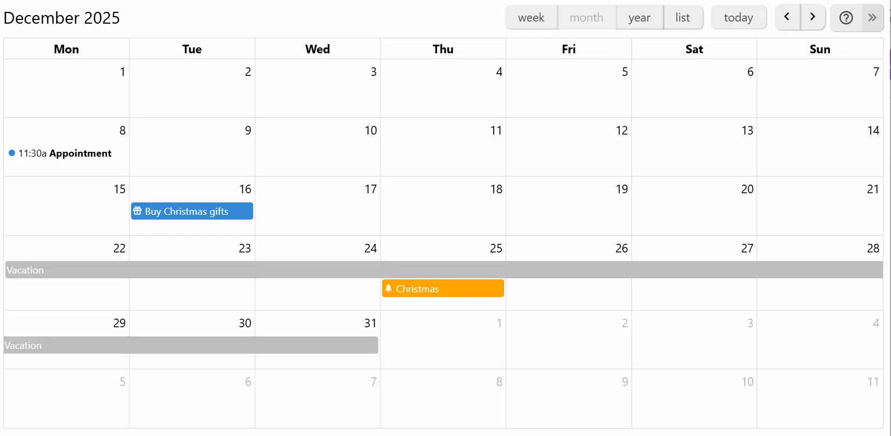
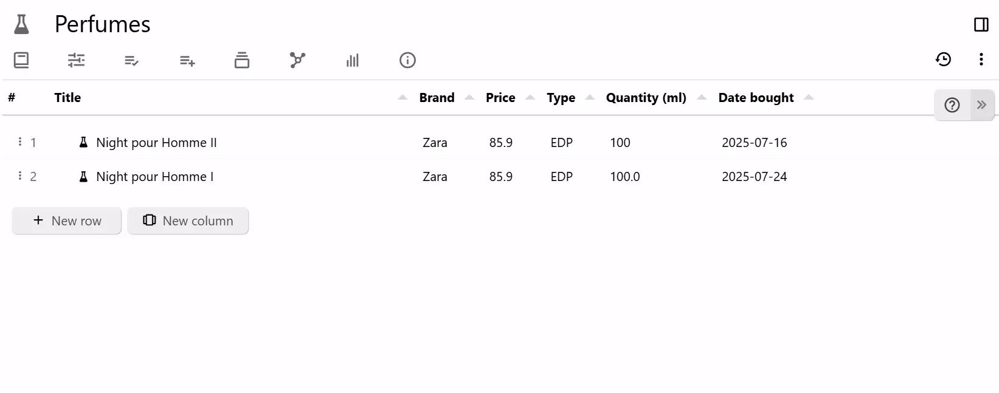
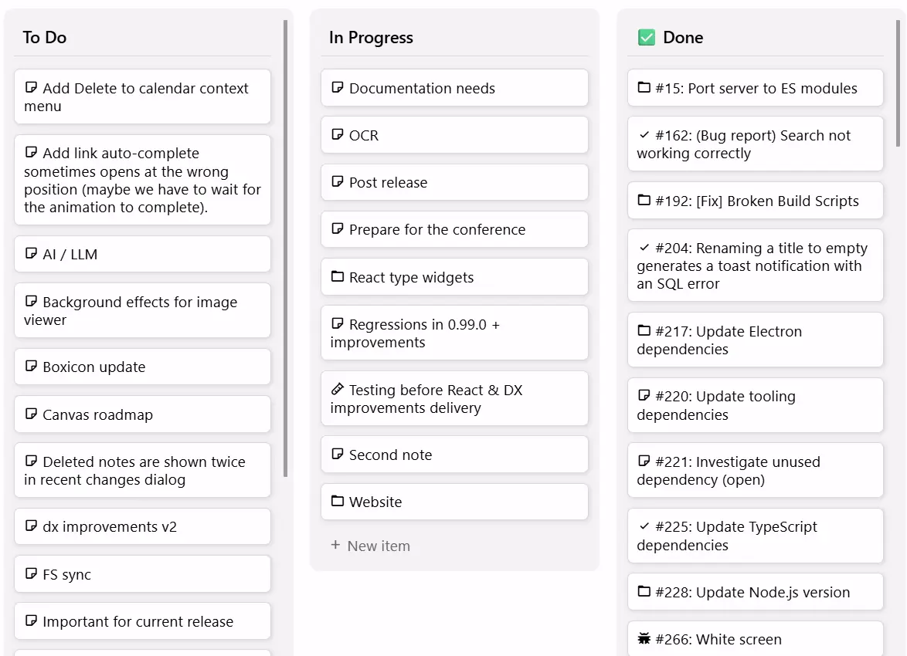
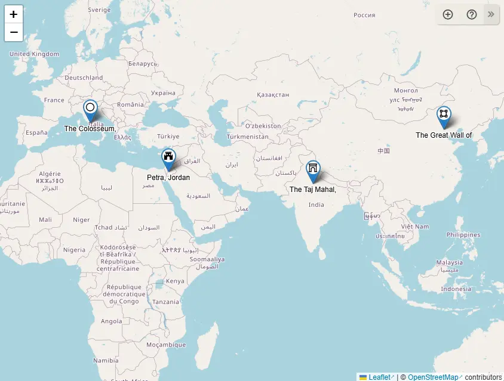
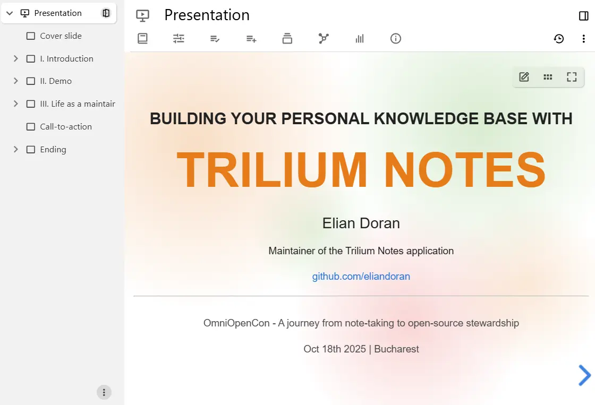

# Коллекции
Коллекции — уникальный тип заметок, не имеющий содержимого, но вместо этого отображающий свои дочерние заметки различными способами представления.

## Основные коллекции

=== " Календарь"

    <a class="reference-link" href="Collections/Calendar.md">Календарь</a> отображает календарь недели, месяца или года с заметками, показанными как события. Новые события можно легко добавлять перетаскиванием по календарю.

    <figure class="image"></figure>

=== " Таблица"

    <a class="reference-link" href="Collections/Table.md">Таблица</a> отображает каждую заметку как строку в таблице, с <a class="reference-link" href="Advanced%20Usage/Attributes/Promoted%20Attributes.md">Продвигаемыми атрибутами</a>, также показанными. Это облегчает визуализацию атрибутов заметок, а также делает их легко редактируемыми.

    <figure class="image"></figure>

=== " Kanban-доска"

    <a class="reference-link" href="Collections/Kanban%20Board.md">Kanban-доска</a> отображает заметки в колонках, сгруппированных по значению метки. Элементы и колонки можно легко создавать или перетаскивать, чтобы менять их статус.

    <figure class="image"></figure>

=== " Геокарта"

    <a class="reference-link" href="Collections/Geo%20Map.md">Геокарта</a>, отображающая географическую карту, на которой заметки представлены как метки на карте. Новые метки можно легко добавлять, указывая на карте. Кроме того, можно добавлять [фигуры](Collections/Geo%20Map/Drawing%20shapes.md), такие как пути, прямоугольники и круги, а также GPX-треки.

    <figure class="image"></figure>

=== " Презентация"

    <a class="reference-link" href="Collections/Presentation.md">Презентация</a>, которая показывает каждую заметку как слайд и может демонстрироваться в полноэкранном режиме с плавными переходами или экспортироваться в PDF для распространения.

    <figure class="image"></figure>

## Классические коллекции

Классические коллекции находятся в режиме только для чтения и собирают содержимое всех дочерних заметок в одно непрерывное представление. Это делает их идеальными для чтения объёмной информации, разбитой на небольшие управляемые фрагменты.

*   <a class="reference-link" href="Collections/Grid%20View.md">Сетка</a> — способ представления по умолчанию для дочерних заметок (см. <a class="reference-link" href="Basic%20Concepts%20and%20Features/Notes/Note%20List.md">Список заметок</a>), где заметки отображаются плитками с видимым заголовком и содержимым.
*   <a class="reference-link" href="Collections/List%20View.md">Список</a> похож на <a class="reference-link" href="Collections/Grid%20View.md">Сетку</a>, но отображает заметки одну под другой с разворачиваемым/сворачиваемым содержимым, а также работает рекурсивно.

Классические коллекции используют разбиение на страницы для поддержки большого числа заметок. Размер страницы можно настроить через `pageSize`.

## Создание новой коллекции

Чтобы создать новую коллекцию, щёлкните правой кнопкой по заметке в <a class="reference-link" href="Basic%20Concepts%20and%20Features/UI%20Elements/Note%20Tree.md">Дереве заметок</a> и выберите _Вставить дочернюю заметку_ → _Коллекция_ → нужный тип.

По умолчанию коллекции поставляются с конфигурацией по умолчанию и иногда даже образцовыми заметками. Чтобы создать коллекцию полностью с нуля:

1.  Создайте новую заметку типа _Текст_ (или любого типа).
2.  Измените [тип заметки](Note%20Types.md) на _Коллекция_.
3.  В <a class="reference-link" href="Collections/Collection%20Properties.md">Свойствах коллекции</a> выберите нужный тип вида.
4.  Обратитесь к справочной странице соответствующего типа вида, чтобы понять, как их настраивать.

## Конфигурация

Чтобы изменить конфигурацию коллекции или даже переключиться на другую коллекцию (например, с Kanban-доски на Календарь), см. панель <a class="reference-link" href="Collections/Collection%20Properties.md">Свойства коллекции</a> вверху заметки.

## Архивные заметки

По умолчанию [архивные заметки](Basic%20Concepts%20and%20Features/Notes/Archived%20Notes.md) не будут показаны в коллекциях. Это поведение можно изменить, перейдя в <a class="reference-link" href="Collections/Collection%20Properties.md">Свойства коллекции</a> и отметив _Показывать архивные заметки_.

Архивные заметки будут обычно обозначаться серым цветом в отличие от обычных.

## Скрытие дочерних заметок из дерева заметок

Для коллекций с большим числом элементов может быть полезно скрыть элементы из дерева заметок для производительности и уменьшения загромождения. Это особенно полезно для отдельных коллекций, таких как геокарта или доска задач.

Для этого перейдите в <a class="reference-link" href="Collections/Collection%20Properties.md">Свойства коллекции</a> и выберите _Скрыть дочерние заметки в дереве_.

## Продвинутые сценарии использования

### Добавление описания коллекции

Чтобы добавить текст перед коллекцией, например чтобы описать её:

1.  Создайте новую коллекцию.
2.  Измените [тип заметки](Note%20Types.md) с _Коллекция_ на _Текст_.

Теперь текст будет отображаться выше, сохраняя вид коллекции.

Единственный недостаток этого метода — <a class="reference-link" href="Collections/Collection%20Properties.md">Свойства коллекции</a> больше не будут показаны. В этом случае измените атрибуты вручную или временно переключитесь обратно на тип _Коллекция_ для настройки.

### Использование сохранённого поиска

Коллекции по умолчанию отображают только дочерние заметки. Однако возможно использовать функциональность <a class="reference-link" href="Basic%20Concepts%20and%20Features/Navigation/Search.md">Поиска</a>, чтобы отображать заметки по всему дереву, с продвинутой функциональностью запросов.

Для этого просто запустите <a class="reference-link" href="Basic%20Concepts%20and%20Features/Navigation/Search.md">Поиск</a> и перейдите в <a class="reference-link" href="Collections/Collection%20Properties.md">Свойства коллекции</a> и выберите нужный тип коллекции. Чтобы сохранить коллекцию на основе поиска, используйте <a class="reference-link" href="Note%20Types/Saved%20Search.md">Сохранённый поиск</a>.

> [!IMPORTANT]
> Во время поиска ни одна из коллекций не будет отображать дочерние заметки результатов поиска. Причина в том, что поиск может находить заметку несколько раз, вызывая экспоненциальный рост числа результатов.

## Внутреннее устройство

Сами по себе коллекции — просто заметки без содержимого, которые полагаются на механизм <a class="reference-link" href="Basic%20Concepts%20and%20Features/Notes/Note%20List.md">Списка заметок</a> (тот, что перечисляет дочерние заметки внизу заметки), чтобы отображать информацию.

По умолчанию новые коллекции используют предопределённые <a class="reference-link" href="Advanced%20Usage/Templates.md">Шаблоны</a>, которые безопасно хранятся в <a class="reference-link" href="Advanced%20Usage/Hidden%20Notes.md">Скрытых заметках</a>, чтобы определить некоторую базовую конфигурацию, такую как тип вида, а также некоторые <a class="reference-link" href="Advanced%20Usage/Attributes/Promoted%20Attributes.md">Продвигаемые атрибуты</a>, чтобы облегчить редактирование.

Коллекции не хранят свою конфигурацию (например, положение на карте, скрытые столбцы в таблице) в содержимом самой заметки, а как вложения.
