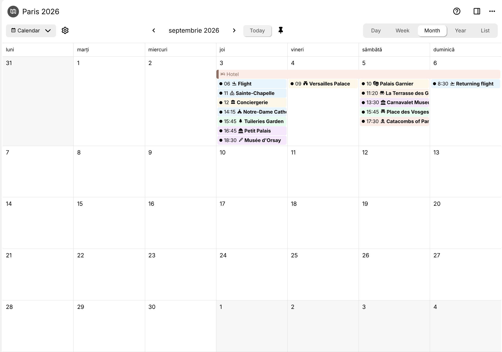
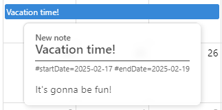
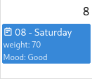
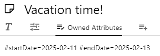
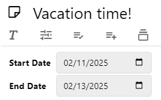
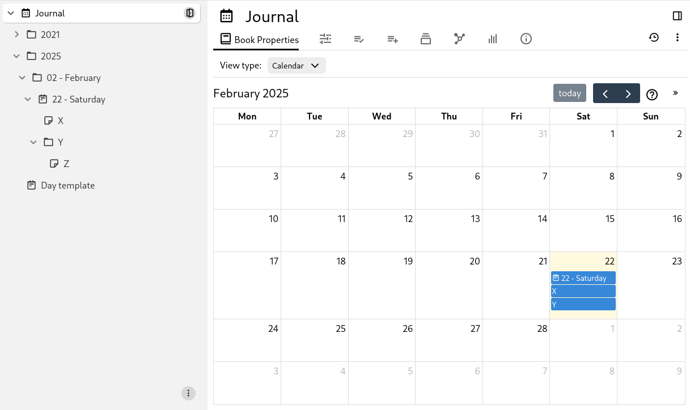
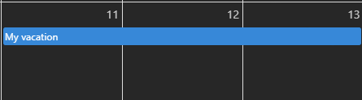
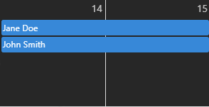
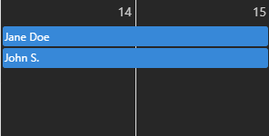

# Календарь
<figure class="image"></figure>

Вид календаря отображает каждую дочернюю заметку с датой начала и опциональной датой окончания как событие.

У вида календаря есть несколько режимов отображения:

*   Вид месяца, где отображается весь месяц, и можно вставлять события на весь день. Перечислены и события с конкретным временем, и события на весь день.
*   Вид недели, где все 7 дней недели (или 5, если выходные скрыты) отображаются колонками. Этот режим позволяет вводить и отображать события с конкретным временем, а не только события на весь день.
*   Вид дня, который показывает только один день. Особенно полезен для плотного расписания или мобильных видов.
*   Вид списка, который отображает последовательно все события заданного месяца.
*   Вид года, который отображает весь год для быстрой справки.

В отличие от других видов коллекций, вид календаря также допускает некоторое взаимодействие, например перемещение событий и создание новых.

## Создание календаря

Щёлкните правой кнопкой по существующей заметке в <a class="reference-link" href="../Basic%20Concepts%20and%20Features/UI%20Elements/Note%20Tree.md">Дереве заметок</a> и выберите _Вставить дочернюю заметку_ → _Коллекция_ → _Календарь_.

## Создание нового события/заметки

Чтобы создать новое событие:

*   Сначала нажмите нужный день (виды месяца и года) или нужный временной слот (вид дня).
*   Альтернативно, перетащите через несколько дней (или временных слотов), чтобы задать и дату начала, и дату окончания.

В любом случае появится небольшое всплывающее окно с запросом заголовка и даты и времени события, которое будет создано. Дату и время там можно изменить так же, как во всплывающем виде существующего события (см. ниже).

На этом этапе событие ещё не создано — это защита от случайных щелчков. Добавьте заголовок по желанию и нажмите кнопку _Создать_. Если заголовок не задан, для события будут применены правила <a class="reference-link" href="../Advanced%20Usage/Default%20Note%20Title.md">Заголовка заметки по умолчанию</a>.

Поле шаблона <span class="tn-icon bx bx-detail"></span> под датой и временем показывает тип заметки или шаблон, из которого сделана заметка события. Чтобы сделать событие из другого, нажмите поле и выберите его из списка; календарь запомнит выбор для следующего события. Выберите _Ещё шаблоны…_, чтобы изменить, какие шаблоны перечислены (см. [Шаблоны событий](#шаблоны-событий)). Введённые для события дата и время заменяют любые даты и времена, которые несёт шаблон.

Чтобы задать событиям время перед созданием (например, после щелчка по дню в виде месяца), нажмите _Добавить время_ и задайте время начала и окончания; продолжительность показана справа от них. Чтобы снова сделать событие на весь день, нажмите кнопку <span class="tn-icon bx bx-x"></span> в конце строки. Добавление или удаление времени сохраняет даты, поэтому событие может начинаться во времени в один день и заканчиваться во времени в другой (например, ночная смена). Изменение даты или времени начала сдвигает окончание на ту же величину, сохраняя продолжительность. Пустая дата окончания означает, что событие заканчивается в день своего начала; установка времени окончания раньше времени начала переносит дату окончания на следующий день.

После создания событие появится на календаре. Чтобы отредактировать содержимое события (включая повторение), нажмите на него, чтобы открыть во всплывающем виде.

> [!NOTE]
> Создание новых заметок из календаря будет учитывать отношение `~child:template`, если оно задано на заметке коллекции.

## Взаимодействие с событиями

*   Наведение мыши на событие отобразит информацию о заметке.
    
*   Левый щелчок по событию откроет выделенное всплывающее окно для быстрой настройки события или редактирования содержимого его заметки.
*   Правый щелчок предложит больше опций, включая открытие заметки в новом разделении или окне.
*   Перетащите событие по календарю, чтобы перенести его на другой день.
*   Длину события можно изменить, поместив мышь на правый край события и перетащив.

На [календаре только для чтения](../Basic%20Concepts%20and%20Features/Notes/Read-Only%20Notes.md) события нельзя перетаскивать, изменять в размере или создавать, их контекстное меню предлагает только места, где их можно открыть, а кнопка закрепления текущей даты скрыта. Переключение между видами месяца, недели и дня всё ещё работает, но выбор не сохраняется.

### Всплывающий вид

При щелчке по событию рядом с ним появится всплывающее окно, содержащее следующую информацию:

*   Заголовок и значок события, оба редактируемые.
*   Кнопки для взаимодействия с событием:
    *   Открыть событие в той же панели, новой вкладке и т.д.
    *   Палитра для изменения цвета события.
    *   Кнопка удаления события из календаря, которая может опционально удалить его заметку.
*   Возможности, специфичные для календаря:
    *   Дата начала и, для события, охватывающего несколько дней, дата окончания.
    *   Время начала и окончания с продолжительностью справа от них и кнопкой <span class="tn-icon bx bx-x"></span>, которая убирает время, делая событие на весь день. Событие на весь день вместо этого показывает кнопку _Добавить время_.
    *   Полный редактор повторения, открываемый из выпадающего списка под временем, чтобы одно и то же событие появлялось еженедельно, ежемесячно и т.д.
*   <a class="reference-link" href="../Advanced%20Usage/Attributes/Promoted%20Attributes.md">Продвигаемые атрибуты</a> метки, если есть.
*   Содержимое заметки, которое можно редактировать прямо из панели.

Чтобы закрыть всплывающее окно:

*   Нажмите кнопку X в правом верхнем углу всплывающего окна.
*   В календаре нажмите куда угодно вне всплывающего окна.
*   Или просто нажмите клавишу <kbd>Escape</kbd>.

Можно переключаться между событиями, щёлкая по ним, даже когда всплывающий вид уже открыт.

События могут иметь <a class="reference-link" href="../Note%20Types/Text/Links/Internal%20(reference)%20links.md">Внутренние (ссылочные) ссылки</a> между собой, и щелчок по такой ссылке автоматически перенесёт календарь на нужную дату, а всплывающий вид — на новую заметку.

## Взаимодействие на мобильных устройствах

Когда Trilium на мобильном устройстве, взаимодействие с календарём немного отличается:

*   Нажатие на событие отображает всплывающий вид, который позволяет редактировать событие.
*   Длительное нажатие события вызывает контекстное меню, включая опцию открытия в <a class="reference-link" href="../Basic%20Concepts%20and%20Features/Navigation/Quick%20edit.md">Быстром редактировании</a>.
*   Чтобы вставить новое событие, коснитесь и удерживайте пустое место. При успехе пустое место окрасится, указывая выбор.
    *   Перед отпусканием протяните через несколько ячеек, чтобы создать многодневные события.
    *   При отпускании появится запрос ввода заголовка заметки.
*   Чтобы переместить существующее событие, коснитесь и удерживайте его, пока пустое место рядом с ним не окрасится.
    *   В этот момент событие можно перетащить на другие дни календаря.
    *   Или событие можно изменить в размере, нажав на маленький кружок на правом конце события.
    *   Чтобы выйти из режима редактирования, просто нажмите на пустое место где угодно на календаре.

## Настройка вида календаря

В <a class="reference-link" href="Collection%20Properties.md">Свойствах коллекции</a> можно:

*   Скрыть выходные из вида недели.
*   Отображать номера недель на календаре.
*   Скрывать регулярные события из видов месяца, года и списка (см. [Скрытие регулярных событий](#скрытие-регулярных-событий)).
*   Задать продолжительность слота (длину каждой временной строки в виде дня/недели).
*   Задать интервал подписей слотов (как часто появляются временные подписи на оси в виде дня/недели).

Те же настройки также перечислены под _Общие_ в диалоге <span class="tn-icon bx bx-cog"></span> _Свойства календаря_ (как его открыть, см. [Шаблоны событий](#шаблоны-событий)). Временные слоты перечислены там независимо от того, в каком виде находится календарь. Его раздел _Включённые заметки_ задаёт, показываются ли архивные заметки и насколько глубоко календарь ищет события (см. [Ограничение глубины](#ограничение-глубины)).

### Шаблоны событий

По умолчанию новое событие — заметка <a class="reference-link" href="../Note%20Types/Text.md">Текст</a>. Чтобы делать события из других типов заметок или из <a class="reference-link" href="../Advanced%20Usage/Templates.md">Шаблонов</a> с предопределённым содержимым и атрибутами (такими как цвет), откройте диалог <span class="tn-icon bx bx-cog"></span> _Свойства календаря_ из <a class="reference-link" href="../Basic%20Concepts%20and%20Features/UI%20Elements/Note%20menu.md">Меню заметки</a> или из меню настроек <a class="reference-link" href="Collection%20Properties.md">Свойств коллекции</a> и найдите _Шаблоны событий_. Здесь вы можете:

*   Включить тип заметки или шаблон заметки, уже созданный в вашей базе знаний, нажав кнопку <span class="tn-icon bx bx-list-plus"></span> _Добавить существующий шаблон_, а затем выбрав нужный тип заметки или шаблон.
*   Создать новый шаблон, нажав кнопку <span class="tn-icon bx bx-plus"></span> _Создать новый шаблон_. Шаблон создаётся как дочерний для календаря и не показывается как событие.
*   Нажать кнопку <span class="tn-icon bx bx-x"></span>, чтобы убрать шаблон из списка. Шаблон удаляется только из списка, а не стирается.
*   Нажать кнопку <span class="tn-icon bx bx-dots-vertical-rounded"></span> пользовательского шаблона, чтобы отредактировать, открыть в новом окне, продублировать или удалить его.
*   Перетащить шаблон за его ручку, чтобы изменить порядок списка, показываемого при создании события.

Диалог недоступен на календаре только для чтения или на календаре, помеченном `#calendarRoot` или `#workspaceCalendarRoot` (см. [Использование с Журналом / календарём](#использование-с-журналом--календарём)).

### Атрибуты событий

События могут показывать значения своих атрибутов под заголовком — в виде месяца, а в видах недели и дня — для событий на весь день и для событий с временем, достаточно высоких, чтобы их вместить. Чтобы выбрать, какие атрибуты показываются, откройте диалог <span class="tn-icon bx bx-cog"></span> _Свойства календаря_ (как его открыть, см. [Шаблоны событий](#шаблоны-событий)) и найдите _Атрибуты событий_. Он перечисляет <a class="reference-link" href="../Advanced%20Usage/Attributes/Promoted%20Attributes.md">Продвигаемые атрибуты</a>, которые определяет календарь, и те, которые определяют сами события. Здесь вы можете:

*   Включить атрибут, чтобы показывать его на событиях. Новые атрибуты скрыты, пока вы их не включите, что не даёт календарю загромождаться.
*   Перетащить атрибут за его ручку, чтобы изменить порядок, в котором события их показывают.
*   Создать новый атрибут, который сразу показывается на событиях, или отредактировать либо удалить один из определяемых календарём.

Даты, времена и повторение событий не перечислены, так как календарь всегда показывает их сам.

Чтобы изменить значение атрибута, не открывая событие, щёлкните правой кнопкой по событию (или долго нажмите его на телефоне) и используйте раздел _Атрибуты_ его контекстного меню. Он перечисляет показываемые атрибуты типов «флажок», «список» и «дата» и работает как на [Kanban-доске](Kanban%20Board.md).

Если у события есть метка `#calendar:displayedAttributes`, включая унаследованную от календаря, вместо этого показываются атрибуты, перечисленные в этой метке.

## Настройка календаря с помощью атрибутов

Следующие атрибуты можно добавить к типу Коллекция:

<table>
    <thead>
        <tr>
            <th>Имя</th>
            <th>Описание</th>
        </tr>
    </thead>
    <tbody>
        <tr>
            <td><code>#calendar:hideWeekends</code></td>
            <td>Когда присутствует (независимо от значения), скроет субботу и воскресенье из календаря.</td>
        </tr>
        <tr>
            <td><code>#calendar:weekNumbers</code></td>
            <td>Когда присутствует (независимо от значения), покажет номер недели на календаре.</td>
        </tr>
        <tr>
            <td><code>#calendar:hideRoutineEvents</code></td>
            <td>Когда присутствует (независимо от значения), скроет регулярные события из видов месяца, года и списка. См. <a href="#скрытие-регулярных-событий">Скрытие регулярных событий</a>.</td>
        </tr>
        <tr>
            <td><code>#calendar:initialDate</code></td>
            <td>Изменяет дату, на которой открывается календарь. Когда отсутствует, календарь открывается на текущей дате.</td>
        </tr>
        <tr>
            <td><code>#calendar:view</code></td>
            <td><p>Какой вид отображать в календаре:</p><ul><li><code>timeGridDay</code> для вида <em>день</em>;</li><li><code>timeGridWeek</code> для вида <em>неделя</em>;</li><li><code>dayGridMonth</code> для вида <em>месяц</em>;</li><li><code>multiMonthYear</code> для вида <em>год</em>;</li><li><code>listMonth</code> для вида <em>список</em>.</li></ul><p>Любое другое значение будет отброшено, и вместо него будет использован вид по умолчанию (месяц).</p><p>Значение этой метки автоматически обновляется при изменении вида кнопками интерфейса.</p></td>
        </tr>
        <tr>
            <td><code>#calendar:slotDuration</code></td>
            <td>Задаёт, какой длины каждый временной слот на календаре. По умолчанию <code>00:15:00</code> (15 минут). Должно иметь формат "HH:MM:SS". Например, чтобы создать слоты каждые 10 минут, задайте <code>#calendar:slotDuration="00:10:00"</code>.</td>
        </tr>
        <tr>
            <td><code>#calendar:slotLabelInterval</code></td>
            <td>Задаёт, как часто временные слоты на календаре должны иметь подписи. По умолчанию <code>01:00:00</code> (1 час). Должно иметь формат "HH:MM:SS". Например, чтобы подписывать слоты каждые 30 минут, задайте <code>#calendar:slotLabelInterval="00:30:00"</code>.</td>
        </tr>
        <tr>
            <td><code>~child:template</code></td>
            <td>Определяет шаблон для вновь создаваемых заметок в календаре (перетаскиванием или щелчком).</td>
        </tr>
    </tbody>
</table>

Кроме того, первый день недели может быть воскресеньем или понедельником и настраивается в настройках приложения.

## Настройка событий календаря с помощью атрибутов

Для каждой заметки календаря можно использовать следующие атрибуты:

| Имя | Описание |
| --- | --- |
| `#startDate` | Дата начала события, которая отобразит его в календаре. Формат — `YYYY-MM-DD` (год, месяц и день, разделённые дефисом). |
| `#endDate` | Похоже на `startDate`, указывает дату окончания, если событие охватывает несколько дней. Дата включается, так что последний день тоже учитывается. Атрибут может отсутствовать для однодневных событий. |
| `#startTime` | Время начала события. Если это значение отсутствует, событие считается событиям на весь день. Формат — `HH:MM` (часы в 24-часовом формате и минуты). |
| `#endTime` | Похоже на `startTime`, указывает время окончания события (относительно `endDate`, если она есть, или `startDate`). |
| `#recurrence` | Это опциональная строка CalDAV `RRULE`, которая, если присутствует, определяет, должен ли задача повторяться. Обратите внимание, что она не включает атрибут `DTSTART`, который выводится напрямую из `#startDate` и `#startTime`. Примеры корректных строк `RRULE` см. на [https://icalendar.org/rrule-tool.html](https://icalendar.org/rrule-tool.html) |
| `#color` | Отображает событие указанным цветом (именованным, таким как `red`, `gray`, или hex, таким как `#FF0000`). Это также изменит цвет заметки в других местах, таких как дерево заметок. |
| `#calendar:color` | **❌ Удалено начиная с v0.100.0. Используйте** `#color` **вместо него.**  <br>  <br>Похоже на `#color`, но применяет цвет только для события в календаре, а не для других мест, таких как дерево заметок. |
| `#iconClass` | Если присутствует, значок заметки будет отображён слева от заголовка события. |
| `#calendar:title` | Изменяет заголовок события, чтобы указывать на атрибут заметки, отличный от заголовка; может быть меткой или отношением (без символа `#` или `~`). См. _Сценарии использования_ для получения дополнительной информации. |
| `#calendar:titleTemplate` | Изменяет заголовок, с которым событие отображается на календаре, и заполняется заново для каждого повторения повторяющегося события. См. _Сценарии использования_ для отображения возраста в день рождения. |
| `#calendar:displayedAttributes` | Имеет приоритет над [Атрибутами событий](#атрибуты-событий), выбранными в свойствах календаря. Позволяет отображать значение одного или нескольких атрибутов в календаре в заданном порядке, так: <br>  <br>   <br>  <br>`#weight="70" #Mood="Good" #calendar:displayedAttributes="weight,Mood"`  <br>  <br>Может также использоваться с отношениями, в этом случае отобразится заголовок целевой заметки:  <br>  <br>`~assignee=@My assignee #calendar:displayedAttributes="assignee"` |
| `#calendar:startDate` | Позволяет использовать другую метку для представления даты начала, отличную от `startDate` (например, `expiryDate`). Имя метки **не должно** иметь префикс `#`. Если метка не определена для заметки, вместо неё будет использоваться значение по умолчанию. |
| `#calendar:endDate` | Похоже на `#calendar:startDate`, позволяет изменить атрибут, который используется для чтения даты окончания. |
| `#calendar:startTime` | Похоже на `#calendar:startDate`, позволяет изменить атрибут, который используется для чтения времени начала. |
| `#calendar:endTime` | Похоже на `#calendar:startDate`, позволяет изменить атрибут, который используется для чтения времени окончания. |

## Как работает календарь



Календарь отображает все дочерние заметки коллекции, имеющие `#startDate`. Опционально можно добавить `#endDate`.

Текстовая заметка с датой начала показывается со значком <span class="tn-icon bx bx-calendar-event"></span> в дереве заметок и в других местах, если у неё нет собственного значка (заданного через `#iconClass`). Дата начала читается из меток, которые называет `#calendar:startDate`, если таковые есть.

Дату начала и окончания легко отредактировать прямо из коллекции календаря, нажав на событие. Чтобы отредактировать дату, находясь в самой заметке события, можно добавить к заметке коллекции следующие атрибуты:

```
#viewType=calendar #label:startDate(inheritable)="promoted,alias=Start Date,single,date"
#label:endDate(inheritable)="promoted,alias=End Date,single,date"
#hidePromotedAttributes 
```

Это даст результат:



Когда не используется в Журнале, календарь является рекурсивным. То есть он ищет события не только в своих дочерних заметках, но и в детях этих дочерних заметок.

### Ограничение глубины

Чтобы ограничить, насколько глубоко календарь ищет события, задайте _Максимальная глубина вложенности_ под _Включённые заметки_ в диалоге <span class="tn-icon bx bx-cog"></span>_Свойства календаря_ (как его открыть, см. [Шаблоны событий](#шаблоны-событий)) или метку `#maxNestingDepth`: `0` показывает только дочерние заметки, `1` добавляет их детей и так далее. Без значения события ищутся на каждом уровне. Настройка не применяется в Журнале.

## Повторение

Встроенный вид календаря также поддерживает повторяющиеся задачи (например, каждую неделю, каждый месяц, а также более сложные правила повторения).

Начиная с v0.105.0, повторение можно редактировать прямо из календаря, нажав на событие, а затем выбрав опцию _Повторяется_.

### Пользовательское повторение с использованием подмножества RRULE

Если встроенного редактора повторения из всплывающего окна события недостаточно, более сложные правила можно задать вручную через метку `#recurrence`.

Например, чтобы заметка повторялась на календаре:

*   Каждый день — `#recurrence="FREQ=DAILY;INTERVAL=1"`
*   Каждые 3 дня — `#recurrence="FREQ=DAILY;INTERVAL=3"`
*   Каждую неделю — `#recurrence="FREQ=WEEKLY;INTERVAL=1"`
*   Каждые 2 недели в понедельник, среду и пятницу — `#recurrence="FREQ=WEEKLY;INTERVAL=2;BYDAY=MO,WE,FR"`
*   Каждые 3 месяца — `#recurrence="FREQ=MONTHLY;INTERVAL=3"`
*   Каждые 2 месяца в первое воскресенье — `#recurrence="FREQ=MONTHLY;INTERVAL=2;BYDAY=1SU"`
*   Каждый месяц в последнюю пятницу — `#recurrence="FREQ=MONTHLY;INTERVAL=1;BYDAY=-1FR"`

Другие примеры корректных строк `RRULE` см. на [https://icalendar.org/rrule-tool.html](https://icalendar.org/rrule-tool.html)

Обратите внимание, что строка повторения не включает атрибут `DTSTART`, как определено в спецификации iCAL. Он выводится напрямую из атрибутов `startDate` и `startTime`.

Если вы хотите переопределить метку, которую календарь использует для получения строки повторения, используйте атрибут `#calendar:recurrence`. Например, можно задать `#calendar:recurrence=taskRepeats`. Тогда строку повторения можно задать так: `#taskRepeats="FREQ=DAILY;INTERVAL=1"`.

Также обратите внимание, что метка повторения может быть сделана продвигаемой, как и даты начала и окончания.

> [!WARNING]
> Если строка повторения некорректна, будет показано всплывающее уведомление с ID заметки и заголовком заметки с ошибочным сообщением о повторении. Эта заметка не будет добавлена в календарь.

### Скрытие регулярных событий

События, повторяющиеся в большинство дней недели, такие как сон или рабочие часы, заполняют каждую ячейку вида месяца. Чтобы скрыть их из видов, показывающих много дней сразу, отметьте _Скрыть регулярные события_ в <a class="reference-link" href="Collection%20Properties.md">Свойствах коллекции</a> (или задайте `#calendar:hideRoutineEvents`).

Событием считается регулярным, когда у него есть время начала и оно повторяется в среднем 4 и более дней в неделю, например:

| Событие | Дней в неделю | Скрыто из видов месяца, года и списка |
| --- | --- | --- |
| Каждый день с 23:00 до 07:00 | 7 | Да |
| С понедельника по пятницу с 09:00 до 17:00 | 5 | Да |
| Через день в 07:00 | 3.5 | Нет |
| Понедельник, среда и пятница в 18:00 | 3 | Нет |
| Каждый день, без времени начала | 7 | Нет, так как длится весь день |
| Каждый месяц или каждый год | — | Нет |

Виды дня и недели всегда показывают регулярные события. Чтобы снова показывать их везде, снимите отметку с опции.

## Настройка продолжительности слота и интервала подписей

Временные слоты в видах дня и недели можно настроить в <a class="reference-link" href="Collection%20Properties.md">Свойствах коллекции</a>

*   _Продолжительность слота_ управляет тем, какой высоты каждый временной слот на календаре (по сути, наименьшая единица времени, на которую разбита сетка).
    *   Более короткая продолжительность означает больше строк и более мелкую гранулярность; более длинная — меньше, более крупных строк.
    *   По умолчанию одна строка каждые 15 минут.
*   _Интервал подписей_ управляет тем, как часто временная подпись появляется на левой оси.
    *   Это не зависит от размера слота: можно иметь очень маленькие слоты, но подписывать только каждый час, чтобы ось оставалась читаемой.
    *   По умолчанию временная подпись показывается каждый час.

> [!NOTE]
> Эти значения также можно настроить напрямую через [метки](../Advanced%20Usage/Attributes/Labels.md) `#calendar:slotDuration` и `#calendar:slotLabelInterval`. Оба значения используют формат `HH:mm:ss`. Часы могут достигать `24` (`24:00:00`), а минуты и секунды должны быть между `00` и `59`. Минимальная осмысленная продолжительность — 1 минута (`00:01:00`).

## Сценарии использования

### Использование с Журналом / календарём

Возможно интегрировать вид календаря в Журнал с заметками дня. Для этого измените тип заметки Журнала (корень календаря) на Коллекция, а затем выберите вид Календарь.

В режиме журнала всплывающий редактор не будет показывать даты, повторение, цвета или удаление, так как заметки дня не являются редактируемыми событиями.

На основе атрибута `#calendarRoot` (или `#workspaceCalendarRoot`) календарь узнаёт, что он находится в календаре, и применяет следующее:

*   События календаря теперь отображаются на основе их атрибута `dateNote`, а не `startDate`.
*   Интерактивное редактирование, такое как перетаскивание по пустому периоду или изменение размера события, больше невозможно.
*   Нажатие на пустое место даты автоматически откроет заметку этого дня или создаст её, если её не существует.
*   Прямые потомки заметки дня будут отображены на календаре, несмотря на отсутствие атрибута `dateNote`. Потомки дочерних заметок отображаться не будут.



### Использование другого атрибута в качестве заголовка события

По умолчанию события отображаются на календаре по заголовку их заметки. Однако можно настроить отображение другого атрибута вместо него.

Для этого присвойте дочерней заметке (не заметке календаря/коллекции) `#calendar:title` со значением `name`, где `name` — любая метка (не добавляйте префикс `#`). Атрибут также может прийти через наследование, например из атрибута шаблона. Если у заметки нет запрошенной метки, вместо неё будет использоваться заголовок заметки.

```
#startDate=2025-02-11 #endDate=2025-02-13 #name="Мой отпуск" #calendar:title="name"
```

### Использование атрибута-отношения в качестве заголовка события

Аналогично использованию атрибута, используйте `#calendar:title` и задайте ему значение `name`, где `name` — имя используемого отношения.

Более того, если отношений с одним именем несколько, они будут отображены как несколько событий, исходящих из одной заметки.

```
#startDate=2025-02-14 #endDate=2025-02-15 ~for=@John Smith ~for=@Jane Doe #calendar:title="for"
```

Обратите внимание, что возможно даже задать `#calendar:title` на целевой заметке (например, «John Smith»), которая попытается отрендерить её атрибут. Обратите внимание, что по соображениям безопасности здесь нельзя использовать и отношение (случайная рекурсия атрибутов могла бы зациклить приложение бесконечно).

```
#calendar:title="shortName" #shortName="John S."
```

### Отображение возраста в повторяющемся событии

День рождения или годовщина повторяется каждый год, и интересно в каждом повторении число лет, которое она отмечает. Чтобы отобразить его:

1.  Задайте дату начала события как исходную дату (например, дату рождения).
2.  Нажмите на событие, затем выберите выпадающий список _Повторяется_.
3.  Выберите _Ежегодно_ и отметьте _Показывать число лет в заголовке_.

Событие затем отображается как «John Smith (35)» в 2025 году, «John Smith (36)» в 2026 году и так далее. Затронут только календарь; заметка сохраняет свой заголовок.

Флажок задаёт метку `#calendar:titleTemplate`, которая задаёт заголовок, с которым отображается событие, и заполняется заново для каждого повторения, которое производит правило повторения:

```
#startDate=1990-05-12 #recurrence="FREQ=YEARLY" #calendar:titleTemplate="${title} (${years})"
```

Чтобы сформулировать заголовок иначе, отредактируйте метку напрямую. Флажок тогда отключён, как и когда шаблон унаследован, чтобы он никогда не перезаписывал ваш собственный шаблон.

В шаблоне можно использовать следующие значения:

| Значение | Описание |
| --- | --- |
| `${title}` | Заголовок, который иначе отображался бы с событием: заголовок заметки или атрибут, на который указывает `#calendar:title`. |
| `${years}` | Целые годы между `#startDate` и отображаемым повторением. На первом повторении равен `0`. |
| `${date}` | Дата отображаемого повторения как объект [day.js](https://day.js.org/docs/en/display/format). Например, `${date.format('YYYY')}`. |
| `${startDate}` | Дата начала события в той же форме. Например, `${startDate.format('YYYY')}`. |

Чтобы использовать один и тот же шаблон для каждого события календаря, сделайте метку наследуемой на заметке коллекции:

```
#calendar:titleTemplate(inheritable)="${title} (${years})"
```

> [!NOTE]
> Шаблон, который нельзя прочитать — неизвестное значение или выражение, отличное от значения и показанного выше вызова `format` — оставляет событие с его простым заголовком и сообщает причину в консоли браузера.
