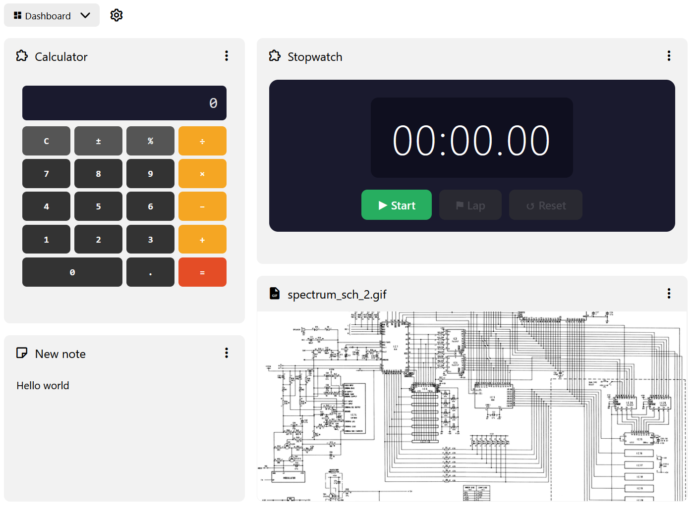

# Дашборд (Dashboard)
<figure class="image"></figure>

> [!NOTE]
> Дашборд в настоящее время считается бета-версией. Это означает, что его поведение может меняться до стабилизации.

Дашборд — коллекция, представленная в Trilium v0.104.0. Она похожа на коллекцию <a class="reference-link" href="Grid%20View.md">Сетка</a>, но имеет ключевые отличия:

*   Макет сетки не фиксирован, что позволяет использовать плитки разной ширины и высоты. Сетка имеет 12 колонок и неограниченное число строк.
*   Каждый виджет представляет дочернюю заметку коллекции и может быть переставлен или изменён в размере.
*   Сетка распределяет колонки равномерно, заполняя весь экран.
    *   Если доступное пространство слишком мало (например, в разделении или на мобильном), колонки сворачиваются, и все виджеты отображаются один под другим.
    *   Пока колонки свёрнуты, виджеты нельзя переставлять или изменять в размере.
*   В отличие от <a class="reference-link" href="Grid%20View.md">Сетки</a>, виджеты не кликабельны, что позволяет им быть интерактивными.

## Типы виджетов

Дашборд использует тот же механизм рендеринга, что и <a class="reference-link" href="Grid%20View.md">Сетка</a> или <a class="reference-link" href="../Basic%20Concepts%20and%20Features/Notes/Note%20List.md">Список заметок</a>, что означает, что может быть отрендерена любая заметка, например:

*   Статическое содержимое через <a class="reference-link" href="../Note%20Types/Text.md">Текст</a> или <a class="reference-link" href="../Note%20Types/Code.md">Код</a>.
*   Изображения через <a class="reference-link" href="../Note%20Types/File.md">Файл</a>, <a class="reference-link" href="../Note%20Types/Mermaid%20Diagrams.md">Диаграммы Mermaid</a>, <a class="reference-link" href="../Note%20Types/Mind%20Map.md">Mind Map</a>.
*   Интерактивные виджеты через <a class="reference-link" href="../Note%20Types/Render%20Note.md">Render Note</a>.
*   Веб-страницы можно отображать через <a class="reference-link" href="../Note%20Types/Web%20View.md">Веб-представление</a> и обновлять через контекстное меню.
*   <a class="reference-link" href="../Collections.md">Коллекции</a> рендерятся интерактивно внутри дашборда.

> [!TIP]
> Интерактивные виджеты с использованием <a class="reference-link" href="../Note%20Types/Render%20Note.md">Render Note</a> — главный сценарий использования дашборда. С помощью чата <a class="reference-link" href="../AI.md">ИИ</a> эти виджеты легко создавать, так как ИИ обучен их писать.

## Добавление новых виджетов

Есть два способа добавить виджеты на дашборд:

*   Создайте дочернюю заметку любого типа — дашборд автоматически подхватит её и добавит на сетку.
*   Из <a class="reference-link" href="../Basic%20Concepts%20and%20Features/UI%20Elements/Note%20Tree.md">Дерева заметок</a> перетащите существующую заметку на дашборд, и она будет размещена там. Это [клонирует](../Basic%20Concepts%20and%20Features/Notes/Cloning%20Notes.md) заметку в коллекцию.

## Дашборды только для чтения

На [дашборде только для чтения](../Basic%20Concepts%20and%20Features/Notes/Read-Only%20Notes.md) виджеты нельзя перемещать или изменять в размере, заметки, перетащенные из <a class="reference-link" href="../Basic%20Concepts%20and%20Features/UI%20Elements/Note%20Tree.md">Дерева заметок</a>, не добавляются, а меню виджета больше не предлагает его удалить.
