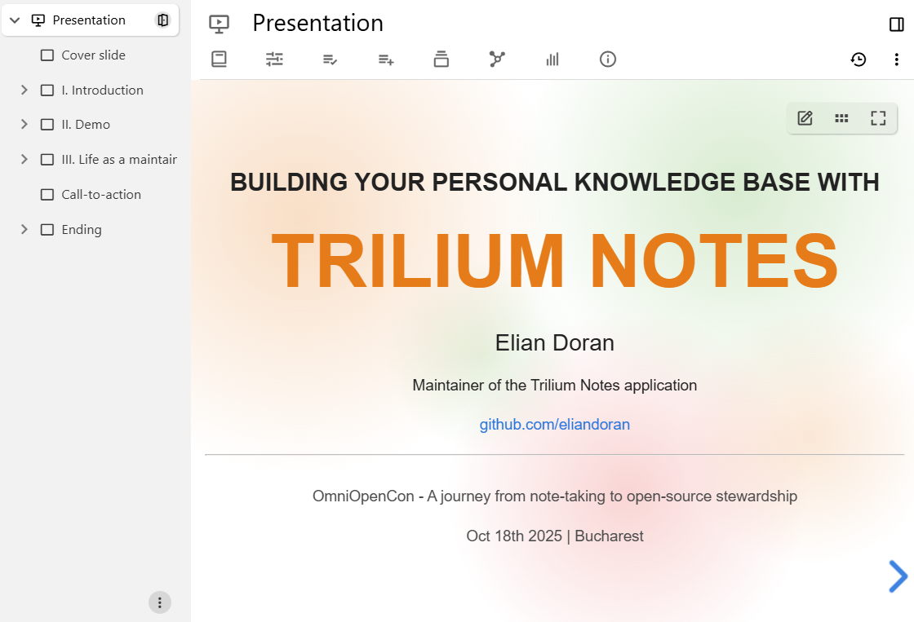
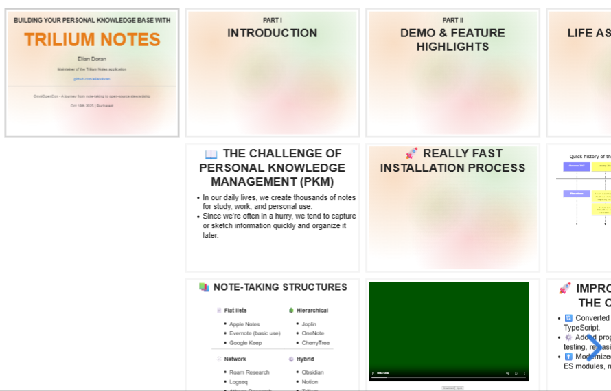

# Презентация
<figure class="image"></figure>

Вид Презентация позволяет создавать слайд-шоу прямо внутри Trilium.

### Создание новой презентации

Щёлкните правой кнопкой по существующей заметке в <a class="reference-link" href="../Basic%20Concepts%20and%20Features/UI%20Elements/Note%20Tree.md">Дереве заметок</a> и выберите _Вставить дочернюю заметку_ → _Коллекция_ → _Презентация_.

Презентация без слайдов показывает вместо слайдов и боковой панели слайдов кнопку <span class="tn-icon bx bx-plus"></span> _Новый слайд_, которая создаёт первый слайд и начинает его редактирование. Стрелка рядом с ней создаёт вместо этого слайд другого типа, как описано ниже. Презентация только для чтения показывает только сообщение о том, что в ней нет слайдов. Пока нет ни одного слайда, кнопка _Боковая панель слайдов_ отключена, а элементы управления под слайдами не показываются.

## Как это работает

*   Каждый слайд — дочерняя заметка коллекции.
*   Слайды по умолчанию не показываются в <a class="reference-link" href="../Basic%20Concepts%20and%20Features/UI%20Elements/Note%20Tree.md">Дереве заметок</a>, так как боковая панель слайдов уже перечисляет их (см. <a class="reference-link" href="../Basic%20Concepts%20and%20Features/UI%20Elements/Note%20Tree/Hiding%20the%20subtree.md">Скрытие поддерева</a>). Чтобы показать их, откройте <span class="tn-icon bx bx-cog"></span> настройки коллекции и выключите _Скрыть дочерние заметки в дереве_.
*   Порядок дочерних заметок определяет порядок слайдов.
*   В отличие от традиционного программного обеспечения для презентаций, слайды можно размещать как горизонтально, так и вертикально (подробнее см. ниже).
*   Прямые потомки размещаются горизонтально, а их потомки — вертикально. Потомки глубже двух уровней вложенности игнорируются.
*   Коллекция <a class="reference-link" href="Kanban%20Board.md">Kanban-доска</a> или <a class="reference-link" href="Table.md">Таблица</a> показывается как один слайд, работая так же, как в самой заметке, поэтому её потомки не размещаются как вертикальные слайды. Другие коллекции сохраняют своих потомков как вертикальные слайды.
*   Слайды имеют фиксированную форму 16:9 (1280×720). Предпросмотр в заметке — уменьшенная копия того, что показывается в полноэкранном режиме, поэтому содержимое, помещающееся в предпросмотре, помещается и при показе. Когда окно или экран имеет другую форму, слайд центрируется с полосами вокруг него.
*   Слайд, чьё содержимое больше самого слайда, уменьшается до вписывания, включая текст. Чтобы сохранить текст крупным, разделите содержимое на несколько слайдов.

## Взаимодействие и навигация

### Боковая панель слайдов

Боковая панель слева от слайдов показывает миниатюру каждого слайда в теме презентации, с вертикальными слайдами, сдвинутыми вправо под слайдом, которому они принадлежат. Слайды Веб-представления, <a class="reference-link" href="Kanban%20Board.md">Kanban-доски</a> и <a class="reference-link" href="Table.md">Таблицы</a> показываются значком.

*   Показываемый слайд обведён, а панель прокручивается, чтобы держать его в виду.
*   Щёлкните миниатюру, чтобы перейти к её слайду.
*   Чтобы переместить слайд, перетащите его миниатюру; линия показывает, куда он попадёт. Перетащенный строго вверх или вниз, слайд сохраняет свой уровень:
    *   Слайд верхнего уровня забирает с собой свои вертикальные слайды, а перетащенный над вертикальными слайдами другого слайда, он встаёт после всего этого стека.
    *   Вертикальный слайд может встать среди вертикальных слайдов любого слайда. Сброшенный под слайд, у которого их нет, он становится первым вертикальным слайдом этого слайда, и линия сдвигается вправо.
*   Чтобы изменить уровень слайда, перетащите его также в сторону: вправо, чтобы сделать его вертикальным слайдом, влево — чтобы сделать слайдом верхнего уровня. Отступ линии показывает уровень, который он получит.
    *   Слайд, имеющий собственные вертикальные слайды, не может стать вертикальным слайдом, а слайд <a class="reference-link" href="Kanban%20Board.md">Kanban-доски</a> или <a class="reference-link" href="Table.md">Таблицы</a> не может принимать вертикальные слайды.
*   Слайды нельзя перетаскивать в презентации только для чтения или на основе поиска, а также в заметку, сортирующую своих потомков с помощью `#sorted`.
*   После того как миниатюра нажата или достигнута с помощью <kbd>Tab</kbd>, боковая панель принимает клавиатуру, пока вы не щёлкнете по слайдам:
    *   Нажмите <kbd>↑</kbd> и <kbd>↓</kbd>, чтобы перейти к предыдущему или следующему слайду по порядку, включая вертикальные слайды.
    *   Нажмите <kbd>Home</kbd> и <kbd>End</kbd>, чтобы перейти к первому или последнему слайду.
    *   Нажмите <kbd>Alt</kbd>+<kbd>↑</kbd> и <kbd>Alt</kbd>+<kbd>↓</kbd>, чтобы переместить слайд вверх или вниз на его уровне, мимо целого стека вертикальных слайдов. Нажмите <kbd>Alt</kbd>+<kbd>→</kbd>, чтобы сделать его вертикальным слайдом на его месте, и <kbd>Alt</kbd>+<kbd>←</kbd>, чтобы сделать его слайдом верхнего уровня (наоборот в языках справа налево). Применяются те же ограничения, что и при перетаскивании.
*   Правый щелчок по миниатюре или нажатие <kbd>Shift</kbd>+<kbd>F10</kbd> либо клавиши <kbd>Menu</kbd> на сфокусированной открывает её контекстное меню. Миниатюра обведена, пока меню открыто, а показываемый слайд не меняется:
    *   _Редактировать слайд_ переходит к слайду и редактирует его на месте, как это делает двойной щелчок. Доступно для текстовых слайдов, слайдов <a class="reference-link" href="Kanban%20Board.md">Kanban-доски</a> и <a class="reference-link" href="Table.md">Таблицы</a>.
    *   _Открыть заметку_ открывает заметку слайда в новой вкладке, разделении или окне.
    *   _Новый слайд после_ добавляет пустой слайд после него на его уровне, а _Новый вертикальный слайд_ добавляет его в конец его вертикальных слайдов. Каждый спрашивает тип слайда из того же списка, что и стрелка рядом с кнопкой _Новый слайд_. Презентация переходит к новому слайду. _Дублировать_ копирует слайд с его вертикальными слайдами сразу после него.
    *   _Переместить вверх_, _Переместить вниз_, _Сделать вертикальным слайдом_ и _Сделать слайдом верхнего уровня_ перемещают слайд, как это делают <kbd>Alt</kbd> и клавиши со стрелками. Пункт отключён там, куда слайд не может попасть.
    *   _Удалить слайд…_ удаляет слайд с его вертикальными слайдами после запроса подтверждения.
    *   Презентация только для чтения предлагает только _Открыть заметку_. Презентация на основе поиска не может добавлять, перемещать или удалять слайды.
*   Чтобы свернуть боковую панель, нажмите кнопку <span class="tn-icon bx bx-sidebar"></span> _Боковая панель слайдов_ слева на панели инструментов над слайдами, после настроек коллекции. Нажмите её снова, чтобы вернуть панель. Каждое устройство запоминает выбор для каждой презентации.
*   Боковая панель скрыта, когда заметка слишком узкая, чтобы вместить её.

### Элементы управления под слайдами

Под слайдами находятся три группы кнопок.

#### Перемещение между слайдами

Слева кнопки <span class="tn-icon bx bx-chevron-left"></span> _Предыдущий слайд_ и <span class="tn-icon bx bx-chevron-right"></span> _Следующий слайд_ проходят через каждый слайд по порядку, включая вертикальные слайды, как это делают <kbd>Shift</kbd>+<kbd>Пробел</kbd> и <kbd>Пробел</kbd>. Между ними находится номер показываемого слайда из общего числа слайдов.

Презентация открывается на слайде, который она показывала в последний раз, в том числе на другом устройстве после синхронизации, если только этот слайд не был удалён. Презентация только для чтения не помнит свой слайд и открывается на сохранённом или на первом.

#### Редактирование

В центре:

*   Кнопка <span class="tn-icon bx bx-plus"></span> _Новый слайд_ добавляет пустой текстовый слайд после показываемого слайда на том же уровне: после слайда и его вертикальных слайдов или среди вертикальных слайдов. Презентация переходит к новому слайду и начинает редактировать его на месте. Стрелка <span class="tn-icon bx bx-chevron-down"></span> рядом с ней добавляет вместо этого слайд другого типа:

    *   _Текст_ и <a class="reference-link" href="../Note%20Types/Canvas.md">Холст</a> идут первыми, как слайды, которые можно редактировать на месте; презентация начинает редактировать новый слайд.
    *   <a class="reference-link" href="Kanban%20Board.md">Kanban-доска</a> и <a class="reference-link" href="Table.md">Таблица</a> создают коллекцию из того же шаблона, что и новая в другом месте, которую презентация также начинает редактировать.
    *   <a class="reference-link" href="../Note%20Types/Mermaid%20Diagrams.md">Диаграммы Mermaid</a> создают диаграмму и открывают её в <a class="reference-link" href="../Basic%20Concepts%20and%20Features/Navigation/Quick%20edit.md">Быстром редактировании</a>, чтобы написать её. Слайд показывает диаграмму после её сохранения, а кнопка <span class="tn-icon bx bx-edit"></span> _Редактировать этот слайд_ открывает её в Быстром редактировании снова.
    *   <a class="reference-link" href="../Note%20Types/Code.md">Код</a> открывает список языков кода, включённых в настройках кодовых заметок, как это делают другие меню типов заметок приложения, заканчиваясь пунктом _Настроить заметки с кодом..._, чтобы изменить, какие из них предлагаются. Новая заметка открывается в <a class="reference-link" href="../Basic%20Concepts%20and%20Features/Navigation/Quick%20edit.md">Быстром редактировании</a> для написания кода, как и диаграмма Mermaid.
    *   _Веб-представление_ и _Таблица (Spreadsheet)_ создают пустую заметку этого типа. Её содержимое добавляется в <a class="reference-link" href="../Basic%20Concepts%20and%20Features/Navigation/Quick%20edit.md">Быстром редактировании</a> кнопкой <span class="tn-icon bx bx-edit"></span> _Редактировать этот слайд_.

    [Презентация только для чтения](../Basic%20Concepts%20and%20Features/Notes/Read-Only%20Notes.md) её не показывает, как и презентация, созданная из поиска.
*   Кнопка <span class="tn-icon bx bx-edit"></span> _Редактировать этот слайд_ редактирует текущий слайд: на месте для текстового слайда, слайда-холста, Kanban-доски или Таблицы, как это делает двойной щелчок, и в <a class="reference-link" href="../Basic%20Concepts%20and%20Features/Navigation/Quick%20edit.md">Быстром редактировании</a> для слайда любого другого типа или там, где слайд нельзя редактировать на месте. [Презентация только для чтения](../Basic%20Concepts%20and%20Features/Notes/Read-Only%20Notes.md) её не показывает. Пока слайд редактируется на месте, кнопка становится кнопкой <span class="tn-icon bx bx-check"></span> _Завершить редактирование_.
*   Кнопка <span class="tn-icon bx bx-palette"></span> _Фон слайда_ выбирает цвет фона текущего слайда или очищает его, чтобы слайд использовал фон темы. Она недоступна для слайдов веб-представления, Kanban-доски и Таблицы, которые покрывают весь слайд, а презентация только для чтения её не показывает. Градиент всё равно можно задать через метку `#slide:background`.

#### Просмотр

Справа:

*   Нажмите кнопку Обзор <span class="tn-icon bx bx-grid-horizontal"></span> (или клавишу <kbd>O</kbd>), чтобы показать вид с высоты птичьего полёта на слайды. Нажмите кнопку снова, чтобы выключить его.
*   Нажмите кнопку <span class="tn-icon bx bx-fullscreen"></span> _Начать показ_ (или клавишу <kbd>F</kbd>), чтобы показать презентацию в полноэкранном режиме. Нажмите <kbd>Esc</kbd> или кнопку <span class="tn-icon bx bx-exit-fullscreen"></span> _Выйти из полноэкранного режима_, чтобы покинуть его.

В полноэкранном режиме кнопки редактирования скрыты, а две другие группы гаснут, пока мышь неподвижна. Двигайте мышь, чтобы вернуть их.

### Сочетания клавиш

Следующие сочетания клавиш работают, пока презентация является активной заметкой: после щелчка по слайдам или боковой панели и в полноэкранном режиме. Клавиши, нажатые в другом разделении, дереве заметок или поле, идут туда.

*   Нажмите <kbd>←</kbd> и <kbd>→</kbd> (или <kbd>H</kbd> и <kbd>L</kbd>), чтобы перейти к слайду слева или справа (горизонтально).
*   Нажмите <kbd>↑</kbd> и <kbd>↓</kbd> (или <kbd>K</kbd> и <kbd>J</kbd>), чтобы перейти к слайду вверх или вниз (вертикально).
*   Нажмите <kbd>Пробел</kbd> и <kbd>Shift</kbd>+<kbd>Пробел</kbd>, чтобы перейти к следующему/предыдущему слайду по порядку.
*   Нажмите <kbd>F</kbd>, чтобы начать показ в полноэкранном режиме.
*   И ещё несколько — нажмите <kbd>?</kbd>, чтобы показать всплывающее окно со всеми поддерживаемыми комбинациями клавиш.

## Редактирование слайда на месте

Дважды щёлкните слайд, сделанный из текстовой заметки, чтобы отредактировать его прямо на слайде в теме презентации. Пунктирный контур отмечает редактируемый слайд, а панель форматирования появляется рядом с выделенным текстом. Изменения сохраняются по мере ввода, как в любой текстовой заметке, а слайд, выросший за край слайда, уменьшается для вписывания.

Чтобы завершить редактирование, нажмите <kbd>Esc</kbd>, нажмите кнопку <span class="tn-icon bx bx-check"></span> _Завершить редактирование_ под слайдами или перейдите к другому слайду. Запуск показа в полноэкранном режиме также завершает редактирование, и в полноэкранном режиме слайды нельзя редактировать.

Слайд <a class="reference-link" href="Kanban%20Board.md">Kanban-доски</a> или <a class="reference-link" href="Table.md">Таблицы</a> доступен только для чтения, пока он не отредактирован, чтобы карточку или ячейку нельзя было изменить случайно во время показа, и щелчок по карточке или строке ничего не открывает. Дважды щёлкните его, чтобы отредактировать на слайде, как в его заметке, затем нажмите кнопку <span class="tn-icon bx bx-check"></span> _Завершить редактирование_ или перейдите к другому слайду, чтобы завершить. Панель над коллекцией не имеет переключателя типа вида на слайде и показывает <span class="tn-icon bx bx-cog"></span> настройки только пока слайд редактируется.

Дважды щёлкните слайд-<a class="reference-link" href="../Note%20Types/Canvas.md">Холст</a>, чтобы рисовать на нём на месте. Редактор холста покрывает презентацию, с теми же инструментами, что и в заметке-холсте, и открывает рисунок в том размере и месте, в котором слайд его показывает. Рисунок сохраняется по ходу. Нажмите <kbd>Esc</kbd> или кнопку <span class="tn-icon bx bx-check"></span> _Завершить редактирование_, чтобы завершить.

Слайды других типов заметок, таких как диаграммы, открываются в <a class="reference-link" href="../Basic%20Concepts%20and%20Features/Navigation/Quick%20edit.md">Быстром редактировании</a> кнопкой <span class="tn-icon bx bx-edit"></span> _Редактировать этот слайд_. [Презентация только для чтения](../Basic%20Concepts%20and%20Features/Notes/Read-Only%20Notes.md) не может редактироваться на месте, как и слайд, собственная заметка которого доступна только для чтения.

## Вертикальные слайды и вложенность

В отличие от традиционного программного обеспечения для презентаций, такого как Microsoft PowerPoint, слайды в Trilium можно размещать горизонтально или вертикально, чтобы создать глубину или лучше организовать слайды по темам.

Такая горизонтальная/вертикальная организация влияет на переходы (особенно на переход «слайд»), однако наиболее заметна она в навигации.

*   Нажатие <kbd>←</kbd> и <kbd>→</kbd> перемещается по слайдам горизонтально, пропуская вертикальные заметки под текущим слайдом. Это полезно для пропуска целых глав/связанных слайдов.
*   Нажатие <kbd>↑</kbd> и <kbd>↓</kbd> перемещается по вертикальным слайдам на текущем уровне.
*   Нажатие <kbd>Пробел</kbd> и <kbd>Shift</kbd> + <kbd>Пробел</kbd> переходит к следующему/предыдущему слайду по порядку независимо от направления. Как правило, это комбинация клавиш, которую стоит использовать при показе.
*   Кнопки _Предыдущий слайд_ и _Следующий слайд_ под слайдами идут по порядку, как <kbd>Пробел</kbd> и <kbd>Shift</kbd>+<kbd>Пробел</kbd>.

<figure class="image image-style-align-right image_resized" style="width:55.57%;"></figure>

Все прямые потомки коллекции будут размещены горизонтально. Если прямой потомок также имеет потомков, эти потомки будут размещены как вертикальные слайды.

В следующем примере структура заметок такова:

*   Коллекция-презентация
    *   Trilium Notes (демонстрационная страница)
    *   Слайд «Введение»
        *   «Проблема управления личными знаниями»
        *   «Структуры ведения заметок»
    *   Слайд «Демонстрация и основные возможности»
        *   «Действительно быстрый процесс установки»
        *   Видео-слайд

## Настройка

На уровне коллекции можно настроить:

*   Тему всей презентации на одну из предопределённых тем, перейдя в <a class="reference-link" href="Collection%20Properties.md">Свойства коллекции</a> и найдя опцию _Тема_.
*   В настоящее время невозможно создавать пользовательские темы, хотя это планируется.
*   Обратите внимание, что невозможно изменить CSS через <a class="reference-link" href="../Theme%20development/Custom%20app-wide%20CSS.md">Пользовательский CSS для всего приложения</a>, так как слайды рендерятся изолированно (в shadow DOM).

На уровне слайда:

*   Чтобы изменить цвет фона слайда, перейдите к нему и используйте кнопку <span class="tn-icon bx bx-palette"></span> _Фон слайда_ на панели инструментов или задайте `#slide:background` на его заметке в hex-цвет.
*   Более сложные фоны можно получить через градиенты. Для этого нет интерфейса; это нужно задавать через `#slide:background` как определение CSS-градиента, например: `linear-gradient(to bottom, #283b95, #17b2c3)`.

## Советы и приёмы

*   Текстовые заметки, как правило, сохраняют форматирование (полужирный, курсив, цвета переднего плана и фона) и размер шрифта. Блоки кода и таблицы также работают.
*   Попробуйте использовать не только текстовые заметки — презентация использует тот же механизм, что и [опубликованные заметки](../Advanced%20Usage/Sharing.md) и <a class="reference-link" href="../Basic%20Concepts%20and%20Features/Notes/Note%20List.md">Список заметок</a>, поэтому она должна уметь отображать <a class="reference-link" href="../Note%20Types/Mermaid%20Diagrams.md">Диаграммы Mermaid</a>, <a class="reference-link" href="../Note%20Types/Canvas.md">Холст</a> и <a class="reference-link" href="../Note%20Types/Mind%20Map.md">Mind Map</a> в полноэкранном режиме (без интерактивности).
    *   <a class="reference-link" href="../Note%20Types/Canvas.md">Холст</a> принимает светлый или тёмный стиль темы или собственный цвет фона слайда.
    *   Заметка <a class="reference-link" href="../Note%20Types/Code.md">Код</a> заполняет ширину слайда, подсвеченная как в заметке. С темой кода, следующей за темой приложения, слайд использует светлую или тёмную тему кода, соответствующую теме презентации. Длинный код уменьшается для вписывания в слайд.
    *   Для <a class="reference-link" href="../Note%20Types/Mermaid%20Diagrams.md">Диаграмм Mermaid</a> у некоторых есть предопределённый фон, который можно изменить через frontmatter. Например, для XY-диаграмм:

        ```
        ---
        config:
            themeVariables:
                xyChart:
                    backgroundColor: transparent
        ---
        ```
*   Слайд-<a class="reference-link" href="../Note%20Types/Web%20View.md">Веб-представление</a> показывает свою страницу через весь слайд, страницу можно прокручивать, а её ссылки — нажимать. Клавиатура остаётся у презентации, поэтому <kbd>Пробел</kbd> и клавиши со стрелками по-прежнему меняют слайды после щелчка по странице; чтобы печатать на странице, откройте саму заметку веб-представления. Показываются только адреса `http://` и `https://`. Это работает так же, как сама заметка веб-представления, поэтому вне десктопного приложения некоторые веб-сайты отказываются отображаться.

## Внутреннее устройство

Вид Презентация использует [Reveal.js](https://revealjs.com/) для обработки навигации и макета слайдов.
