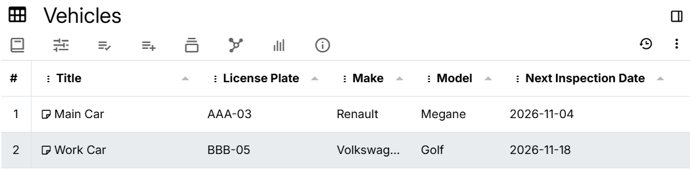

# Таблица
<figure class="image"></figure>

Вид таблицы отображает информацию в виде сетки, где строки — отдельные заметки, а столбцы — <a class="reference-link" href="../Advanced%20Usage/Attributes/Promoted%20Attributes.md">Продвигаемые атрибуты</a>. Кроме того, значения можно редактировать.

## Как это работает

Табличная структура представлена так:

*   Каждая дочерняя заметка — строка в таблице.
*   Если дочерние строки также имеют потомков, они будут показаны под разворачиваемым элементом (вложенные заметки).
*   Каждый столбец — [продвигаемый атрибут](../Advanced%20Usage/Attributes/Promoted%20Attributes.md), определённый на заметке коллекции.
    *   На самом деле поддерживаются и продвигаемые, и непродвигаемые атрибуты, но требуется использовать определение метки/отношения.
    *   Продвигаемые атрибуты обычно определяются как наследуемые, чтобы появляться в дочерних заметках, но это не обязательно.
*   Если есть несколько определений атрибутов с тем же `name`, будет показано только одно.
*   Если у определения атрибута несколько значений, все они будут сгруппированы под одним столбцом с плашками, указывающими отдельные значения.

Также есть несколько предопределённых столбцов:

*   Текущий номер элемента, обозначаемый символом `#`.
    *   Он просто считает заметку и зависит от сортировки.
*   <a class="reference-link" href="../Advanced%20Usage/Note%20ID.md">ID заметки</a>, представляющий уникальный ID, используемый внутренне Trilium.
*   Заголовок заметки.
*   _Создана_ и _Изменена_ — дата и время создания и последнего изменения заметки. Эти столбцы по умолчанию скрыты и не редактируются; покажите их из контекстного меню столбца и щёлкните их заголовок, чтобы сортировать по ним.

## Взаимодействие

### Создание новой таблицы

Щёлкните правой кнопкой по существующей заметке в <a class="reference-link" href="../Basic%20Concepts%20and%20Features/UI%20Elements/Note%20Tree.md">Дереве заметок</a> и выберите _Вставить дочернюю заметку_ → _Коллекция_ → _Таблица_.

### Добавление столбцов

Каждый столбец — [продвигаемый или непродвигаемый атрибут](../Advanced%20Usage/Attributes/Promoted%20Attributes.md), определённый на заметке коллекции.

Чтобы создать новый столбец:

*   Нажмите _Добавить новый столбец_ внизу таблицы.
*   Щёлкните правой кнопкой по существующему столбцу и выберите Добавить столбец слева/справа.
*   Щёлкните правой кнопкой по пустому месту заголовка столбцов и выберите _Метка_ или _Отношение_ в разделе _Новый столбец_.

### Добавление новых строк

Каждая строка — на самом деле заметка, являющаяся дочерней заметкой заметки коллекции.

Чтобы создать новую заметку:

*   Нажмите _Добавить новую строку_ внизу таблицы.
*   Щёлкните правой кнопкой по существующей строке и выберите _Вставить строку выше_, _Вставить дочернюю заметку_ или _Вставить строку ниже_.

По умолчанию будет предложено отредактировать заголовок вновь созданной заметки.

Альтернативно заметку можно создать из <a class="reference-link" href="../Basic%20Concepts%20and%20Features/UI%20Elements/Note%20Tree.md">Дерева заметок</a> или [скриптинга](../Scripting.md).

### Контекстное меню

Есть несколько меню:

*   Правый щелчок по столбцу позволяет:
    *   Сортировать по выбранному столбцу и сбрасывать сортировку.
    *   Скрывать выбранный столбец или настраивать видимость каждого столбца.
    *   Добавлять новые столбцы слева или справа от столбца.
    *   Редактировать текущий столбец.
    *   Удалять текущий столбец.
*   Правый щелчок по месту справа от столбцов позволяет:
    *   Настраивать видимость каждого столбца.
    *   Добавлять новые столбцы.
*   Правый щелчок по строке позволяет:
    *   Открывать соответствующую заметку строки в новой вкладке, разделении, окне или редактировать её в быстром редактировании.
    *   Вставлять новую заметку над или под выбранной строкой. Эти опции доступны, только если таблица не отсортирована.
    *   Вставлять новую дочернюю заметку для выбранной строки.
    *   Удалять строку.

### Открытие заметок

Наведение на строку показывает кнопку _Открыть_ в конце её заголовка, которая открывает заметку в быстром редактировании. На сенсорном экране кнопка видна всегда.

Щелчок по самому заголовку вместо этого переименовывает заметку (см. ниже). Чтобы открыть заметку в другом месте:

*   <kbd>Ctrl</kbd>+щелчок или средний щелчок по заголовку открывает заметку в новой вкладке.
*   <kbd>Shift</kbd>+щелчок по заголовку открывает её в новом окне.
*   Правый щелчок по строке открывает заметку в новой вкладке, разделении или окне, или в быстром редактировании.

### Редактирование данных

Просто щёлкните по ячейке в строке, чтобы изменить её значение. Изменение отразится не только в таблице, но и как атрибут соответствующей заметки.

*   Редактирование будет уважать тип продвигаемого атрибута, предлагая, например, обычное текстовое поле, поле выбора числа или выбор даты.
*   Булев столбец показывает флажок, который устанавливается или снимается одним щелчком. Заметка без метки показывает неснятый флажок.
*   Также можно изменить заголовок заметки, щёлкнув по нему.
*   Редактирование отношений также возможно.
    *   Просто щёлкните по отношению, и оно станет редактируемым. Введите текст для поиска заметки и щёлкните по ней.
    *   Чтобы удалить отношение, удалите заголовок заметки из текстового поля и щёлкните вне ячейки.

### Редактирование столбцов

Столбец можно отредактировать, щёлкнув по нему правой кнопкой и выбрав _Редактировать столбец…_ Это в основном изменит определение метки/отношения на уровне коллекции.

Включите _Несколько значений_, чтобы каждая заметка могла содержать несколько значений в этом столбце. Ячейка затем показывает их как плашки (см. [Несколько значений](../Advanced%20Usage/Attributes/Promoted%20Attributes.md) в Продвигаемых атрибутах). Тот же переключатель доступен при добавлении столбца.

Если изменить поле _Имя_ столбца, это запустит пакетную операцию, в которой соответствующая метка/отношение будет переименована во всех потомках.

### Таблицы только для чтения

В [таблице только для чтения](../Basic%20Concepts%20and%20Features/Notes/Read-Only%20Notes.md) ячейки нельзя редактировать, а строки нельзя перетаскивать. Щелчок по заголовку заметки открывает её в быстром редактировании, поэтому кнопки _Открыть_ нет. Кнопки _Новая строка_ и _Новый столбец_ скрыты, а контекстные меню предлагают только то, что оставляет заметки как есть: сортировку и скрытие столбцов и открытие заметок. Столбцы всё ещё можно менять в размере и местами, но макет не сохраняется. Диалог _Свойства таблицы_ недоступен.

## Работа с данными

### Сортировка по столбцу

По умолчанию порядок заметок соответствует порядку в <a class="reference-link" href="../Basic%20Concepts%20and%20Features/UI%20Elements/Note%20Tree.md">Дереве заметок</a>. Однако можно отсортировать данные по значениям столбца:

*   Для этого просто щёлкните по столбцу.
*   Чтобы переключиться между сортировкой по возрастанию или убыванию, просто щёлкните снова по тому же столбцу. Стрелка рядом со столбцом укажет направление сортировки. На несортированном столбце стрелка появляется только при наведении на его заголовок.
*   Чтобы отключить сортировку и вернуться к исходному порядку, щёлкните правой кнопкой по любому столбцу на заголовке и выберите _Очистить сортировку_.

### Изменение порядка и скрытие столбцов

*   Столбцы можно менять местами, перетаскивая заголовок столбцов.
*   Столбцы можно скрывать или показывать, щёлкая правой кнопкой по столбцу и нажимая пункт, соответствующий столбцу.

### Изменение порядка строк

Заметки можно перетаскивать, чтобы изменить их порядок. Для этого наведите мышь на три вертикальные точки рядом с номером строки и перетащите мышь в нужную позицию.

Это также изменит порядок заметки в <a class="reference-link" href="../Basic%20Concepts%20and%20Features/UI%20Elements/Note%20Tree.md">Дереве заметок</a>.

Изменение порядка имеет некоторые ограничения:

*   Если у родительской заметки есть `#sorted`, изменение порядка будет отключено.
*   При использовании вложенных таблиц изменение порядка также будет отключено.
*   В настоящее время можно менять заметки местами даже при использовании сортировки по столбцу, но результат может быть непоследовательным.

### Вложенные деревья

Если дочерние заметки коллекции также имеют собственных потомков, они будут отображены в иерархии.

Рядом с заголовком каждого элемента будет кнопка разворачивания или сворачивания. По умолчанию все элементы развёрнуты.

Поскольку вложенность не всегда желательна, можно ограничить вложенность определённым числом уровней или даже полностью отключить её. Для этого перейдите в <a class="reference-link" href="../Basic%20Concepts%20and%20Features/UI%20Elements/Note%20menu.md">Меню заметки</a> → _Свойства таблицы_ и задайте _Максимальную глубину вложенности_ (в разделе _Включённые заметки_) или задайте [метку](../Advanced%20Usage/Attributes/Labels.md) `#maxNestingDepth` коллекции:

*   `0` отключает вложенность, показывая только дочерние заметки коллекции.
*   `1` также показывает их детей, `2` — уровень ниже, и так далее.
*   Удаление метки снова показывает каждый уровень.

Ограничения:

*   В этом режиме нельзя менять заметки местами.

## Ограничения

*   Нет поддержки фильтрации строк по определённым критериям. Для этого случая рассмотрите использование вида таблицы в поиске; например, `note.dateCreated >= TODAY-7` перечисляет заметки, созданные за последнюю неделю.

## Использование в поиске

Вид таблицы можно использовать в <a class="reference-link" href="../Note%20Types/Saved%20Search.md">Сохранённом поиске</a>, добавив атрибут `#viewType=table`.

В отличие от использования в коллекции, сохранённые поиски не ограничены подиерархией заметки и допускают продвинутые запросы благодаря мощности <a class="reference-link" href="../Basic%20Concepts%20and%20Features/Navigation/Search.md">Поиска</a>.

Однако есть и некоторые ограничения:

*   Невозможно менять заметки местами.
*   Невозможно добавить новую строку.

Столбцы поддерживаются — они определяются как <a class="reference-link" href="../Advanced%20Usage/Attributes/Promoted%20Attributes.md">Продвигаемые атрибуты</a> заметки <a class="reference-link" href="../Note%20Types/Saved%20Search.md">Сохранённого поиска</a>.

Редактирование также поддерживается.
