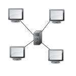
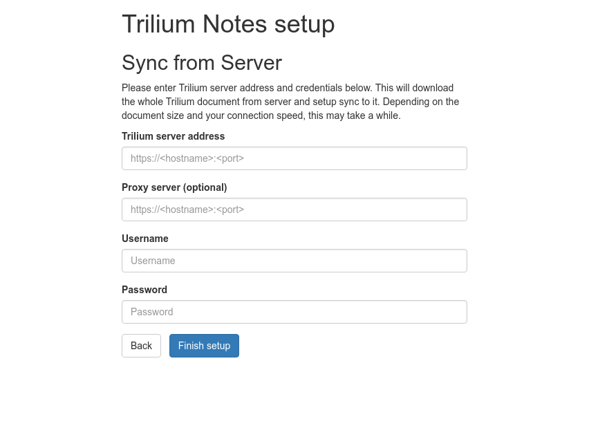
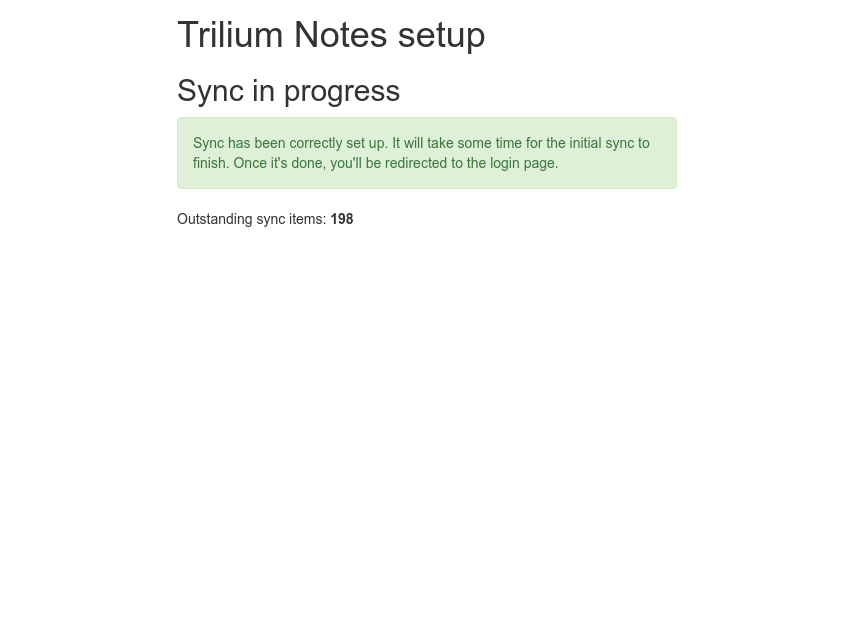

# Синхронизация
Trilium — это приложение для ведения заметок с приоритетом офлайн-работы (offline-first), которое хранит все данные локально в настольном клиенте. Тем не менее оно также позволяет настроить синхронизацию с серверным экземпляром, благодаря чему несколько настольных клиентов могут синхронизироваться с центральным сервером. Это образует топологию «звезда»:



В такой конфигурации центральный сервер (называемый _сервером синхронизации_) и несколько _клиентских_ (или _настольных_) экземпляров синхронизируются с сервером синхронизации. После настройки синхронизация выполняется автоматически и непрерывно, не требуя ручного вмешательства.

## Настройка синхронизации

### Вопросы безопасности

Безопасная настройка сервера крайне важна и может быть сложной. Крайне важно использовать действительный [сертификат TLS](Server%20Installation/HTTPS%20\(TLS\).md) (HTTPS), а не незашифрованное HTTP-соединение, чтобы обеспечить безопасность и избежать потенциальных уязвимостей.

### Синхронизация настольного экземпляра с сервером синхронизации

Этот способ используется, когда у вас уже есть настольный экземпляр Trilium и вы хотите настроить сервер синхронизации на своём веб-хосте.

1.  **Развёртывание сервера**: убедитесь, что ваш серверный экземпляр развёрнут, но ещё не инициализирован.
2.  **Настройка настольного приложения**: откройте настольный экземпляр, перейдите в <a class="reference-link" href="../Basic%20Concepts%20and%20Features/UI%20Elements/Options.md">Настройки</a> → _Синхронизация_ (_Sync_) → _Сервер синхронизации_ (_Sync server_) и укажите адрес вашего сервера в поле _Адрес сервера_ (_Server address_).
    *   Обратите внимание, что адрес сервера синхронизации также можно переопределить через <a class="reference-link" href="../Advanced%20Usage/Configuration%20(config.ini%20or%20environment%20variables).md">конфигурацию (config.ini или переменные окружения)</a> — в этом случае приоритет имеет указанное там значение. Если это так, на это укажет поле _Используемый сервер_ (_Server in use_).
3.  **Проверка синхронизации**: нажмите кнопку _Проверить синхронизацию_ (_Test sync_), чтобы проверить соединение с сервером синхронизации.
    *   В случае успеха клиент начнёт отправку всех данных на серверный экземпляр.
    *   Этот процесс может занять некоторое время, но вы можете продолжать пользоваться Trilium. Периодически проверяйте серверный экземпляр, чтобы убедиться, что синхронизация завершена. После завершения на сервере должен появиться экран входа.

### Синхронизация настольного экземпляра с существующего сервера синхронизации

Этот способ используется, когда у вас уже есть сервер синхронизации и вы хотите настроить новый настольный экземпляр для синхронизации с ним.

1.  **Установка настольного приложения**: следуйте инструкциям на странице [установки настольного приложения](Desktop%20Installation.md).
2.  **Первоначальная настройка**: когда появится запрос, выберите вариант настройки синхронизации с сервером синхронизации.



1.  **Данные сервера**: укажите адрес сервера Trilium и введите пароль сервера. Если на сервере включена <a class="reference-link" href="Server%20Installation/Multi-factor%20authentication%20with%20TOTP.md">многофакторная аутентификация с помощью TOTP</a>, также введите одноразовый пароль из приложения-аутентификатора или код восстановления.
2.  **Завершение настройки**: нажмите кнопку «Finish setup». В случае успеха вы увидите следующий экран:



После завершения синхронизации вы будете автоматически перенаправлены в приложение Trilium.

### Синхронизация между настольными приложениями (Desktop-to-desktop)

Этот способ позволяет двум настольным экземплярам синхронизироваться друг с другом без необходимости <a class="reference-link" href="Server%20Installation.md">установки сервера</a>.

Каждое настольное приложение содержит встроенный сервер. В этой схеме новый настольный экземпляр использует этот сервер в качестве сервера синхронизации для существующего, поэтому он должен быть запущен и доступен по сети всякий раз, когда выполняется синхронизация. Оба устройства должны находиться в одной сети.

1.  **Новый настольный экземпляр**: при первом запуске на экране настройки выберите _Connect a desktop app_. На странице отобразятся _Addresses for this device_, и приложение начнёт ожидать подключения.
2.  **Доступ по сети**: если на странице указано, что устройство недоступно для других устройств, выберите _Allow network access & restart_. Trilium перезапустится, после чего снова выберите _Connect a desktop app_.
3.  **Существующий настольный экземпляр**: откройте <a class="reference-link" href="../Basic%20Concepts%20and%20Features/UI%20Elements/Options.md">Настройки</a> → _Синхронизация_ (_Sync_), укажите в поле _Адрес сервера_ (_Server address_) один из адресов, показанных на новом настольном экземпляре (например, `http://192.168.0.10:37840`), и нажмите _Test now_.
4.  **Начальная синхронизация**: новый настольный экземпляр отобразит ход синхронизации и откроет базу знаний после её завершения. После этого существующий экземпляр продолжит синхронизироваться с новым.

> [!WARNING]
> Начиная с версии v0.104.0 для работы этой синхронизации необходимо включить доступ по локальной сети (LAN). Подробнее см. в разделе <a class="reference-link" href="Desktop%20Installation/Network%20Access.md">Сетевой доступ</a>.

## Настройка прокси

Поддерживаются два варианта настройки прокси:

*   **Явная настройка прокси**: укажите прокси-сервер в разделе Настройки / Синхронизация. Поддерживаются только прокси-серверы без аутентификации.
*   **Системные настройки прокси**: если прокси-сервер не задан явно, Trilium будет использовать системные настройки прокси.

## Устранение неполадок

### Синхронизация даты и времени

Для успешной синхронизации на клиенте и сервере должны быть установлены одинаковые дата и время с допустимым расхождением до пяти минут.

### Проблемы с сертификатами

При использовании TLS Trilium проверяет сертификат сервера. Если проверка не проходит (например, из-за самоподписанных сертификатов или некоторых корпоративных прокси), вы можете запустить клиент Trilium с переменной окружения `NODE_TLS_REJECT_UNAUTHORIZED`, установленной в `0`:

```
export NODE_TLS_REJECT_UNAUTHORIZED=0
```

Это отключит проверку сертификатов TLS, что значительно снизит безопасность и сделает соединение уязвимым для атак MITM. Настоятельно рекомендуется использовать действительный подписанный сертификат сервера. Более новые версии Trilium включают скрипт `trilium-no-cert-check.sh` для этой цели.

### Разрешение конфликтов

Если вы отредактировали одну и ту же заметку на нескольких экземплярах до синхронизации, Trilium разрешает конфликты, сохраняя более новое изменение и отбрасывая более старое. Старая версия остаётся доступной в [истории версий заметки](../Basic%20Concepts%20and%20Features/Notes/Note%20Revisions.md), что позволяет при необходимости восстановить данные.

### Проверка контрольных сумм (Hash Check)

После каждой синхронизации Trilium вычисляет хеш всех синхронизированных данных как на клиенте, так и на сервере синхронизации. При обнаружении расхождения Trilium автоматически запускает механизм восстановления для устранения проблемы.