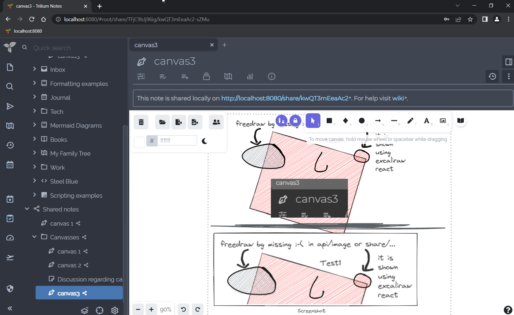

# Холст
<figure class="image"></figure>

Заметки-холсты используют библиотеку Excalidraw, позволяющую вести рукописные заметки мышью, пером или касанием на бесконечном холсте. Также поддерживается базовое диаграммирование, ввод текста и графики.

## Взаимодействие

*   Заметку можно переключить [только для чтения](../Basic%20Concepts%20and%20Features/Notes/Read-Only%20Notes.md) из <a class="reference-link" href="../Basic%20Concepts%20and%20Features/UI%20Elements/Note%20menu.md">Меню заметки</a>.

## Толщина пера

Перо рисует с половиной _толщины штриха_, выбранной в панели свойств, что подходит для рукописного ввода. Чтобы рисовать с полной толщиной, выключите _Тонкий штрих пера_ в <a class="reference-link" href="../Basic%20Concepts%20and%20Features/UI%20Elements/Options.md">Настройках</a> → _Прочее_. Уже нарисованные штрихи сохраняют свою толщину.

## Встраивание заметок

Начиная с v0.104.0, Холст поддерживает встраивание заметок аналогично функциональности <a class="reference-link" href="Text/Include%20Note.md">Включения заметки</a> для заметок <a class="reference-link" href="Text.md">Текст</a>.

Чтобы встроить заметку:

*   Из <a class="reference-link" href="../Basic%20Concepts%20and%20Features/UI%20Elements/Note%20Tree.md">Дерева заметок</a> перетащите элемент на холст.
*   Вручную, выбрав _Ещё инструменты_ → _Веб-встраивание_ и вставив ссылку на заметку (например, `root/MujWAc9fQ1nj`).

Встраивание заметок в холст следует тем же правилам, что и <a class="reference-link" href="Text/Include%20Note.md">Включение заметки</a>: некоторые заметки отображаются как изображения (например, <a class="reference-link" href="Mind%20Map.md">Mind Map</a>), а некоторые отображаются полностью интерактивно, такие как <a class="reference-link" href="../Collections.md">Коллекции</a>.

## Ссылка на заметку

1.  Из <a class="reference-link" href="../Basic%20Concepts%20and%20Features/UI%20Elements/Note%20Tree.md">Дерева заметок</a> щёлкните правой кнопкой по заметке, на которую нужно сослаться, и выберите _Дополнительно → Копировать путь заметки в буфер обмена_.
2.  В заметке-холсте щёлкните правой кнопкой по элементу и выберите _Добавить ссылку_ (или нажмите <kbd>Ctrl</kbd>+<kbd>K</kbd>). Вставьте ссылку и нажмите <kbd>Enter</kbd>.
3.  Значок  появится в правом верхнем углу элемента и при щелчке перейдёт к связанной заметке.

## Рисование в текстовой заметке

Чтобы рисовать внутри заметки <a class="reference-link" href="Text.md">Текст</a> вместо отдельной заметки, вставьте холст для рисования через _Холст для рисования_ в меню _Вставка_. См. _Холсты для рисования_ в <a class="reference-link" href="Text/Include%20Note.md">Включении заметки</a>.
