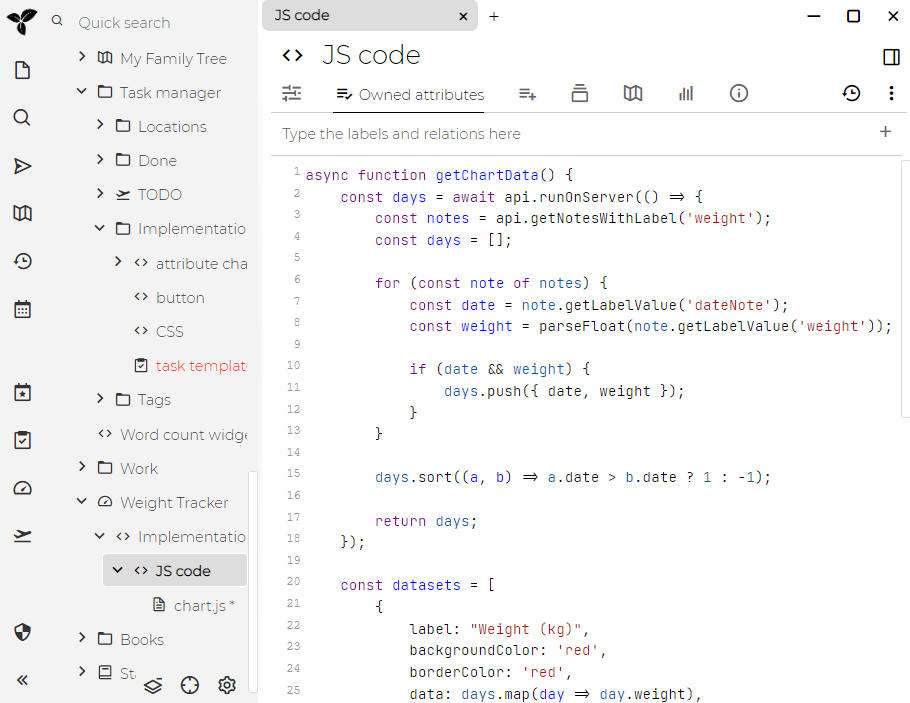

# Код
Trilium поддерживает создание заметок «код», то есть заметок, содержащих какой-либо формальный код — будь то язык программирования (C++, JavaScript), структурированные данные (JSON, XML) или другие виды кода (CSS и т.д.).

Это может быть полезно для нескольких вещей:

*   программисты могут хранить фрагменты кода как заметки с подсветкой синтаксиса
*   заметки с JavaScript-кодом можно выполнять внутри Trilium для дополнительной функциональности
    *   такие заметки с JavaScript-кодом мы называем «скриптами» — см. <a class="reference-link" href="../Scripting.md">Скриптинг</a>
*   JSON, XML и т.д. можно использовать для хранения структурированных данных (как правило, в сочетании со скриптингом)

Для более коротких фрагментов кода, которые можно встроить в заметки [Текст](Text.md), см. [Блоки кода](Text/Developer-specific%20formatting/Code%20blocks.md).

## Создание кодовой заметки

В [Дереве заметок](../Basic%20Concepts%20and%20Features/UI%20Elements/Note%20Tree.md) щёлкните правой кнопкой по заметке и выберите _Вставить дочернюю заметку_ или _Вставить заметку после_, затем:

*   Чтобы создать кодовую заметку с простым текстом, выберите _Код_.
*   Чтобы создать кодовую заметку на заданном языке, наведите на _Код_ и выберите язык. Список показывает языки, включённые в настройках (см. ниже), и заканчивается пунктом _Настроить заметки с кодом..._, который открывает их.

## Изменение языка кодовой заметки

Чтобы изменить язык кодовой заметки, найдите значок  в <a class="reference-link" href="../Basic%20Concepts%20and%20Features/UI%20Elements/Status%20bar.md">Строке состояния</a>. При щелчке он раскроет список доступных языков (который можно настроить согласно разделу ниже). Меню также содержит строку поиска для быстрой фильтрации и значки для визуального различения некоторых языков программирования.

В <a class="reference-link" href="../Installation%20%26%20Setup/Mobile%20Frontend.md">Мобильном интерфейсе</a> тот же список доступен в <a class="reference-link" href="../Basic%20Concepts%20and%20Features/UI%20Elements/Note%20menu.md">Меню заметки</a> → _Настройки заметки_ → _Изменить языковой режим_.

## Настройка списка языков

Trilium поддерживает подсветку синтаксиса для многих языков, но по умолчанию показывает только некоторые из них. Чтобы изменить, какие языки предлагаются, перейдите в <a class="reference-link" href="../Basic%20Concepts%20and%20Features/UI%20Elements/Options.md">Настройки</a> → _Заметки с кодом_ и найдите _Доступные MIME-типы в выпадающем списке_. Здесь вы можете:

*   Добавить язык, нажав кнопку  _Добавить ещё один язык_, которая также показывает, сколько языков осталось, а затем выбрав его. При выборе наведите курсор на язык, чтобы увидеть, где он подсвечивается синтаксически.
*   Нажать кнопку  рядом с языком или выбрать его и нажать <kbd>Delete</kbd>, чтобы убрать его из списка. _Простой текст_ удалить нельзя.
*   Увидеть, где каждый язык подсвечивается синтаксически: значок _Блоки кода_ означает блоки кода в текстовых заметках, значок _Заметки с кодом_ — кодовые заметки.

Языки перечислены в одном порядке везде, где выбирается один: в меню языка в <a class="reference-link" href="../Basic%20Concepts%20and%20Features/UI%20Elements/Status%20bar.md">Строке состояния</a>, в подменю _Код_ при создании заметки и в языке блока кода. По умолчанию список отсортирован по алфавиту, с _Простым текстом_ первым. Чтобы использовать собственный порядок:

1.  Выключите переключатель _Сортировать по алфавиту_ вверху раздела.
2.  Удерживайте ручку **\=**, показанную рядом с языком, а затем перетащите его вверх или вниз. Альтернативно выберите язык и нажмите <kbd>Ctrl</kbd>+<kbd>↑</kbd> или <kbd>Ctrl</kbd>+<kbd>↓</kbd>.

Повторное включение _Сортировать по алфавиту_ не отбрасывает ваш порядок: он используется снова при следующем выключении переключателя.

Обратите внимание, что список языков не обновляется немедленно — нужно вручную [обновить приложение](../Troubleshooting/Refreshing%20the%20application.md).

Список языков также разделяется с возможностью [Блоки кода](Text/Developer-specific%20formatting/Code%20blocks.md) заметок [Текст](Text.md).

## Перенос строк

Длинные строки можно отображать на нескольких строках:

*   Глобально для всех кодовых заметок в <a class="reference-link" href="../Basic%20Concepts%20and%20Features/UI%20Elements/Options.md">Настройках</a> → _Заметки с кодом_.
*   Для конкретной заметки, перейдя в меню в <a class="reference-link" href="../Basic%20Concepts%20and%20Features/UI%20Elements/Note%20menu.md">Меню заметки</a> и выбрав _Перенос строк_ и выбрав соответствующую опцию:
    *   _Авто_, чтобы уважать глобальный перенос строк для кодовых заметок.
    *   _Вкл_ или _Выкл_, чтобы изменить состояние переноса строк для этой заметки независимо от глобальной опции.

> [!NOTE]
> Перенос строк также можно настроить на уровне заметки через [метку](../Advanced%20Usage/Attributes/Labels.md) `#wrapLines`, которая также может наследоваться.

## Номера строк

Числа в начале каждой строки можно скрыть в <a class="reference-link" href="../Basic%20Concepts%20and%20Features/UI%20Elements/Options.md">Настройках</a> → _Заметки с кодом_ → _Редактор_ → _Номера строк_. Настройка применяется к каждому редактору кода, такому как исходник заметки [Markdown](Markdown.md), и к коду, показанному без его редактора (см. _Цветовые схемы_ ниже).

Включённая кодовая заметка или встроенный кодовый файл могут показывать или скрывать их самостоятельно через подменю _Номера строк_ своего меню _Дополнительные действия_, см. <a class="reference-link" href="Text/Include%20Note.md">Включение заметки</a>. Его запись _Авто_ следует настройке.

## Настройка опций через строку состояния

Строка состояния внизу редактора показывает позицию курсора, текущие настройки отступов и язык.

Позиция курсора показана как _Ln_ (строка) и _Col_ (столбец), обе считаются от 1. Табуляция считается за столько столбцов, сколь отображаемая ширина табуляции, поэтому столбец соответствует тому, где курсор появляется на экране. Пока выделен текст, _Выделено_ показывает число выделенных символов, считая каждый разрыв строки за один.

Щелчок по индикатору отступов открывает меню из трёх разделов:

1.  _Отступать с помощью_ — переключение между пробелами и табуляцией (`#indentWithTabs`). Если активно переопределение для конкретной заметки, появляется опция «Сбросить к значению по умолчанию».
2.  _Отображаемая ширина_ — выбор из предустановленных ширин (1, 2, 3, 4, 6, 8). Изменения сохраняются как метка `#tabWidth` для конкретной заметки.
3.  _Переотступить содержимое в_ — преобразование существующих отступов в другой стиль. Например, переотступить файл с 4 пробелов на 2 пробела или с пробелов на табуляцию. Это перезаписывает начальные пробелы на каждой строке, сохраняя остатки выравнивания.

Щелчок по индикатору языка позволяет изменить MIME-тип заметки. Как и в выборе _Типа заметки_, ввод текста сужает список языков.

Те же два меню находятся на панели инструментов кодовой заметки или кодового файла, включённого в текстовую заметку, см. <a class="reference-link" href="Text/Include%20Note.md">Включение заметки</a>.

### Переотступка

Когда вы переотступаете содержимое, редактор:

*   Измеряет визуальную ширину столбца начальных пробелов каждой строки, используя текущий стиль
*   Вычисляет уровни отступов и любой остаток выравнивания
*   Перестраивает начальные пробелы в целевом стиле
*   Сохраняет не-начальные пробелы, пустые строки и содержимое без отступов

## Преобразование текста

Чтобы изменить выделенные строки или текст, щёлкните по выделению правой кнопкой и откройте _Преобразовать_. Его команды идут в трёх группах:

*   _Сортировать по возрастанию_, _Сортировать по убыванию_, _Перемешать строки_, _Обратить порядок строк_ и _Убрать дубликаты строк_, которая сохраняет первую копию каждой строки.
*   _Убрать в начале_, _Убрать в конце_ и _Убрать с обеих сторон_ удаляют пробелы в начале, в конце или с обеих сторон каждой строки. _Убрать пустые строки_ также удаляет строки, содержащие только пробелы.
*   _В верхний регистр_, _В нижний регистр_, _Как в предложении_, _Как в заголовке_ и _Убрать диакритику_.

Команды первых двух групп изменяют каждую строку, которую выделение затрагивает, даже частично. Команды третьей группы изменяют только выделенный текст. Каждое изменение отменяется за один шаг через <kbd>Ctrl</kbd>+<kbd>Z</kbd>.

*   Сортировка читает числа, даты и времена по их значению, как сортировка таблицы (см. <a class="reference-link" href="Text/Tables.md">Таблицы</a>), и игнорирует регистр букв и отступы. Пустые строки идут последними.
*   _Как в предложении_ переводит текст в нижний регистр и делает заглавной первое слово каждого предложения и каждой строки. _Как в заголовке_ делает заглавной каждое слово, кромке малозначительных слов, таких как «of» и «the», которые остаются в нижнем регистре, если только не начинают или не заканчивают предложение.
*   _Убрать диакритику_ превращает буквы, такие как `é`, `ș` и `ł`, в `e`, `s` и `l`, и убирает огласовки иврита и арабского. Буквы, такие как `ß` и `æ`, остаются как есть.
*   Сортировка и изменения регистра следуют языку, заданному в <a class="reference-link" href="../Basic%20Concepts%20and%20Features/UI%20Elements/Options.md">Настройках</a> → _Язык и регион_ → _Язык содержимого по умолчанию_. В турецком, например, заглавная `i` — это `İ`.

## Привязки клавиш Vim

Кодовые заметки можно редактировать с привязками клавиш в стиле Vim, имитирующими клавиши текстового редактора [Vim](https://www.vim.org/). Чтобы включить их, перейдите в <a class="reference-link" href="../Basic%20Concepts%20and%20Features/UI%20Elements/Options.md">Настройки</a> → _Заметки с кодом_ → _Редактор_ и включите _Привязки клавиш Vim_. Опция применяется только к текущему устройству.

*   Если вы новичок в Vim, начните с <a class="reference-link" href="Text/Vim%20mode/Vim%20beginner%20guide.md">Руководства для начинающих Vim</a>.
*   По клавишам и командам см. <a class="reference-link" href="Text/Vim%20mode/Vim%20full%20reference.md">Полный справочник Vim</a>. Его строки, помеченные **Только текстовые заметки**, не применяются к кодовым заметкам.

Текстовые заметки имеют собственный режим Vim с собственной опцией и настройками: см. <a class="reference-link" href="Text/Vim%20mode.md">Режим Vim</a>.

## Цветовые схемы

Начиная с Trilium 0.94.0 цвета кодовых заметок можно настраивать, перейдя в <a class="reference-link" href="../Basic%20Concepts%20and%20Features/UI%20Elements/Options.md">Настройки</a> → Заметки с кодом и найдя раздел _Внешний вид_.

Кодовая заметка или кодовый файл, показанные без своего редактора, например во <a class="reference-link" href="Text/Include%20Note.md">Включении заметки</a>, на карточках <a class="reference-link" href="../Collections.md">Коллекций</a> или в подсказке, используют те же цвета и номера строк, что и редактор. Распечатка использует _Светлую тему_. [Опубликованная страница](../Advanced%20Usage/Sharing.md) использует светлую или тёмную тему VS Code, следующую режиму страницы.

> [!NOTE]
> **Почему здесь всего несколько тем, тогда как для тем блоков кода текстовых заметок их много?**
> Причина в том, что заметки с кодом используют другую технологию, чем используемая в текстовых заметках, и поэтому выбор тем более ограничен. Если вы найдёте тему CodeMirror 6 (не 5), которую хотели бы использовать, сообщите нам, и мы можем рассмотреть её добавление в набор тем по умолчанию. Возможности добавлять новые темы нет (по крайней мере, пока), так как темы определены в JavaScript, а не на уровне CSS.

## Лигатуры программирования

Если вы видите `!=`, отображаемое как `≠`, или `->` как `→` внутри кодовой заметки, это _лигатуры шрифта_: шрифт моноширинный по умолчанию рисует определённые пары символов как единый символ. Сам текст не изменяется Trilium (в отличие от текстовых заметок, имеющих <a class="reference-link" href="Text/Automatic%20replacements.md">Автоматические замены</a>), и при копировании вы получаете обратно `!=` и `->`.

Это можно отключить в <a class="reference-link" href="../Basic%20Concepts%20and%20Features/UI%20Elements/Options.md">Настройках</a> → Внешний вид → Шрифты → Лигатуры программирования.

## Поведение виртуальной клавиатуры

При использовании виртуальной клавиатуры предложения и исправления клавиатуры управляются следующим образом:

*   Для заметок [Markdown](Markdown.md) и кодовых заметок с простым текстом автокоррекция **включена**, как и автоматическая капитализация.
*   Для всех остальных кодовых заметок автокоррекция выключена, чтобы избежать проблем при наборе кода.

> [!NOTE]
> Не все браузеры и платформы уважают это значение, поэтому предложения клавиатуры могут появляться без автокоррекции, или браузер может проигнорировать это и всё равно скорректировать текст.
