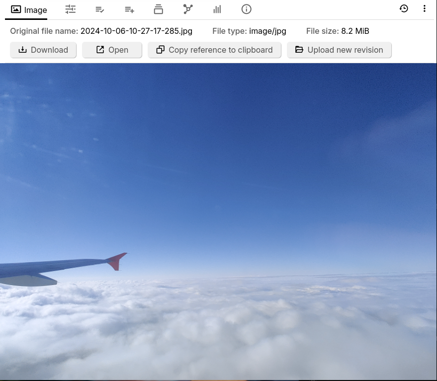
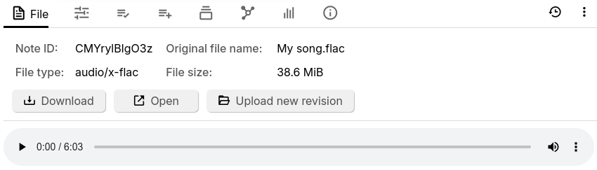
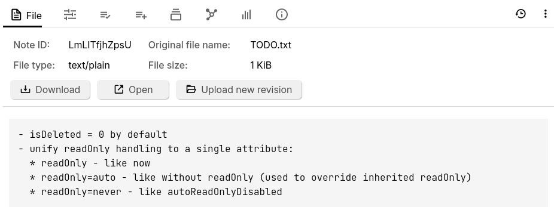
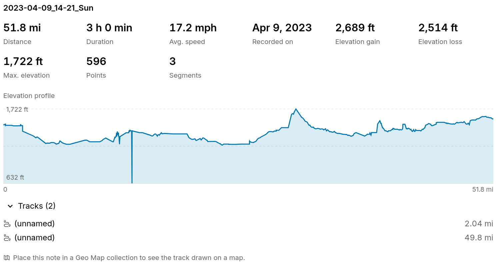
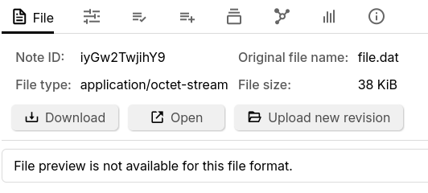
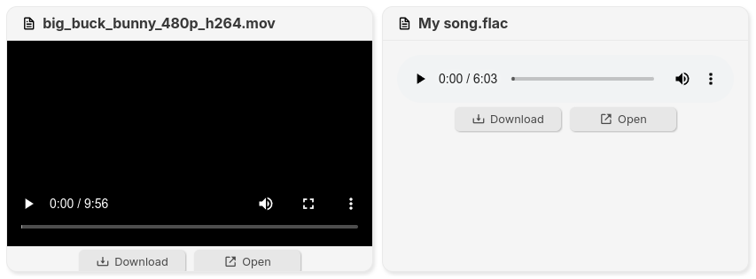

# Файл
Тип заметки _Файл_ можно использовать для прикрепления различных внешних файлов, таких как изображения, видео или PDF-документы.

## Загрузка файла

Поскольку эти файлы поступают из внешнего источника, создать тип заметки _Файл_ напрямую невозможно:

*   Перетащите файл в <a class="reference-link" href="../Basic%20Concepts%20and%20Features/UI%20Elements/Note%20Tree.md">Дерево заметок</a>.
*   Щёлкните правой кнопкой по заметке и выберите _Импортировать в заметку_, указав один из поддерживаемых файлов.

## Поддерживаемые типы файлов

### PDF

PDF можно загружать в Trilium, и они будут отображать живой предпросмотр с полной поддержкой различных возможностей, таких как оглавление, аннотации, а также запоминание последней прочитанной страницы. Подробнее см. выделенную страницу <a class="reference-link" href="File/PDFs.md">PDF</a>.

## Документы Office

Trilium предлагает предпросмотры для документов Office, таких как Word (`.docx`), Excel (`.xlsx`) и PowerPoint (`.pptx`). Подробнее см. выделенный раздел <a class="reference-link" href="File/Office%20documents.md">Документы Office</a>.

### Изображения

<figure class="image image-style-align-center image_resized" style="width:50%;"></figure>

Взаимодействие:

*   [Ссылку на изображение](Text/Images/Image%20references.md) можно скопировать, нажав значок  из области <a class="reference-link" href="../Basic%20Concepts%20and%20Features/UI%20Elements/Note%20buttons.md">Кнопок заметки</a>, что позволяет вставить её в заметку <a class="reference-link" href="Text.md">Текст</a>.

### Видео

См. <a class="reference-link" href="File/Audio%20%26%20Video.md">Аудио и видео</a>.

### Аудио

<figure class="image image-style-align-center image_resized" style="width:50%;"></figure>

Добавление поддерживаемого аудиофайла раскроет базовый аудиоплеер, который можно использовать для его воспроизведения.

Взаимодействия:

*   Аудио можно воспроизвести/приостановить с помощью выделенной кнопки.
*   Перетаскивание мыши по полосе прогресса или щелчок по ней будет перематывать по песне.
*   Можно установить громкость.
*   Скорость воспроизведения можно настроить через контекстное меню рядом с громкостью.

### Текстовые файлы

<figure class="image image-style-align-center image_resized" style="width:50%;"></figure>

Файлы, опознанные как содержащие текст, будут показывать предпросмотр их содержимого. Один частый сценарий использования этого типа файла — встраивание текстовых файлов, содержимое которых не обязательно представляет интерес для пользователя, таких как сторонние библиотеки или сгенерированное содержимое, которые затем можно скачать при необходимости.

Обратите внимание, что, как правило, текстовые файлы будут [импортированы](../Basic%20Concepts%20and%20Features/Import%20%26%20Export.md) как заметки <a class="reference-link" href="Text.md">Текст</a> или <a class="reference-link" href="Code.md">Код</a>. Чтобы обойти это поведение и создать тип заметки _Файл_, используйте функцию _Импортировать в заметку_ и снимите отметки _Импортировать HTML, Markdown и TXT как текстовые заметки_, а также _Импортировать распознанные кодовые файлы как кодовые заметки_.

Поскольку один из сценариев использования файлов вместо заметок — отображение больших файлов, предпросмотр содержимого ограничен относительно небольшим количеством символов. Чтобы просмотреть весь файл, рассмотрите открытие его во внешнем приложении.

### GPS-треки

Trilium отображает информацию о GPS-треках в формате `.gpx`, такую как расстояние, продолжительность, профиль высот, треки, метки.

Когда заметка `.gpx` сброшена на <a class="reference-link" href="../Collections/Geo%20Map.md">Геокарту</a>, сам трек также будет отображён на карте.

<figure class="image"></figure>

### Шрифты

Поддерживаемые форматы шрифтов будут показывать интерактивный предпросмотр шрифта:

*   Поле для ввода пользовательского текста.
*   Ползунок для изменения размера шрифта предпросмотра.
*   Предпросмотр текста в заданном размере.
*   Выборка различных размеров шрифта для этого шрифта.
*   Латинский алфавит.

Кроме того, включение _В выборе шрифта_ сделает шрифт доступным в выборе шрифта <a class="reference-link" href="../Basic%20Concepts%20and%20Features/UI%20Elements/Options.md">Настройки</a> → _Внешний вид_. Подробнее см. <a class="reference-link" href="../Basic%20Concepts%20and%20Features/Themes/Personalizing%20the%20font.md">Персонализация шрифта</a>.

### Неизвестные типы файлов

<figure class="image image-style-align-center image_resized" style="width:50%;"></figure>

Если файл не удалось опознать как ни один из поддерживаемых типов файлов выше, он будет обработан как неизвестный файл. В этом случае будут доступны все взаимодействия по умолчанию, такие как скачивание или открытие файла внешне, но предпросмотра содержимого не будет.

## Взаимодействие

*   Независимо от типа файла, в области <a class="reference-link" href="../Basic%20Concepts%20and%20Features/UI%20Elements/Note%20menu.md">Меню заметки</a> будет отображён ряд кнопок.
    *    (Скачать), которая скачает файл для локального использования.
    *    (Открыть), которая откроет файл в приложении по умолчанию системы.
    *    (Загрузить новую ревизию), чтобы заменить файл новым.
*   Изменить тип заметки _Файл_ **невозможно**.
*   Преобразуйте во [вложение](../Basic%20Concepts%20and%20Features/Notes/Attachments.md) из [меню заметки](../Basic%20Concepts%20and%20Features/UI%20Elements/Note%20menu.md).

## Связь с другими заметками

*   Файлы также отображаются в <a class="reference-link" href="../Basic%20Concepts%20and%20Features/Notes/Note%20List.md">Списке заметок</a> в зависимости от их типа:

    
*   Не-изображения можно встраивать в текстовые заметки как виджеты только для чтения через функциональность <a class="reference-link" href="Text/Include%20Note.md">Включение заметки</a>.
*   Файлы-изображения можно встраивать в текстовые заметки как обычные изображения через <a class="reference-link" href="Text/Images/Image%20references.md">Ссылки на изображения</a>.

## Лимит размера файла

Отдельный файл не может быть больше 374 МиБ. Подробнее см. _Максимальный размер импорта_ в <a class="reference-link" href="../Basic%20Concepts%20and%20Features/Import%20%26%20Export.md">Импорт и экспорт</a>.
