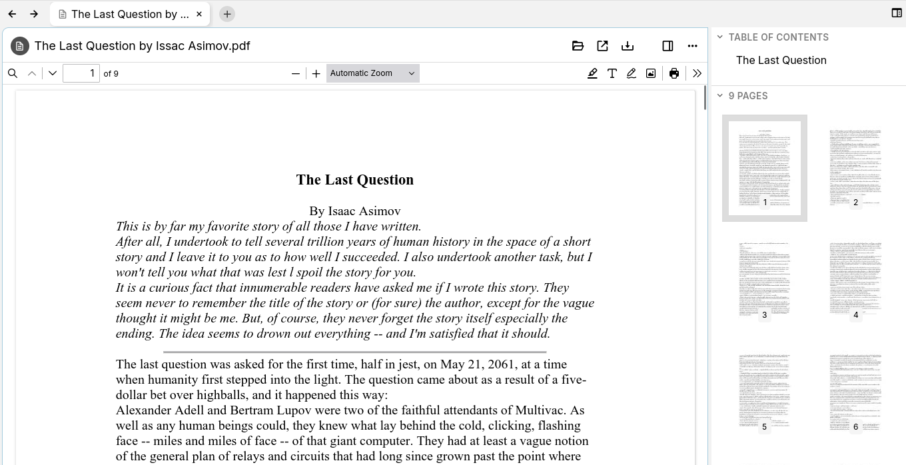

# PDF-файлы
<figure class="image image_resized" style="width:74.34%;"></figure>

PDF-файлы можно загружать в Trilium, где они будут отображаться без необходимости предварительно их скачивать.

Начиная с версии v0.102.0 PDF-файлы отображаются с помощью встроенного в Trilium просмотрщика PDF, представляющего собой адаптированную версию [просмотрщика PDF.js от Mozilla](https://mozilla.github.io/pdf.js/) (также встроенного в браузер Mozilla Firefox). В более ранних версиях PDF отображаются с помощью стандартного просмотрщика браузера.

## Возможности

*   Последняя просмотренная страница и позиция прокрутки сохраняются между перезапусками и переключениями заметок.
*   Аннотации (текст, выделение) и комментарии. Они сохраняются автоматически.
*   Возможность заполнения форм.
*   Возможность печати или скачивания.
*   Можно сохранить как [шаблон](../../Advanced%20Usage/Templates.md), и содержимое PDF будет скопировано в новую заметку. Это особенно полезно в сочетании с аннотациями или заполненными формами.
*   Интеграция с <a class="reference-link" href="../../Basic%20Concepts%20and%20Features/UI%20Elements/Right%20Sidebar.md">правой боковой панелью</a>: отображение списка страниц с миниатюрами, оглавления и списка аннотаций.
*   Базовая поддержка подписей (рукописных, а не полноценных цифровых подписей), аналогично аннотациям. Подписи сохраняются и могут повторно использоваться в нескольких документах (до 5 штук).

## Сохранение последней позиции и настроек

Для каждого PDF Trilium запоминает следующую информацию:

*   Текущую страницу.
*   Позицию прокрутки на текущей странице.
*   Поворот страницы.

Это удобно при чтении больших документов, поскольку позиция запоминается автоматически. Сохранение происходит в фоновом режиме через несколько секунд после прекращения прокрутки.

> [!TIP]
> Технически информация о позиции прокрутки и повороте хранится в разделе <a class="reference-link" href="../../Basic%20Concepts%20and%20Features/Notes/Attachments.md">вложений</a>, в специальном вложении `pdfHistory.json`.

## Аннотации

Начиная с версии v0.102.0 можно добавлять аннотации к PDF. Для этого воспользуйтесь кнопками аннотаций в правой части панели инструментов PDF ().

Начиная с версии v0.103.0:

*   Аннотации отключены, если заметка помечена как <a class="reference-link" href="../../Basic%20Concepts%20and%20Features/Notes/Read-Only%20Notes.md">заметка только для чтения</a>.
*   Также можно добавлять комментарии — они похожи на выделение, но позволяют прикрепить текст.
*   <a class="reference-link" href="../../Basic%20Concepts%20and%20Features/UI%20Elements/Right%20Sidebar.md">Правая боковая панель</a> также отображает список аннотаций (выделений, комментариев).

### Поддерживаемые виды аннотаций

Поддерживаются следующие способы аннотирования:

*   **Выделение (Highlight)**  
    Позволяет выделять текст одним из предустановленных цветов.
    *   Также настраивается толщина.
    *   Можно выделять и пустое пространство, используя инструмент как толстый маркер.
*   **Текст (Text)**  
    Позволяет добавлять произвольный текст с настраиваемым цветом и размером.
*   **Перо (Pen)**  
    Позволяет свободно рисовать на документе с настраиваемым цветом, толщиной и прозрачностью.
*   **Изображение (Image)**  
    Позволяет вставлять изображения извне Trilium прямо в документ.

### Редактирование существующих аннотаций

Хотя аннотации хранятся внутри самого PDF, их можно редактировать. Чтобы отредактировать аннотацию, нажмите одну из кнопок аннотаций из предыдущего раздела для входа в режим редактирования и кликните по существующей аннотации. Появится панель инструментов с параметрами настройки аннотации (например, смены цвета), а также возможностью удалить её.

### Как хранятся аннотации

Аннотации сохраняются непосредственно в сам PDF-файл. При внесении изменений Trilium заменяет PDF на обновлённый.

Поскольку изменения сохраняются автоматически, вручную сохранять документ после работы с аннотациями не нужно.

Преимущество «вшитых аннотаций» в том, что они остаются доступными при скачивании (для использования вне Trilium) или при публикации заметки.

Недостаток заключается в том, что весь PDF приходится заново отправлять на сервер, что может снижать производительность на больших документах. Если вы столкнётесь с проблемами в работе этой системы, пожалуйста, [сообщите об этом](../../Troubleshooting/Reporting%20issues.md).

## Ссылки на страницу или аннотацию

Ссылка может открывать PDF на конкретной странице или на одной из его аннотаций. Чтобы создать такую ссылку:

*   Для ссылки на страницу нажмите правой кнопкой мыши по странице в разделе _Pages_ <a class="reference-link" href="../../Basic%20Concepts%20and%20Features/UI%20Elements/Right%20Sidebar.md">правой боковой панели</a> и выберите _Copy reference_.
*   Для ссылки на аннотацию нажмите правой кнопкой мыши по ней в разделе _Annotations_ боковой панели и выберите _Copy reference_.

Вставленная в текстовую заметку ссылка превращается во <a class="reference-link" href="../Text/Links/Internal%20(reference)%20links.md">внутреннюю ссылку</a>, отображающую название PDF, за которым следует страница (_Page 5_) или _Annotation on page 5_ для ссылки на аннотацию. Нажатие по ней открывает PDF и прокручивает его к нужной странице или аннотации.

Ссылка на аннотацию также хранит номер её страницы, поэтому ссылка на удалённую аннотацию всё равно откроет правильную страницу.

> [!NOTE]
> Аннотация, созданная после открытия PDF, не имеет постоянного идентификатора до повторного открытия PDF, поэтому скопированная для неё ссылка указывает только на её страницу.

## Заполнение форм

Как и аннотации, формы поддерживаются в Trilium начиная с версии v0.102.0. Если в документе есть поля для заполнения, они подсвечиваются цветным фоном.

Просто введите текст в поля формы, и он будет сохранён автоматически.

## Навигация по боковой панели

См. специальный раздел о PDF на странице <a class="reference-link" href="../../Basic%20Concepts%20and%20Features/UI%20Elements/Right%20Sidebar/Outline%20tab.md">Вкладка «Структура» (Outline)</a>.

## Функция публикации

PDF-файлами также можно делиться с помощью функции <a class="reference-link" href="../../Advanced%20Usage/Sharing.md">публикации</a>. При этом также используется встроенный просмотрщик PDF Trilium.

Если вы используете обратный прокси на сервере со строгими ограничениями доступа для функции публикации, убедитесь, что каталог `[host].com/pdfjs` доступен. Обратите внимание, что этот каталог находится вне маршрута `/share`, так как он является общим для всего приложения.

## OCR

PDF-файлы поддерживают <a class="reference-link" href="../../Advanced%20Usage/Text%20Extraction%20(OCR).md">извлечение текста (OCR)</a>, что позволяет находить их содержимое через <a class="reference-link" href="../../Basic%20Concepts%20and%20Features/Navigation/Search.md">поиск</a>.