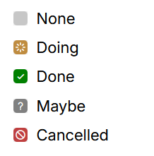

# Markdown
Trilium всегда поддерживал Markdown через свою [функцию импорта](../Basic%20Concepts%20and%20Features/Import%20%26%20Export/Markdown.md), однако файл либо преобразовывался в заметку <a class="reference-link" href="Text.md">Текст</a> (конвертировался во внутренний HTML-формат Trilium), либо сохранялся как заметка <a class="reference-link" href="Code.md">Код</a> только с подсветкой синтаксиса.

Этот тип заметки имеет разделённый вид, то есть исходный код и предпросмотр документа отображаются бок о бок. Подробнее см. <a class="reference-link" href="../Basic%20Concepts%20and%20Features/UI%20Elements/Note%20types%20with%20split%20view.md">Типы заметок с разделённым видом</a>.

## Обоснование

Цель этого типа заметки — заполнить пробел: рендерить Markdown, не изменяя его структуру или пробелы, которые неизбежно изменились бы иначе через импорт/экспорт.

Хотя Markdown теперь специально обрабатывается наличием механизма предпросмотра, Trilium в своей основе остаётся WYSIWYG-редактором, поэтому Markdown не заменит текстовые заметки.

> [!NOTE]
> Запросы возможностей, касающиеся реализации Markdown, будут рассматриваться, но если они выходят за рамки Trilium, они не будут реализованы. Один из ключевых аспектов интеграции Markdown — повторное использование компонентов, уже доступных через другие возможности приложения.

## Возможности

### Панель вида исходника

*   Подсветка синтаксиса для синтаксиса Markdown.
*   Вложенная подсветка синтаксиса для кода внутри блоков кода, включая <a class="reference-link" href="Mermaid%20Diagrams.md">Диаграммы Mermaid</a> в блоках ` ```mermaid `.
*   При редактировании больших документов предпросмотр прокручивается вместе с редактором исходника.

### Панель предпросмотра

Следующие возможности поддерживаются форматом Markdown Trilium и будут видны в панели предпросмотра:

*   Весь стандартный и синтаксис GitHub (базовое форматирование, таблицы, цитаты).
*   Базовый HTML также поддерживается (например, сворачиваемые блоки с помощью `<details>` и `<summary>`).
*   Блоки кода с подсветкой синтаксиса.
    *   Язык должен быть указан, чтобы применилась подсветка синтаксиса (например, ` ```js `).
    *   Блоки кода будут уважать перенос строк из раздела <a class="reference-link" href="Text.md">Текст</a> в <a class="reference-link" href="../Basic%20Concepts%20and%20Features/UI%20Elements/Options.md">Настройках</a>.
*   <a class="reference-link" href="Text/Block%20quotes%20%26%20admonitions.md">Цитаты и замечания</a>
*   <a class="reference-link" href="Text/Math%20Equations.md">Математические формулы</a> (как встроенные, так и блочные)
*   <a class="reference-link" href="Mermaid%20Diagrams.md">Диаграммы Mermaid</a> с помощью ` ```mermaid `
*   <a class="reference-link" href="Text/Include%20Note.md">Включение заметки</a> (встроенного синтаксиса Markdown нет, но HTML-синтаксис прекрасно работает):

    ```html
    <figure class="include-note" data-note-id="vJDjQm0VK8Na" data-box-size="expandable">
        <figcaption>Необязательная подпись с <strong>HTML</strong>-форматированием</figcaption>
    </figure>
    ```

    *   Подпись необязательна. Markdown внутри HTML-блока не обрабатывается, поэтому форматируйте подпись HTML-тегами.
    *   Включения, записанные как `<section class="include-note">`, — синтаксис более ранних версий — по-прежнему работают.
    *   Их также можно быстро создать через команду `/include` или через выделенное сочетание клавиш (по умолчанию не назначено).
*   <a class="reference-link" href="Text/Links/Internal%20(reference)%20links.md">Внутренние (ссылочные) ссылки</a> через её HTML-синтаксис или через формат в стиле _Wikilinks_ (только <a class="reference-link" href="../Advanced%20Usage/Note%20ID.md">ID заметки</a>):

    ```
    [[Hg8TS5ZOxti6]]
    ```
*   Списки дел с расширенными состояниями задач:

    <table class="ck-table-resized" style="border-style:none;">
        <colgroup>
            <col style="width:80.6%;">
            <col style="width:19.4%;">
        </colgroup>
        <tbody>
            <tr>
                <td><pre><code class="language-text-x-markdown">- [ ] None
    - [/] Doing
    - [X] Done
    - [?] Maybe
    - [-] Cancelled</code></pre></td>
                <td><figure class="image image-style-align-right"></figure></td>
            </tr>
        </tbody>
    </table>

    Состояния задач настраиваются: их можно менять местами, создавать новые с разными цветами и символами или удалять ненужные. Подробнее см. <a class="reference-link" href="../Advanced%20Usage/Customizing%20to-do%20task%20states.md">Настройка состояний задач списка дел</a>.

    Обратите внимание, что элементы списка дел с состояниями, отличными от «None» и «Done», специфичны для Trilium и могут плохо работать с другим программным обеспечением для Markdown.
*   <a class="reference-link" href="Text/Footnotes.md">Сноски</a> также поддерживаются через соответствующий синтаксис Markdown:

    ```
    This is [^1], while this is [^2].

    [^1]: the first footnote
    [^2]: the second footnote
    ```

    *   Их также можно быстро создать командой `/footnote`.
*   <a class="reference-link" href="Text/Aside%20blocks.md">Боковые блоки</a> отделяют содержимое в сером блоке справа, с обтеканием основного текста вокруг него (другие позиции и цвета см. в <a class="reference-link" href="../Basic%20Concepts%20and%20Features/Import%20%26%20Export/Markdown/Supported%20syntax.md">Поддерживаемом синтаксисе</a>). Запишите теги `<aside>` на отдельных строках, с пустыми строками вокруг содержимого, которое читается как Markdown:

    ```
    <aside>

    A **side note** at the right of the text.

    </aside>
    ```
*   Разрывы страниц для <a class="reference-link" href="../Basic%20Concepts%20and%20Features/Notes/Printing%20%26%20Exporting%20as%20PDF.md">Печати и экспорта в PDF</a>:

    ```
    <div class="page-break"></div>
    ```
*   Выделения (цвет фона) поддерживаются как через синтаксис Markdown `==`, так и через каноническое HTML-представление в Trilium:

    ```
    ==highlighted==
    <span style="background-color:#e5e64d;--tn-background:#e5e64d;">Highlighted</span>
    ```

### Ссылки

Поддерживается несколько типов ссылок:

*   Веб-URL можно записывать стандартным синтаксисом Markdown:

    ```
    [Wikipedia](https://www.wikipedia.org)
    ```
*   [Референс-ссылка](Text/Links/Internal%20\(reference\)%20links.md) на другие заметки с динамическим заголовком — либо вручную, введя ID заметки, либо через диалог _Добавить ссылку_:

    ```
    [[B9oMG6rFvvfq]]
    ```
*   Начиная с v0.108.0, [референс-ссылка](Text/Links/Internal%20\(reference\)%20links.md) на [заголовок](Text/Block%20references.md) или [якорь](Text/Anchors.md) заметки <a class="reference-link" href="Text.md">Текст</a>, которая показывает заголовок заметки, за которым следует заголовок или якорь. Диалог _Добавить ссылку_ и список `@` записывают ссылку с её целью после ID заметки:

    ```
    [[B9oMG6rFvvfq?block=a1b2c3d4]]
    [[B9oMG6rFvvfq?bookmark=setup]]
    ```
*   [Референс-ссылка](Text/Links/Internal%20\(reference\)%20links.md) на другие заметки с пользовательским текстом:

    ```
    [This is a link](#root/LhtnZxtVsUMp)
    ```

Чтобы создать ссылку:

*   Наберите её вручную, используя описанный выше синтаксис.
*   Используйте диалог _Добавить ссылку_, нажав <kbd>Ctrl</kbd>+<kbd>L</kbd> или введя команду `/link`.

<a class="reference-link" href="Text/Link%20Previews.md">Превью ссылок</a> также отображаются, но пока нет механизма для их автоматической вставки — их нужно копировать из заметки <a class="reference-link" href="Text.md">Текст</a>.

### Сочетания клавиш

Заметки Markdown разделяют некоторые сочетания клавиш заметок <a class="reference-link" href="Text.md">Текст</a>:

*   _Вырезать в заметку_ (<kbd>Ctrl</kbd>+<kbd>X</kbd>), которая вырезает выделение в новую дочернюю заметку.
*   _Добавить ссылку_ (<kbd>Ctrl</kbd>+<kbd>L</kbd>), которая показывает диалог создания внешних или референсных ссылок.
*   _Дата/время_ (<kbd>Alt</kbd>+<kbd>T</kbd>), которая уважает то же форматирование, что и текстовые заметки.
*   _Включить заметку_ (по умолчанию не назначено), которая вызывает тот же диалог вставки заметок, что и для текстовых заметок.

Кроме того, доступны следующие сочетания клавиш форматирования:

*   <kbd>Ctrl</kbd>+<kbd>B</kbd> для переключения **полужирного**.
*   <kbd>Ctrl</kbd>+<kbd>I</kbd> для переключения _курсива_.
*   <kbd>Ctrl</kbd>+<kbd>M</kbd> для оборачивания текущего выделения во встроенную математику (`$`).
*   <kbd>Ctrl</kbd>+<kbd>Shift</kbd>+<kbd>X</kbd> для переключения ~~зачёркивания~~.

### Изображения и вложения

Изображения можно вставлять в документ четырьмя разными способами:

*   Перетаскиванием прямо в область редактора.
*   Вставкой изображения из буфера обмена.
*   Вставкой ссылки на другое [вложение](../Basic%20Concepts%20and%20Features/Notes/Attachments.md) (например, кнопкой _Копировать ссылку в буфер обмена_).
*   Использованием слэш-команды `/image`.

Ссылка на изображение вложения выглядит так:

```

```

### Автодополнение

#### Слэш-команды

Как и заметки <a class="reference-link" href="Text.md">Текст</a>, заметки Markdown поддерживают набор слэш-команд:

*   Вставка текущей даты и времени (`/date`).
*   [Включение](Text/Include%20Note.md) другой заметки (`/include`).
*   Загрузка и вставка изображения (`/image`).
*   Вставка ссылки на заметку (`/link`).
*   Вставка блока математической формулы (`/math`).
*   Вставка [сноски](Text/Footnotes.md) (`/footnote`).
*   Вставка диаграммы [Mermaid](Mermaid%20Diagrams.md) (`/mermaid`), с одним вариантом на образец шаблона (например, `/mermaid:flowchart`).
*   Вставка сворачиваемого блока (`/collapsible`).
*   Вставка [вкладок](../Basic%20Concepts%20and%20Features/Import%20%26%20Export/Markdown/Supported%20syntax.md) (`/tabs`).
*   Вставка [бокового блока](Text/Aside%20blocks.md) (`/aside`) — серого блока справа с обтеканием текста вокруг него.
*   Вставка разрыва страницы для печати (`/page-break`).
*   Вставка таблицы (`/table`).
*   Создание замечаний (например, `/tip`, `/note`, `/important`, `/caution`, `/warning`).
*   Вставка элементов задач (`/todo:<состояние>`, например `/todo:done`), по одному на настроенное состояние задачи.
*   Вставка кодовых фрагментов (`/snippet:<имя>`) из ваших Markdown-/обычнотекстовых фрагментов.

Список показывает каждую команду по её названию, как в текстовых заметках. Ввод названия команды, её ключевого слова (как перечислены выше) или связанного слова, такого как `latex` или `grid`, находит её.

Обратите внимание, что слэш-команды работают только вне блоков кода и встроенного кода.

#### Связывание заметок через `@` или `[[`

Как и в заметках <a class="reference-link" href="Text.md">Текст</a>, ввод `@` в начале строки или после пробела открывает поиск заметок. Выбор заметки заменяет набранное ссылкой на неё в формате в стиле Wikilinks (`[[noteId]]`), который предпросмотр показывает как <a class="reference-link" href="Text/Links/Internal%20(reference)%20links.md">Внутреннюю (ссылочную) ссылку</a> с заголовком заметки.

Поиск выполняется по всему, что набрано после `@`, включая пробелы, поэтому можно набрать заголовок вроде `@My meeting notes`; нажмите <kbd>Esc</kbd>, чтобы закрыть список и продолжить писать. Если ни одна заметка не подходит, список предлагает создать её как дочернюю для Markdown-заметки или во входящих; ссылка вставляется после создания заметки.

Также можно начать набирать ссылку напрямую: `[[` открывает тот же список, а закрытие скобок самостоятельно закрывает его. Чтобы изменить, куда указывает существующая ссылка, поместите курсор внутрь неё и выберите другую заметку.

Начиная с v0.108.0, заметка связывается, как только она выбрана. За ссылкой следует ¶, и список показывает, куда в заметке может указывать ссылка: _Ссылка на всю заметку_, её заголовки и её якоря.

*   Чтобы направить ссылку на заголовок или якорь, введите часть его имени после ¶ и нажмите <kbd>Enter</kbd> или <kbd>Tab</kbd>. Ссылка затем несёт свою цель после ID заметки, например `[[noteId?block=a1b2c3d4]]`.
*   Чтобы оставить ссылку на всю заметку, нажмите <kbd>Enter</kbd> на _Ссылка на всю заметку_ или нажмите <kbd>Esc</kbd>. Нажатие <kbd>Backspace</kbd> или ввод пробела сразу после ¶ делает то же самое.
*   ¶ не является частью заметки. Текст, набранный после неё, остаётся, если только не выбран заголовок или якорь.

Только заметки <a class="reference-link" href="Text.md">Текст</a> имеют заголовки и якоря для связывания. Заметка, созданная из списка, связывается без этого шага. Чтобы пропустить его для каждой заметки, выключите _Предлагать заголовки и якоря для ссылок_ под _Автодополнение заметок_ в <a class="reference-link" href="../Basic%20Concepts%20and%20Features/UI%20Elements/Options.md">Настройках</a> → _Текстовые заметки_ → _Возможности_.

Как и слэш-команды, `@` и `[[` ничего не делают внутри блоков кода и встроенного кода.

В редакторе ссылка `[[noteId]]` показывается как значок и заголовок заметки, за которыми следует заголовок или якорь, на который она указывает, чтобы можно было понять, на какую заметку она указывает, не отыскивая её ID. Щелчок по ней или перемещение курсора рядом с ней показывает ссылку как она записана, чтобы её можно было отредактировать. Ссылки внутри блоков кода и встроенного кода остаются как есть.

#### Автодополнение языка блока кода

Начиная с v0.104.0, ввод \`\`\` для вставки блока кода автоматически открывает список предлагаемых типов языков, имеющих подсветку синтаксиса.

Список языков совпадает с заданным для заметок <a class="reference-link" href="Code.md">Код</a> в <a class="reference-link" href="../Basic%20Concepts%20and%20Features/UI%20Elements/Options.md">Настройках</a>, это не полный список языков, поддерживаемых Trilium.

### Другие возможности

*   <a class="reference-link" href="Text/Table%20of%20contents.md">Оглавление</a> будет отображено в <a class="reference-link" href="../Basic%20Concepts%20and%20Features/UI%20Elements/Right%20Sidebar.md">Правой боковой панели</a> на основе заголовков уровней Markdown.
*   Markdown-заметка, включённая в заметку <a class="reference-link" href="Text.md">Текст</a>, показывает её исходник, её предпросмотр или оба, и может редактироваться на месте. См. _Включённый Markdown_ в <a class="reference-link" href="Text/Include%20Note.md">Включении заметки</a>.

### Опубликованные заметки

Когда Markdown-заметка [публикуется публично](../Advanced%20Usage/Sharing.md), она отображается с расширенным форматированием так же, как заметки <a class="reference-link" href="Text.md">Текст</a>.

Большинство описанных выше возможностей должно поддерживаться. Если вы столкнётесь с какими-либо проблемами, не стесняйтесь [сообщить о них](../Troubleshooting/Reporting%20issues.md) вместе с образцом Markdown-файла.

## Создание Markdown-заметок

Есть два способа создать Markdown-заметку:

1.  Создайте новую заметку (например, в <a class="reference-link" href="../Basic%20Concepts%20and%20Features/UI%20Elements/Note%20Tree.md">Дереве заметок</a>) и выберите тип _Markdown_, как и все остальные типы заметок.
2.  Создайте заметку типа <a class="reference-link" href="Code.md">Код</a> и выберите в качестве языка либо _Markdown_, либо _GitHub-Flavored Markdown_. Это сохраняет совместимость с вашими существующими заметками до появления этой возможности.

> [!NOTE]
> Различия между новым типом заметки Markdown и кодовыми заметками типа Markdown нет; внутренне оба представлены как заметки <a class="reference-link" href="Code.md">Код</a> с одним из следующих MIME-типов:
>
> *   `text/markdown`
> *   `text/x-markdown`
> *   `text/x-gfm` (GitHub Flavored Markdown)

## Импорт/экспорт

### Импорт

По умолчанию при импорте одного Markdown-файла он автоматически конвертируется в заметку <a class="reference-link" href="Text.md">Текст</a>. Чтобы избежать этого и импортировать его как Markdown-заметку вместо этого:

*   Щёлкните правой кнопкой по <a class="reference-link" href="../Basic%20Concepts%20and%20Features/UI%20Elements/Note%20Tree.md">Дереву заметок</a> и выберите _Импортировать в заметку_.
*   Выберите файл как обычно.
*   Снимите отметку _Импортировать HTML, Markdown и TXT как текстовые заметки, если это неясно из метаданных_.

При импорте ZIP Trilium тип Markdown сохраняется без преобразования в текстовые заметки благодаря метаинформации в нём.

### Экспорт

При экспорте Markdown-файлов расширение сохраняется, а содержимое остаётся таким же, как в виде исходника (с некоторыми мелкими исключениями, такими как обработка вложений).

При экспорте Markdown-файлов как ZIP выбор HTML или Markdown в качестве формата экспорта не имеет значения, так как это затрагивает только заметки <a class="reference-link" href="Text.md">Текст</a>.

Если Markdown-заметка содержит вложения, ZIP-экспорт перепишет ссылки на вложения так, что они будут заменены относительным путём к вложению. При импорте ссылки переписываются обратно.

## Преобразование между текстовыми и Markdown-заметками

Заметки <a class="reference-link" href="Text.md">Текст</a> можно преобразовать в Markdown-заметки и наоборот. См. <a class="reference-link" href="Converting%20between%20note%20types.md">Преобразование между типами заметок</a>.

## Синхронная прокрутка и подсветка блоков

При прокрутке через панель редактирования панель предпросмотра будет пытаться синхронизировать свою позицию, чтобы облегчить просмотр предпросмотра.

Кроме того, блок в предпросмотре, соответствующий позиции курсора в виде исходника, будет слегка подсвечен.

Синхронизация в настоящее время односторонняя: прокрутка предпросмотра не синхронизирует позицию редактора.

Эту возможность пока нельзя отключить; если прокрутка отвлекает, рассмотрите временное переключение в режим редактора, а затем переключение в режим предпросмотра, когда будете готовы.

> [!NOTE]
> Эта возможность синхронизации прокрутки основана на блоках, но предоставляется по возможности, так как наша лежащая в основе библиотека Markdown не поддерживает её нативно, и нам пришлось реализовать собственный алгоритм. Не стесняйтесь [сообщать о проблемах](../Troubleshooting/Reporting%20issues.md), но всегда предоставляйте образец Markdown-файла, чтобы можно было воспроизвести проблему.
