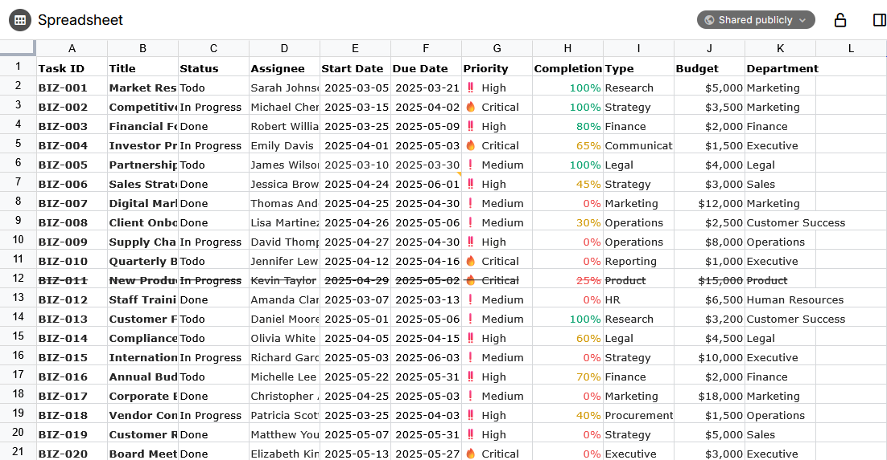

# Таблицы (Spreadsheets)
<figure class="image"></figure>

> [!IMPORTANT]
> Таблицы (Spreadsheets) — новый тип заметок, представленный в v0.103.0, и в настоящее время считается экспериментальным/бета. Как such, ожидайте серьёзных изменений в этом типе заметок.

Таблицы предоставляют привычный опыт, как Microsoft Excel или LibreOffice Calc, с поддержкой формул, проверки данных и форматирования текста.

## Таблицы и коллекции

Есть небольшое пересечение между таблицами и коллекцией <a class="reference-link" href="../Collections/Table.md">Таблица</a>. В целом коллекция-таблица полезна для отслеживания метаинформации о заметках (например, коллекция людей и их дней рождения), тогда как таблицы весьма полезны для вычислений, так как поддерживают формулы.

Таблицы также выигрывают от более широкого набора возможностей, таких как проверка данных, форматирование, и могут работать с относительно большим набором данных.

## Совместимость данных (импорт/экспорт)

Начиная с v0.104.0, Trilium предоставляет уровень совместимости данных между внутренним форматом (Univer) и следующими форматами:

*   Microsoft Excel (.xlsx)
    *   Сохраняет базовое форматирование (шрифты, размеры, границы, фоны).
    *   Формулы сохраняются, но обратите внимание, что не все функции Excel поддерживаются и наоборот с Univer.
    *   Изображения (привязанные к ячейке или плавающие), без сохранения поворота.
    *   Поддерживает несколько листов нативно.
*   Comma-Separated Values (.csv)
    *   Поскольку это текстовый формат, любое форматирование теряется.
    *   Формулы вычисляются и превращаются в их конечное значение вместо этого.
    *   Таблицы с несколькими листами экспортируются как один ZIP, содержащий CSV-файл на лист.

Поддерживаются как [импорт, так и экспорт](../Basic%20Concepts%20and%20Features/Import%20%26%20Export.md), следующим образом:

*   Чтобы импортировать файл, просто перетащите его в <a class="reference-link" href="../Basic%20Concepts%20and%20Features/UI%20Elements/Note%20Tree.md">Дерево заметок</a>, и он будет конвертирован в заметку-таблицу.
    *   Чтобы избежать этого поведения (например, чтобы импортировать .xlsx-файл как настоящий <a class="reference-link" href="File.md">Файл</a>), снимите соответствующую отметку в [Диалоге импорта](../Basic%20Concepts%20and%20Features/Import%20%26%20Export.md). Такой файл показывается в таблице только для чтения (см. <a class="reference-link" href="File/Office%20documents.md">Документы Office</a>).
    *   Несколько файлов можно импортировать одновременно, включая смесь .csv и .xlsx файлов. Структуру папок можно сохранить, используя .zip-файл.
*   В отличие от импорта, экспорт выполняется по заметке:
    *   В <a class="reference-link" href="../Basic%20Concepts%20and%20Features/UI%20Elements/Note%20menu.md">Меню заметки</a> выберите опции _Экспорт в Excel_ или _Экспорт в CSV_.
    *   Если экспортировать как один файл через <a class="reference-link" href="../Basic%20Concepts%20and%20Features/Import%20%26%20Export.md">Импорт и экспорт</a>, результирующий файл будет пользовательским файлом `.triliumsheet`, который сохраняет таблицу как есть.
        *   Экспорт намеренно является другим процессом, чем обычная функциональность <a class="reference-link" href="../Basic%20Concepts%20and%20Features/Import%20%26%20Export.md">Импорта и экспорта</a>, потому что он выполняет конвертацию в несколько форматов с разной степенью совместимости.

Ячейки, вставленные из Excel или другого приложения, сохраняют своё форматирование, кроме шрифта, поэтому они используют шрифт таблицы, как и остальные ячейки.

> [!IMPORTANT]
> Импорт и экспорт для обоих форматов .xlsx и .csv поддерживаются по возможности. Они не поддерживают продвинутые возможности (проверка данных, скриптинг и т.д.). Если вы заметите конкретную проблему, о ней можно [сообщить](../Troubleshooting/Reporting%20issues.md), однако все сообщения об ошибках должны содержать образец файла, чтобы быть рассмотренными.

## Поддерживаемые возможности

Таблица поддерживает следующие возможности:

*   Начиная с v0.104.0, изображения, которые могут быть как внутри ячейки, так и плавающими над ней.
    *   Изображения сохраняются как <a class="reference-link" href="../Basic%20Concepts%20and%20Features/Notes/Attachments.md">Вложения</a> из соображений производительности.
    *   Загрузка изображений уважает те же настройки сжатия, что и <a class="reference-link" href="Text/Images.md">Изображения</a> в тексте.
*   Фильтрация
*   Сортировка
*   Проверка данных
*   Условное форматирование
*   Заметки / аннотации
*   Поиск / замена

Мы можем рассмотреть добавление [других возможностей](https://docs.univer.ai/guides/sheets/features/filter) из Univer в какой-то момент. Если есть конкретная возможность, которую можно легко добавить, её можно обсудить в [GitHub Issues](../Troubleshooting/Reporting%20issues.md).

### Функциональность публикации

Таблицы можно [публиковать](../Advanced%20Usage/Sharing.md), в этом случае выполняется попытка HTML-рендеринга таблицы по возможности:

*   Сохраняет базовое форматирование.
*   Ячейки с формулами отображают предвычисленное значение вместо формулы.

Начиная с v0.104.0:

*   Числа и даты корректно форматируются.
*   Изображения показываются внутри ячейки или плавающими над ней, включая поворот.

Для более продвинутых случаев использования это, скорее всего, не будет работать как задумано. Не стесняйтесь [сообщать о проблемах](../Troubleshooting/Reporting%20issues.md), но имейте в виду, что мы можем не достичь полного паритета возможностей со всеми возможностями Univer.

## Возможности, пока не поддерживаемые

### О Pro-возможностях

Таблицы Univer также имеют [Pro-план](https://univer.ai/pro), который добавляет довольно много функциональности, такой как диаграммы, печать, сводные таблицы, экспорт и т.д.

Поскольку Pro-план требует лицензии, Trilium не поддерживает никакие премиум-возможности. Теоретически pro-возможности можно использовать в пробном режиме с некоторыми ограничениями; мы можем исследовать это направление в какой-то момент.

### Запланированные возможности

Есть несколько возможностей, которые уже запланированы, но пока не поддерживаются:

*   Специфичные для Trilium формулы (например, для получения заголовка заметки).
*   Пользовательские формулы
*   Межкнижные вычисления

Если вы хотите, чтобы мы работали над этими возможностями, рассмотрите [поддержку нас](https://triliumnotes.org/en/support-us).

### Поддержка мобильных устройств

Версии до v0.104.0 не имеют выделенной мобильной поддержки, что означает, что взаимодействие затруднено без мыши и клавиатуры. Начиная с v0.104.0 мы интегрируем мобильный плагин Univer, который вводит такие возможности, как перетаскивание для панорамирования, что делает интерфейс более удобным на мобильных устройствах.
