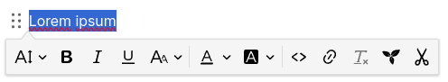
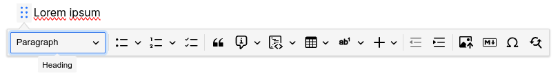
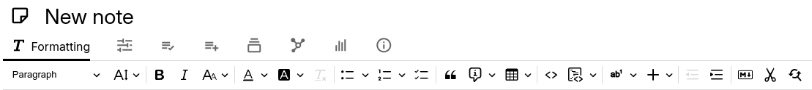

# Текст
Тип заметки по умолчанию в Trilium; текстовые заметки позволяют форматирование, таблицы, изображения, замечания и ряд других возможностей.

## Панели форматирования

Большая часть взаимодействия с текстовыми заметками выполняется через встроенные панели инструментов. В зависимости от предпочтения есть два разных макета:

*   _Плавающая панель инструментов_ по умолчанию скрыта и появляется только при необходимости. В этом режиме есть на самом деле две разные панели:
    
*   Панель инструментов, появляющаяся при выделении текста. Она предоставляет форматирование на уровне текста, такое как полужирный, курсив, цвета текста, встроенный код и т.д.
    __

Подробнее см. <a class="reference-link" href="Text/Formatting%20toolbar.md">Панель форматирования</a>.

## Возможности и форматирование

Вот список различных возможностей, поддерживаемых текстовыми заметками:

<table>
    <thead>
        <tr>
            <th>Выделенная статья</th>
            <th>Возможность</th>
        </tr>
    </thead>
    <tbody>
        <tr>
            <td><a class="reference-link" href="Text/General%20formatting.md">Общее форматирование</a></td>
            <td><ul><li>Заголовки (названия разделов, абзац)</li><li>Размер шрифта</li><li>Полужирный, курсив, подчёркивание, зачёркивание</li><li>Надстрочный, подстрочный</li><li>Цвет шрифта и цвет фона</li><li>Снятие форматирования</li></ul></td>
        </tr>
        <tr>
            <td><a class="reference-link" href="Text/Lists.md">Списки</a></td>
            <td><ul><li>Маркированные списки</li><li>Нумерованные списки</li><li>Списки дел</li></ul></td>
        </tr>
        <tr>
            <td><a class="reference-link" href="Text/Block%20quotes%20%26%20admonitions.md">Цитаты и замечания</a></td>
            <td><ul><li>Цитаты</li><li>Замечания (admonitions)</li></ul></td>
        </tr>
        <tr>
            <td><a class="reference-link" href="Text/Tables.md">Таблицы</a></td>
            <td><ul><li>Базовые таблицы</li><li>Объединение ячеек</li><li>Стилизация таблиц и ячеек</li><li>Подписи таблиц</li></ul></td>
        </tr>
        <tr>
            <td><a class="reference-link" href="Text/Developer-specific%20formatting.md">Форматирование для разработчиков</a></td>
            <td><ul><li>Встроенный код</li><li>Блоки кода</li><li>Сочетания клавиш</li></ul></td>
        </tr>
        <tr>
            <td><a class="reference-link" href="Text/Footnotes.md">Сноски</a></td>
            <td><ul><li>Сноски</li></ul></td>
        </tr>
        <tr>
            <td><a class="reference-link" href="Text/Images.md">Изображения</a></td>
            <td><ul><li>Изображения</li></ul></td>
        </tr>
        <tr>
            <td><a class="reference-link" href="Text/Links.md">Ссылки</a></td>
            <td><ul><li>Внешние ссылки</li><li>Внутренние ссылки Trilium</li></ul></td>
        </tr>
        <tr>
            <td><a class="reference-link" href="Text/Include%20Note.md">Включение заметки</a></td>
            <td><ul><li>Включение заметки</li></ul></td>
        </tr>
        <tr>
            <td><a class="reference-link" href="Text/Block%20references.md">Блочные ссылки</a></td>
            <td><ul><li>Ссылки на блоки заметки</li><li>Включение блоков заметки</li></ul></td>
        </tr>
        <tr>
            <td><a class="reference-link" href="Text/Insert%20buttons.md">Кнопки вставки</a></td>
            <td><ul><li>Символы</li><li><a class="reference-link" href="Text/Math%20Equations.md">Математические формулы</a></li><li>Диаграммы Mermaid</li><li>Горизонтальная линейка</li><li>Разрыв страницы</li></ul></td>
        </tr>
        <tr>
            <td><a class="reference-link" href="Text/Other%20features.md">Другие возможности</a></td>
            <td><ul><li>Отступы<ul><li>Импорт Markdown</li></ul></li><li><a class="reference-link" href="Text/Cut%20to%20subnote.md">Вырезать в подзаметку</a></li><li><a class="reference-link" href="Text/Sorting.md">Сортировка</a></li></ul></td>
        </tr>
        <tr>
            <td><a class="reference-link" href="Text/Premium%20features.md">Премиум-возможности</a></td>
            <td><ul><li><a class="reference-link" href="Text/Slash%20Commands.md">Слэш-команды</a></li><li><a class="reference-link" href="../Advanced%20Usage/Templates.md">Шаблоны</a></li><li><a class="reference-link" href="Text/Format%20Painter.md">Формат по образцу</a></li></ul></td>
        </tr>
    </tbody>
</table>

## Режим «только для чтения» и режим редактирования

Текстовые заметки обычно открываются в режиме редактирования. Однако они могут открываться в режиме только для чтения, если заметка слишком велика или явно помечена как доступная только для чтения. Подробнее см. <a class="reference-link" href="../Basic%20Concepts%20and%20Features/Notes/Read-Only%20Notes.md">Заметки только для чтения</a>.

## Сочетания клавиш

Есть множество сочетаний клавиш для форматирования текста без использования мыши. Справочник по всем комбинациям клавиш см. в <a class="reference-link" href="../Basic%20Concepts%20and%20Features/Keyboard%20Shortcuts.md">Сочетаниях клавиш</a>. Кроме того, см. <a class="reference-link" href="Text/Markdown-like%20formatting.md">Markdown-подобное форматирование</a> как альтернативу сочетаниям клавиш.

Для редактирования клавишами текстового редактора Vim см. <a class="reference-link" href="Text/Vim%20mode.md">Режим Vim</a>.

## Ширина содержимого

Для удобства чтения на более широких экранах ширина текстовых заметок ограничена настраиваемой опцией. Подробнее см. <a class="reference-link" href="../Basic%20Concepts%20and%20Features/UI%20Elements/Content%20width.md">Ширина содержимого</a>.

## Преобразование в Markdown-заметку

Текстовые заметки можно преобразовать в заметки <a class="reference-link" href="Markdown.md">Markdown</a>. См. <a class="reference-link" href="Converting%20between%20note%20types.md">Преобразование между типами заметок</a>.

## Технические детали

Для функциональности редактирования текста Trilium использует коммерческий продукт (с открытым ядром) под названием <a class="reference-link" href="../Advanced%20Usage/Technologies%20used/CKEditor.md">CKEditor</a>. Это даёт преимущество мощного WYSIWYG-редактора (What You See Is What You Get — «что видишь, то и получаешь»).
