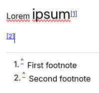

# Сноски
<figure class="image image-style-align-right"></figure>

Сноски удобны для добавления примечаний к абзацу или дополнительных сведений, которые отображаются в нижней части заметки.

## Работа со сносками

*   Чтобы вставить новую сноску, откройте меню  _Insert_ на <a class="reference-link" href="Formatting%20toolbar.md">панели форматирования</a> и выберите  _Footnote_ (или выберите _New footnote_ в её подменю).
*   Чтобы вставить ссылку на существующую сноску, откройте подменю _Footnote_, выберите _Insert footnote_, а затем номер нужной сноски.
*   При наведении указателя мыши на ссылку сноски (например, `[1]`) её содержимое отображается во всплывающей подсказке для удобного просмотра.
*   Нажатие на ссылку сноски в тексте (например, `[1]`) переносит к соответствующей сноске.
*   Аналогично, нажатие на кнопку `^` рядом со сноской возвращает к соответствующей ссылке в тексте.