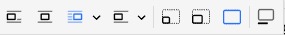
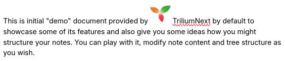
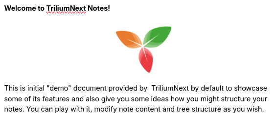
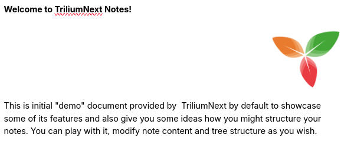
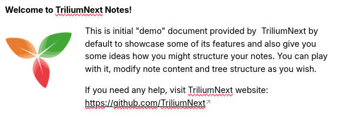

# Изображения
Trilium поддерживает хранение и отображение изображений. Поддерживаются форматы PNG, JPEG, GIF, BMP, WebP, AVIF и SVG.

Изображение можно загрузить в виде [вложения](../../Basic%20Concepts%20and%20Features/Notes/Attachments.md) к заметке или как отдельную [заметку](../../Basic%20Concepts%20and%20Features/Navigation/Tree%20Concepts.md), размещённую в [дереве заметок](../../Basic%20Concepts%20and%20Features/Navigation/Tree%20Concepts.md). Ссылку на него можно скопировать в текстовую заметку, чтобы отобразить изображение прямо в тексте.

## Загрузка изображений

Чтобы добавить изображение в заметку:

*   Просто перетащите его из проводника файлов в редактор заметки в Trilium — изображение будет загружено автоматически.
*   Либо на <a class="reference-link" href="Formatting%20toolbar.md">панели форматирования</a> нажмите кнопку  _Attach file_ и выберите _Image_.
*   В <a class="reference-link" href="../../Installation%20%26%20Setup/Mobile%20Frontend.md">мобильном интерфейсе</a> в том же меню доступен пункт _Camera_, позволяющий сделать фотографию и сразу вставить её.
*   Также можно скопировать и вставить изображение из интернета (см. раздел ниже).

Место вставки изображения зависит от положения курсора. В пустом абзаце изображение отображается на отдельной строке. В пункте списка или после текста в абзаце изображение вставляется в режиме _In line_, внутри строки текста. Изменить расположение позже можно с помощью кнопки _Image position_, описанной в разделе выравнивания ниже.

> [!TIP]
> Чтобы вставить ссылку на изображение вместо его отображения, прикрепите его через _Attach file as a link_ в меню кнопки  _Attach file_. См. <a class="reference-link" href="../../Basic%20Concepts%20and%20Features/Notes/Attachments.md">Вложения</a>.

## Буфер обмена и автоматическая загрузка изображений

Trilium особым образом обрабатывает изображения, копируемые и вставляемые через буфер обмена.

*   При вставке смеси текста и изображений сервер (или настольное приложение — в зависимости от используемой версии) автоматически скачивает изображения.
    *   Это означает, что изображение должно быть общедоступным и достижимым с того устройства, где запущен Trilium. Недоступные изображения отобразятся как битые.
*   Если в Trilium вставляется одно изображение, приоритет отдаётся изображению из буфера обмена. Это позволяет копировать изображения из источников, к которым у Trilium нет прямого доступа, таких как Google Chat, Slack и др.
*   При копировании текста с изображениями из Trilium и вставке в другое приложение (например, Microsoft Word или LibreOffice Writer) изображения сохраняются.

Автоматическая загрузка изображений включена по умолчанию и может быть переключена в <a class="reference-link" href="../../Basic%20Concepts%20and%20Features/UI%20Elements/Options.md">Настройках</a> → _Media_ → _Download images automatically._

## Настройка изображений

Нажатие на изображение открывает всплывающую панель с несколькими параметрами:  

### Выравнивание

Первая кнопка всплывающей панели, _Image position_, показывает значок текущего расположения изображения. Она открывает меню, в котором варианты расположения сгруппированы по способу обтекания текстом:

| Значок | Вариант | Предпросмотр | Описание |
| --- | --- | --- | --- |
|  | _In line_ |  | Изображение располагается внутри абзаца как крупный символ и перемещается вместе с окружающим текстом. Для перемещения используйте перетаскивание или вырезание и вставку. |
|  | _Break text_ → _Align left_, _Align center_ или _Align right_ |   | Изображение отображается на отдельной строке слева, по центру или справа; текст продолжается над ним и под ним, но не рядом с ним. |
|  | _Wrap text_ → _Align left_ или _Align right_ |  | Изображение отображается слева или справа, а текст обтекает его сбоку. |

### Рисование поверх изображения

Чтобы рисовать или писать поверх изображения, нажмите кнопку  _Convert image to a drawing canvas_ на его панели инструментов. Изображение превратится в холст для рисования, отображающий его целиком и закреплённый на месте. См. раздел о холстах для рисования в статье <a class="reference-link" href="Include%20Note.md">Включение заметки</a>.

## Сжатие

Поскольку Trilium не предназначен для использования в качестве основного хранилища изображений, он сжимает и изменяет размер загружаемых изображений (с довольно агрессивными настройками) перед сохранением в базу данных. В результате может быть заметно некоторое снижение качества. Базовые настройки качества доступны в <a class="reference-link" href="../../Basic%20Concepts%20and%20Features/UI%20Elements/Options.md">Настройках</a> → _Media_.

Если вы хотите сохранить изображения в исходном разрешении, рекомендуется сохранять их как вложения к заметке (через контекстное меню <a class="reference-link" href="../../Basic%20Concepts%20and%20Features/UI%20Elements/Note%20menu.md">Меню заметки</a> → _Import files_).

## Размещение изображений рядом

Обычно существует два способа разместить изображения рядом друг с другом:

*   Если они примерно одного размера, просто переведите оба изображения в режим _In line_, как описано в разделе выравнивания выше. Затем их можно перетащить на одну строку.
*   Если они разного размера, создайте [таблицу](Tables.md) с невидимыми границами.