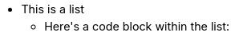
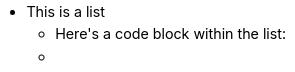
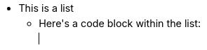
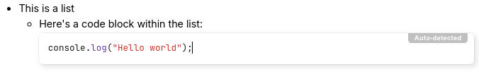
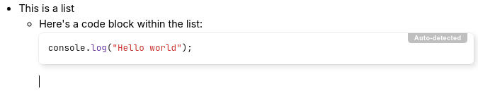
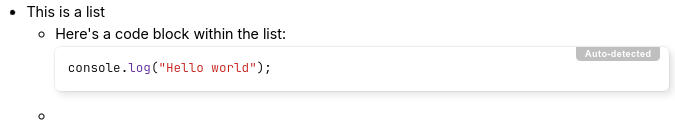

# Списки
Текстовые заметки поддерживают три типа списков:

*    Маркированные списки (неупорядоченные).
*    Нумерованные списки (упорядоченные).
*    Списки задач

Для маркированных и нумерованных списков можно выбрать другой маркер (например, квадраты или римские цифры), нажав значок . Для нумерованных списков также можно указать начальный номер или обратный порядок нумерации. В <a class="reference-link" href="../../Installation%20%26%20Setup/Mobile%20Frontend.md">мобильном интерфейсе</a> эти настройки находятся в строке кнопки _List ›_, которая появляется, когда курсор находится в списке; её кнопка _Тип списка_ также позволяет преобразовать список в другой тип, включая списки задач.

## Работа с клавиатуры

*   Чтобы создать новый список:
    *   Маркированный список: начните строку с `*` или `-` и пробела;
    *   Нумерованный список: начните строку с `1.` или `1)` и пробела;
    *   Список задач: начните строку с `- [ ]` для невыполненного пункта или `[x]` для выполненного.
*   Чтобы создать новый пункт списка, нажмите <kbd>Enter</kbd>.
*   Чтобы добавить пустую строку внутри пункта списка, нажмите <kbd>Shift</kbd>+<kbd>Enter</kbd>.
*   Чтобы выйти из списка, нажмите <kbd>Enter</kbd> дважды.
*   Чтобы объединить два списка, просто удалите промежуток между ними.
*   Чтобы создать вложенные списки, используйте кнопку  (см. _Отступы_ в разделе <a class="reference-link" href="Other%20features.md">Другие функции</a>) или клавишу <kbd>Tab</kbd>. Чтобы уменьшить уровень вложенности текущего элемента, нажмите <kbd>Shift</kbd>+<kbd>Tab</kbd>.
*   В меню маркера блока, описанном на странице <a class="reference-link" href="Formatting%20toolbar.md">Панель форматирования</a>, есть пункты _Вставить элемент выше_, _Вставить элемент ниже_ и _Вставить дочерний элемент_, которые добавляют пустой пункт выше текущего, ниже него и его вложенных пунктов либо как первый вложенный пункт.

## Заголовки и блоки кода внутри списков

В списки можно добавлять блочные элементы, такие как заголовки, блоки кода и таблицы, следующим образом:

<table>
    <tbody>
        <tr>
            <td>1</td>
            <td></td>
            <td>Сначала создайте список.</td>
        </tr>
        <tr>
            <td>2</td>
            <td></td>
            <td>Нажмите Enter, чтобы создать новый пункт списка.</td>
        </tr>
        <tr>
            <td>3</td>
            <td></td>
            <td>Нажмите Backspace, чтобы убрать маркер. Обратите внимание на положение курсора.</td>
        </tr>
        <tr>
            <td>4</td>
            <td></td>
            <td>Теперь вставьте любой нужный блочный элемент, например блок кода.</td>
        </tr>
        <tr>
            <td>5</td>
            <td></td>
            <td>Чтобы продолжить новым пунктом списка, нажимайте Enter, пока курсор не перейдёт на новую пустую позицию.</td>
        </tr>
        <tr>
            <td>6</td>
            <td></td>
            <td>Нажмите Enter ещё раз, чтобы создать новый маркер.</td>
        </tr>
    </tbody>
</table>

Тот же принцип работает для всех трёх типов списков (маркированных, нумерованных и списков задач).

## Сортировка

Пункты списка можно сортировать, при этом вложенные элементы перемещаются вместе со своим родительским пунктом. Это экспериментальная функция, см. <a class="reference-link" href="Sorting.md">Сортировка</a>.

## Выравнивание

Пункт списка можно выровнять по центру или по правому краю с помощью кнопки выравнивания текста на панели форматирования или выровняв ячейку <a class="reference-link" href="Tables.md">таблицы</a>, в которой находится список. Маркер, номер или флажок перемещается вместе с текстом пункта.

## Списки задач

См. <a class="reference-link" href="To-do%20Lists.md">Списки задач</a>.

## Сворачиваемые списки

Начиная с Trilium v0.104.0 вложенные пункты списков можно сворачивать. Это работает для маркированных, нумерованных и списков задач.

Чтобы свернуть или развернуть пункт списка с вложенными подпунктами:

*   Наведите курсор мыши на пункт списка — слева появится стрелка. Клик по ней переключает состояние между свёрнутым и развёрнутым.
*   Для маркированных и нумерованных списков можно также кликнуть прямо по маркеру (точке или номеру) вместо стрелки. Для списков задач это не работает, так как клик по флажку отмечает задачу выполненной.
*   Нажмите <kbd>Ctrl</kbd>+<kbd>Alt</kbd>+<kbd>Enter</kbd>, чтобы свернуть или развернуть пункт в позиции курсора.

Примечания:

*   Свёрнутые пункты всегда показывают стрелку для обозначения своего состояния.
*   Состояние сворачивания сохраняется на уровне заметки и синхронизируется между устройствами, то есть восстанавливается после обновления страницы или перезапуска приложения.
*   Состояние сворачивания также сохраняется при <a class="reference-link" href="../../Basic%20Concepts%20and%20Features/Import%20%26%20Export.md">Импорте и экспорте</a>, но только для формата HTML. При экспорте в Markdown оно не сохраняется.
*   Сворачиваемые списки работают только в редактируемых текстовых заметках. В режиме только для чтения списки всегда полностью развёрнуты.
*   Пункты списка автоматически разворачиваются при редактировании, чтобы избежать ввода в скрытую область.