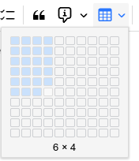
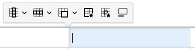
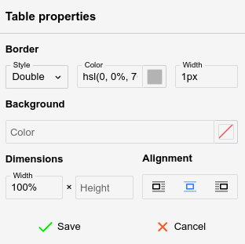
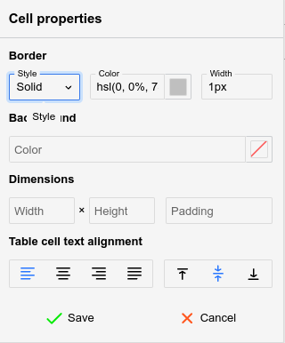

# Таблицы
Таблицы — это мощная функция <a class="reference-link" href="../Text.md">текстовых</a> заметок, поскольку их легко редактировать.

<figure class="image image-style-align-right"></figure>

Чтобы создать таблицу, просто нажмите кнопку таблицы и выберите мышью нужное количество столбцов и строк, как показано на рисунке рядом.

Начиная с версии v0.107.0, это же меню начинается с пункта _Вставить таблицу…_, который позволяет создать таблицу больше размера сетки или ввести её размеры вручную:

1.  Нажмите кнопку  и выберите _Вставить таблицу…_. В позиции курсора откроется небольшая форма.
2.  Введите количество _Столбцов_ (до 100) и _Строк_ (до 1000). Всего таблица может содержать не более 5000 ячеек, например 1000 строк по 5 столбцов.
3.  При необходимости включите _Использовать заголовки_ и укажите количество _Столбцов заголовка_ и _Строк заголовка_. Количество столбцов или строк заголовка не может превышать общее число столбцов или строк.
4.  Нажмите _Вставить_ или <kbd>Enter</kbd>.

Чтобы закрыть форму без вставки таблицы, нажмите <kbd>Esc</kbd> или щёлкните за её пределами. С клавиатуры клавиша <kbd>Tab</kbd> переключает фокус между пунктом _Вставить таблицу…_ и сеткой, пока меню открыто.

В <a class="reference-link" href="../../Installation%20%26%20Setup/Mobile%20Frontend.md">мобильном интерфейсе</a> таблица вставляется через кнопку  на панели форматирования: в её плитке _Вставить таблицу_ перечислены популярные размеры от 2 × 2 до 3 × 4 (строки × столбцы). Нажмите на один из них, чтобы вставить таблицу этого размера; чтобы увеличить её, добавьте строки и столбцы позже.

## Панель форматирования

Когда выбрана таблица, появляется специальная панель форматирования:

В <a class="reference-link" href="../../Installation%20%26%20Setup/Mobile%20Frontend.md">мобильном интерфейсе</a> панель инструментов не всплывает над таблицей. Вместо этого нажмите кнопку  после _Отменить_ и _Повторить_ на панели форматирования в нижней части экрана, чтобы отобразить там панель инструментов таблицы.

## Контекстное меню

Начиная с версии v0.106.0, нажатие правой кнопкой мыши в любом месте таблицы открывает контекстное меню с наиболее частыми операциями над таблицей:

*   _Вставить строку выше_ и _Вставить строку ниже_ вставляют пустую строку рядом со строкой текущей ячейки. Если выделение охватывает несколько строк, вставляется такое же количество строк.
*   _Вставить столбец слева_ и _Вставить столбец справа_ работают аналогично для столбцов.
*   Начиная с v0.107.0, пункты _Сделать заголовком_ или _Сделать заголовком до этой строки_ (в зависимости от выделения) превращают строки в строки заголовка, которые всегда начинаются с верха таблицы:
    *   _Сделать заголовком_ отображается, когда выделение начинается с первой строки, и делает каждую выделенную строку строкой заголовка.
    *   _Сделать заголовком до этой строки_ отображается, когда выделение находится в одной строке ниже первой, и делает эту строку и все строки выше неё строками заголовка.
    *   Ни один из пунктов не отображается, когда выделение охватывает несколько строк ниже первой.
    *   Галочка показывает, что строки уже являются строками заголовка. Повторный выбор пункта превращает их и все строки заголовка ниже них обратно в обычные строки. Например, в таблице с пятью строками заголовка выбор _Сделать заголовком до этой строки_ на третьей строке оставит строками заголовка только первые две.
*   _Объединить ячейки_ объединяет выделенные ячейки в одну. Выделенные ячейки должны образовывать прямоугольник.
*   _Разделить ячейку_ делит каждую выделенную ячейку на две: _По вертикали_ или _По горизонтали_. Пункт _Отменить объединение ячеек_ в том же подменю возвращает каждую объединённую ячейку в выделении к отдельным ячейкам, которые она занимает, сохраняя содержимое в верхней левой ячейке; необъединённые ячейки остаются без изменений.
*   _Выровнять ширину столбцов_ распределяет суммарную ширину столбцов, затронутых выделением, поровну между ними. Остальные столбцы и общая ширина таблицы не меняются. Требуется выделение, охватывающее не менее двух столбцов; объединённая ячейка учитывается для каждого столбца, который она занимает.
*   _Вырезать_, _Копировать_ и _Копировать как Markdown_ применяются к выделенным ячейкам. Начиная с v0.107.0, _Копировать_ и _Вставить_ открывают подменю со своими вариантами, такими как _Копировать как Markdown_ и _Вставить как обычный текст_; нажатие на сами пункты _Копировать_ или _Вставить_ по-прежнему копирует или вставляет:
    *   Вырезание или копирование создаёт меньшую таблицу, содержащую только выделенные ячейки. Вставка поверх выделенных ячеек заменяет их; вставка в другое место вставляет её как отдельную таблицу. Вырезание очищает ячейки без удаления строк или столбцов.
    *   _Копировать как Markdown_ преобразует выделенные ячейки в таблицу Markdown. Выделенная строка заголовка становится заголовком Markdown; без неё добавляется пустая строка заголовка, так как таблицы Markdown требуют её наличия.
*   Начиная с v0.107.0, пункты _Вставить строки выше_ и _Вставить строки ниже_ в подменю _Вставить_ вставляют содержимое буфера обмена как новые строки рядом со строкой текущей ячейки, а не поверх ячеек начиная с курсора. Они отображаются только тогда, когда выделение находится в одной строке, и, как и _Вставить_, только там, где доступен буфер обмена:
    *   Скопированная таблица превращается в новую строку для каждой своей строки, заполняясь с первого столбца. Если в ней больше столбцов, чем в текущей таблице, в таблицу добавляются столбцы, как при обычной вставке. Другое содержимое помещается в первую ячейку одной новой строки.
    *   Новые строки после вставки остаются выделенными.
    *   Если объединённые ячейки связывают строку с другими, новые строки вставляются выше или ниже всего этого блока строк.
*   _Сортировать_ (под разделом буфера обмена) сортирует строки по столбцу текущей ячейки — _По возрастанию_ или _По убыванию_. См. [Сортировка строк](#sorting-rows).
*   _Удалить строку_ и _Удалить столбец_ (под _Сортировать_) удаляют каждую строку или столбец, затронутые выделением, даже если выделена лишь часть их ячеек.
*   _Удалить таблицу_ удаляет всю таблицу и оставляет на её месте пустой абзац. В таблице, вложенной в другую, удаляется только внутренняя таблица.
*   Начиная с v0.107.0, пункт _Выделить_ (под _Удалить таблицу_) выделяет ячейки каждой строки (_Строка_) или столбца (_Столбец_), затронутых выделением, либо все ячейки таблицы (_Таблица_). В отличие от кнопки , которая выделяет таблицу целиком как объект, _Таблица_ выделяет именно её ячейки, поэтому операции с ячейками (например, _Объединить ячейки_) применяются ко всем ним. Во вложенной таблице _Таблица_ выделяет только ячейки внутренней таблицы.

Нажатие правой кнопкой мыши на ячейку, не входящую в текущее выделение, сначала перемещает курсор в неё, поэтому меню всегда применяется к ячейке под указателем.

> [!NOTE]
> В браузере меню Trilium заменяет собственное контекстное меню браузера внутри таблиц. Чтобы открыть меню браузера (например, для подсказок проверки орфографии), удерживайте <kbd>Shift</kbd> при нажатии правой кнопкой мыши. Настольного приложения это не касается, так как его меню уже включает подсказки орфографии. В браузере меню также предлагает _Вставить_ только тогда, когда страница может читать буфер обмена, что требует защищённого соединения (HTTPS) и вашего разрешения; в противном случае вставляйте с помощью <kbd>Ctrl</kbd>+<kbd>V</kbd>.

## Навигация по таблице

*   С помощью мыши:
    *   Нажмите на ячейку, чтобы перевести фокус на неё.
    *   Нажмите кнопку  вверху или внизу таблицы, чтобы вставить пустой абзац рядом с ней.
    *   Нажмите кнопку  в левом верхнем углу таблицы, чтобы выделить её целиком (для удобного копирования, вставки или вырезания), либо перетащите её, чтобы переместить таблицу.
*   С помощью клавиатуры:
    *   Используйте клавиши со стрелками для удобной навигации между ячейками.
    *   Также можно использовать <kbd>Tab</kbd> для перехода к следующей ячейке и Shift+Tab для перехода к предыдущей.
    *   В отличие от клавиш со стрелками, нажатие <kbd>Tab</kbd> в конце таблицы (последняя строка, последний столбец) автоматически создаст новую строку.
    *   Чтобы выделить несколько ячеек, удерживайте <kbd>Shift</kbd> при использовании клавиш со стрелками.
*   С помощью сенсорного экрана:
    *   Начиная с v0.107.0, касание таблицы обводит ячейку с курсором (или выделенные ячейки) и отображает маркер в каждом углу рамки.
    *   Чтобы выделить несколько ячеек, потяните один из маркеров по таблице. Ячейка в противоположном углу остаётся выделенной, поэтому выделение расширяется или сужается по мере движения пальца. Заметка и широкие таблицы прокручиваются, когда маркер достигает края экрана.

## Изменение размера ячеек

*   Ширину столбцов можно изменить, наведя указатель мыши на границу между двумя соседними ячейками и перетащив её.
*   Чтобы задать нескольким столбцам одинаковую ширину, выделите ячейки в этих столбцах и выберите _Выровнять ширину столбцов_ в меню кнопки  на панели форматирования или в [контекстном меню](#context-menu).
*   По умолчанию высоту строк нельзя изменять мышью, но её можно задать в свойствах ячейки (см. ниже).
*   Чтобы точно настроить ширину (в пикселях или процентах) ячейки, нажмите кнопку .

### Изменение размера на сенсорном экране

Начиная с v0.107.0, при касании таблицы в нижней части заметки (над панелью форматирования на мобильных устройствах) появляется специальная полоса. Она содержит сегмент для каждого столбца таблицы с разделителем в конце каждого столбца. Только разделитель столбца с курсором является маркером изменения размера; остальные разделители просто отмечают границы столбцов, поэтому свайп по ним прокручивает таблицу. Когда выделено несколько ячеек, маркер есть у каждого охваченного ими столбца.

*   Чтобы изменить ширину столбца, поместите курсор в одну из его ячеек или нажмите на его сегмент, затем перетащите маркер. Таблица увеличивается или уменьшается вместе со столбцом и прокручивается, когда маркер достигает края экрана. Столбец прилипает к своей исходной ширине и к ширине соседних столбцов.
*   Чтобы отменить изменение размера, верните маркер в исходное положение или коснитесь экрана вторым пальцем.
*   Чтобы сделать ширину столбца и следующего за ним одинаковой, дважды нажмите на маркер между ними.
*   Чтобы выделить столбец, нажмите на его сегмент. Чтобы открыть меню столбца, нажмите и удерживайте сегмент.
*   Чтобы прокрутить широкую таблицу по горизонтали, проведите пальцем вдоль полосы.

Широкая таблица прокручивается немного дальше своего конца, чтобы маркер последнего столбца не оказывался у самого края экрана, где свайп выполняет переход назад.

## Широкие таблицы

Начиная с v0.107.0, таблица может быть шире, чем <a class="reference-link" href="../../Basic%20Concepts%20and%20Features/UI%20Elements/Content%20width.md">ширина содержимого</a>. Такая таблица прокручивается по горизонтали, в то время как остальная часть заметки сохраняет свою ширину.

*   Новая таблица имеет ширину содержимого. Чтобы сделать её шире, перетащите правую границу последнего столбца за край области содержимого. Граница слегка прилипает к краю, поэтому таблицу легко вернуть к ширине содержимого.
*   Чтобы задать точную ширину, введите значение в процентах больше `100%` или ширину в пикселях в  [свойствах таблицы](#table-properties).
*   Таблица, содержимому которой требуется больше места, чем ширина заметки (например, вставленная таблица со множеством столбцов), также прокручивается, а не растягивает заметку.
*   Широкие таблицы прокручиваются точно так же в заметках только для чтения и на опубликованных страницах.
*   При печати или экспорте в PDF широкая таблица уменьшается, чтобы поместиться на странице.

Таблицы внутри других блоков — таких как цитаты, выноски, сворачиваемые блоки, колонки или вкладки — ограничены шириной своего блока и не прокручиваются.

### Поддержка мобильных устройств

В <a class="reference-link" href="../../Installation%20%26%20Setup/Mobile%20Frontend.md">мобильном интерфейсе</a> таблица сохраняет ширину, которую она имеет на настольном компьютере, и прокручивается по горизонтали, вместо того чтобы сжимать столбцы под ширину экрана. Полная ширина таблицы соответствует параметру _Максимальная ширина содержимого_, заданному в <a class="reference-link" href="../../Basic%20Concepts%20and%20Features/UI%20Elements/Options.md">Настройки</a> → _Внешний вид_ → _Ширина содержимого_ на мобильном устройстве (по умолчанию 1200 пикселей). Например, таблица с шириной `50%` будет иметь ширину 600 пикселей.

Чтобы изменять ширину столбцов на мобильных устройствах, используйте полосу, описанную в разделе [Изменение размера на сенсорном экране](#resizing-with-touch).

## Длинные таблицы

Начиная с v0.107.0, строки заголовка таблицы остаются видимыми в верхней части заметки при прокрутке остальной части таблицы и уходят вместе с её концом. Это также работает в заметках только для чтения, на опубликованных страницах и в широких таблицах.

Чтобы превратить строки в строки заголовка, используйте _Сделать заголовком_ в [контекстном меню](#context-menu) или _Строка заголовка_ в меню кнопки  на панели форматирования.

Чтобы строки заголовка прокручивались вместе с остальной таблицей, отключите параметр <a class="reference-link" href="../../Basic%20Concepts%20and%20Features/UI%20Elements/Options.md">Настройки</a> → _Текстовые заметки_ → _Функции_ → _Use sticky header rows for tables_. Эта настройка применяется только к текущему устройству, а опубликованные страницы сохраняют закреплённые строки заголовка.

## Вставка новых строк и столбцов

*   Чтобы вставить новый столбец, нажмите в нужном месте, затем нажмите кнопку  на панели форматирования и выберите _Вставить столбец слева_ или _справа_.
*   Чтобы вставить новую строку, нажмите в нужном месте, затем нажмите кнопку  и выберите _Вставить строку выше_ или _ниже_.
    *   Более быстрый способ создать новую строку, находясь в конце таблицы, — нажать клавишу <kbd>Tab</kbd>.
*   Обе операции также доступны в [контекстном меню](#context-menu), которое вставляет столько строк или столбцов, сколько охватывает выделение.
*   Меню маркера блока рядом с ячейкой, описанное в разделе <a class="reference-link" href="Formatting%20toolbar.md">Панель форматирования</a>, также содержит пункты _Вставить строку выше_ и _Вставить строку ниже_.
*   После вставки курсор перемещается в новую строку (оставаясь в своём столбце) или в новый столбец (оставаясь в своей строке).

## Перемещение строк и столбцов

Начиная с версии v0.106.0, порядок строк и столбцов можно менять с помощью клавиатуры:

*   <kbd>Alt</kbd>+<kbd>Up</kbd> и <kbd>Alt</kbd>+<kbd>Down</kbd> перемещают строки, затронутые выделением, вверх или вниз.
*   <kbd>Alt</kbd>+<kbd>Left</kbd> и <kbd>Alt</kbd>+<kbd>Right</kbd> перемещают столбцы, затронутые выделением, влево или вправо.

Объединённые ячейки никогда не разбиваются при перемещении. Строки или столбцы, связанные объединённой ячейкой, перемещаются как единый блок, а перемещение в сторону такого блока перескакивает через него целиком.

Если в таблице есть строка заголовка, то при перемещении ниже области заголовка она становится обычной строкой, а обычная строка, перемещённая в область заголовка, становится строкой заголовка. Столбцы заголовка ведут себя так же.

Вне таблиц <kbd>Alt</kbd>+<kbd>Left</kbd> и <kbd>Alt</kbd>+<kbd>Right</kbd> по-прежнему служат для навигации по истории заметок, а <kbd>Alt</kbd>+<kbd>Up</kbd> и <kbd>Alt</kbd>+<kbd>Down</kbd> — для перемещения текущего абзаца.

## Сортировка строк

Начиная с версии v0.107.0, строки таблицы можно сортировать по значениям одного столбца:

*   Чтобы отсортировать все строки, поместите курсор в любую ячейку нужного столбца, затем выберите _Сортировать_ → _По возрастанию_ или _По убыванию_ в [контекстном меню](#context-menu). Те же пункты есть в кнопке  на панели форматирования.
*   Чтобы отсортировать только часть строк, выделите их ячейки в нужном столбце и выполните сортировку тем же способом. Сортировка недоступна, если выделение охватывает более одного столбца.

Строки заголовка всегда остаются вверху таблицы и никогда не сортируются. Сортировку можно отменить с помощью <kbd>Ctrl</kbd>+<kbd>Z</kbd>.

### Как сравниваются значения

Каждая ячейка читается как обычный текст, поэтому форматирование не влияет на порядок. Затем Trilium определяет тип значения в ячейке:

| Тип | Примеры | Как сравнивается |
| --- | --- | --- |
| Время | `15:02`, `15:02:38`, `3:02 PM` | По времени суток. |
| Дата | `2026-09-30`, `2026-09-30 15:02`, `30 September 2026`, `Wednesday, 30 September 2026`, `2026-09-30T15:02:38+03:00` | По дате и времени. |
| Число | `12`, `-3.5`, `1,234.56`, `$ 12.04`, `21 RON`, `24.5m` | По числовому значению. |
| Текст | Всё остальное. | По алфавиту без учёта регистра, с числами внутри текста в числовом порядке (`Item 9` перед `Item 10`). Диакритические знаки учитываются, поэтому `a` и `á` различаются. |
| Пусто | Пустая ячейка или содержащая только пробелы. | Не сравнивается. Пустые ячейки всегда идут последними. |

При сортировке по возрастанию сначала идут значения времени, затем даты, числа и текст. При сортировке по убыванию порядок обратный. Пустые ячейки идут последними в обоих направлениях.

Числа, даты и время с одинаковым значением упорядочиваются по их тексту, поэтому `5 apples` идёт перед `5 pears`. Строки, ячейки которых содержат одинаковый текст (без учёта регистра), сохраняют свой исходный взаимный порядок.

*   Даты также распознаются в форматах языка заметки (например, `30.09.2026` или `30. September 2026` для немецкого) и в формате, выбранном в <a class="reference-link" href="../../Basic%20Concepts%20and%20Features/UI%20Elements/Options.md">Настройки</a> → _Текстовые заметки_ → _Редактор_ → _Формат даты/времени_ для [вставки даты и времени](Insert%20buttons.md).
*   Число может начинаться с символа валюты, например `$`, `€` или `£`. Всё, что следует за числом (например, единица измерения), игнорируется, поэтому единицы не конвертируются: `1 km` окажется перед `500 m`. Ячейка, начинающаяся с букв (например, `RON 21`), считается текстом.
*   Десятичный разделитель зависит от языка заметки: `1.500` — это полтора в английском, но тысяча пятьсот в немецком. Запятая или точка, за которой следует не ровно три цифры, всегда читается как десятичный разделитель, поэтому `1,5` означает полтора в любом языке.
*   Язык заметки задаётся в <a class="reference-link" href="../../Basic%20Concepts%20and%20Features/UI%20Elements/Status%20bar.md">строке состояния</a> через значок , иначе используется язык содержимого по умолчанию. См. <a class="reference-link" href="Content%20language%20%26%20Right-to-left%20support.md">Язык содержимого и поддержка письма справа налево</a>.

### Объединённые ячейки

Строки, связанные объединённой ячейкой, держатся вместе и перемещаются как единый блок. Блок сортируется по значению в его первой строке. Если в блоке больше одной ячейки в сортируемом столбце, остальные ячейки не влияют на порядок, и появляется сообщение: _Some rows were sorted together because merged cells tie them to each other_.

Если выделение охватывает лишь часть такого блока, сортируется весь блок целиком.

## Объединение ячеек

Чтобы объединить две или более ячеек, просто выделите их перетаскиванием и нажмите кнопку  на панели форматирования.

Дополнительные параметры доступны при нажатии на стрелку рядом с ней:

*   Нажмите на одну ячейку и выберите объединение вверх/вниз/вправо/влево, чтобы объединить её с соседней ячейкой.
*   Выберите _Объединить выделенные ячейки_, чтобы объединить выделенные ячейки (то же самое, что нажать саму кнопку).
*   Выберите _Разделить ячейку по вертикали_ или _по горизонтали_, чтобы разбить ячейку на несколько (также можно использовать для отмены объединения).
*   Выберите _Отменить объединение ячеек_, чтобы вернуть каждую объединённую ячейку в выделении к отдельным ячейкам, сохранив содержимое в верхней левой.

Пункты _Объединить выделенные ячейки_ и _Отменить объединение ячеек_ доступны начиная с v0.107.0. Объединение и разделение также доступны по правому клику на выделенных ячейках через [контекстное меню](#context-menu), где _Отменить объединение ячеек_ находится в подменю _Разделить ячейку_.

## Свойства таблицы

<figure class="image image-style-align-right"></figure>

Свойства таблицы открываются кнопкой  и позволяют настроить следующее:

*   Граница (не границы ячеек, а внешняя рамка таблицы): стиль (одинарная, двойная), цвет и толщина.
*   Цвет фона (по умолчанию не задан).
*   Ширина и высота таблицы в процентах (должно заканчиваться на `%`) или пикселях (должно заканчиваться на `px`).
*   Выравнивание таблицы:
    *   По левому или правому краю — в этом случае текст обтекает таблицу.
    *   По центру — в этом случае текст не обтекает таблицу независимо от её ширины.

Таблица сразу обновится, чтобы показать изменения, но для их сохранения необходимо нажать кнопку _Сохранить_.

## Свойства ячейки

<figure class="image image-style-align-right"></figure>

Аналогично свойствам таблицы, кнопка  открывает всплывающее окно для настройки стиля одной или нескольких ячеек (в зависимости от выделения).

Можно настроить следующие параметры:

*   Стиль, цвет и толщину границы (как в свойствах таблицы), но применяемые только к текущей ячейке.
*   Цвет фона (по умолчанию не задан).
*   Ширину и высоту ячейки в процентах (должно заканчиваться на `%`) или пикселях (должно заканчиваться на `px`).
*   Внутренние отступы (расстояние от текста до границ ячейки).
*   Выравнивание текста: по горизонтали (по левому краю, по центру, по правому краю, по ширине) и по вертикали (по верхнему краю, по середине, по нижнему краю).
    *   В ячейке с выравниванием по центру или по правому краю каждый элемент маркированного, нумерованного списка или списка задач смещается вместе со своим маркером, номером или флажком.

Ячейка сразу обновится, чтобы показать изменения, но для их сохранения необходимо нажать кнопку _Сохранить_.

## Цвета границ и фона

Цвета границ и фона таблиц и ячеек адаптируются к [теме](../../Basic%20Concepts%20and%20Features/Themes.md) так же, как и [цвета текста](General%20formatting.md). Цвет, выбранный из палитры, пипеткой или введённый вручную, отображается в более светлом или тёмном оттенке, подходящем к текущей теме, чтобы границы оставались видимыми, а текст — читаемым на фоне. Оттенок (тон) остаётся прежним, и таблица сохраняет исходно выбранный цвет.

Цвета, применённые в более старых версиях Trilium, отображаются точно так, как были выбраны, до следующего редактирования заметки.

Старые браузеры, которые не умеют адаптировать цвета, отображают их точно так, как они были выбраны.

Ячейки заголовка затеняются под текущую тему. Чтобы изменить их фон во всех таблицах, задайте переменную `--text-note-table-header-background` в [пользовательской теме](../../Theme%20development/Creating%20a%20custom%20theme.md) или в [пользовательском CSS для всего приложения](../../Theme%20development/Custom%20app-wide%20CSS.md), например `:root { --text-note-table-header-background: #8882; }`. Фон, выбранный для конкретной ячейки, по-прежнему имеет приоритет.

## Подпись

Нажмите кнопку , чтобы вставить подпись или текстовое описание таблицы, которое будет отображаться над ней.

## Границы таблицы

По умолчанию таблицы имеют серую границу, которая становится светлее или темнее в зависимости от текущей [темы](../../Basic%20Concepts%20and%20Features/Themes.md), чтобы оставаться ненавязчивой на тёмном фоне.

Чтобы изменить границу по умолчанию для всех таблиц, задайте переменную `--text-note-table-border-color` в [пользовательской теме](../../Theme%20development/Creating%20a%20custom%20theme.md) или в [пользовательском CSS для всего приложения](../../Theme%20development/Custom%20app-wide%20CSS.md), например `:root { --text-note-table-border-color: #555; }`. Задайте значение `transparent`, чтобы скрыть границы всех таблиц, у которых не задана собственная граница.

Чтобы настроить границы, выполните следующие шаги:

1.  Выделите таблицу.
2.  На плавающей панели выберите _Свойства таблицы_ ().
    1.  Найдите раздел _Граница_ в верхней части открывшейся панели.
    2.  Он управляет внешними границами таблицы.
    3.  Выберите стиль границы. Обычно желаемым вариантом является _Одинарная_.
    4.  Выберите цвет границы.
    5.  Выберите толщину границы в пикселях.
3.  Выделите все ячейки таблицы и нажмите _Свойства ячейки_ ().
    1.  Это управляет внутренними границами таблицы на уровне ячеек.
    2.  Обратите внимание, что можно изменять границы индивидуально, выделив одну или несколько ячеек — в этом случае изменятся только границы, относящиеся к этим ячейкам.
    3.  Повторите те же шаги, что и в пункте (2).

### Таблицы с невидимыми границами

Таблицам можно задать невидимые границы, чтобы создавать простые макеты (колонки, сетки) из текста или [изображений](Images.md) без отвлекающих рамок:

1.  Сначала вставьте таблицу с нужным количеством столбцов и строк.
2.  Выделите всю таблицу.
3.  В _Свойствах таблицы_ задайте:
    1.  _Стиль_: _Одинарная_
    2.  _Цвет_: `transparent`
    3.  _Толщина_: `1px`.
4.  В _Свойствах ячейки_ задайте то же самое, что и на предыдущем шаге.

## Отступ таблицы

Начиная с версии v0.104.1, таблицам можно задавать отступ как целому блоку (смещается вся таблица, а не только содержимое ячейки).

1.  Нажмите кнопку , чтобы выделить всю таблицу. В противном случае отступ применится только к содержимому текущей ячейки.
2.  Нажмите <kbd>Tab</kbd> для увеличения отступа или <kbd>Shift</kbd>+<kbd>Tab</kbd> для его уменьшения. Также можно использовать кнопки отступа на панели форматирования.

Markdown не поддерживает таблицы с отступом, поэтому при преобразовании в Markdown отступ теряется.

## Импорт и экспорт Markdown

Простые таблицы экспортируются в формате GitHub-flavored Markdown (например, набор элементов с `|`). Если таблица оказывается более сложной (содержит HTML-элементы, нестандартные размеры или изображения), она преобразуется в HTML-таблицу.

Как правило, потери форматирования при экспорте в Markdown минимальны благодаря переходу к HTML-форматированию.