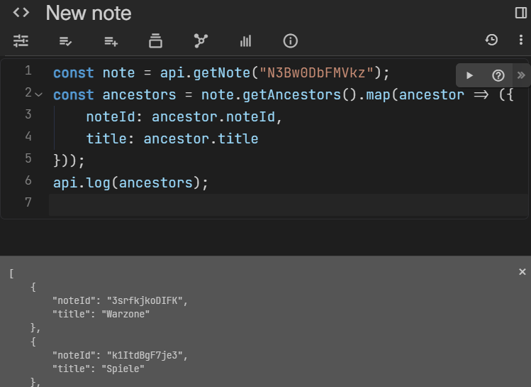

# Журналирование
Как фронтенд-, так и бэкенд-заметки могут записывать сообщения в журнал для отладки.

## Журналирование в интерфейсе через `api.log`

<figure class="image image-style-align-center image_resized" style="width:57.74%;"></figure>

Функция журнала API интегрирована с редактором скриптов и отображает все сообщения, записанные с помощью `api.log`. Это работает как для бэкенд-, так и для фронтенд-скриптов.

Панель журнала API появляется в нижней части заметки (в том числе в режиме <a class="reference-link" href="../Basic%20Concepts%20and%20Features/Navigation/Quick%20edit.md">быстрого редактирования</a>) после выполнения скрипта, использующего `api.log`. Её можно временно скрыть, нажав кнопку закрытия в правом верхнем углу панели.

Помимо строк, можно передавать и объекты — в этом случае они будут отформатированы для удобного чтения, если это возможно (например, рекурсивные объекты не поддерживаются).

## Журналирование в консоль

Для сообщений, которые не должны напрямую отображаться пользователю, можно также использовать стандартный `console.log`.

*   Для фронтенд-скриптов журнал будет отображаться в инструментах разработчика (Developer Tools / Inspect).
*   Для бэкенд-скриптов журнал будет выводиться в консоль сервера во время работы, но **не будет** отображаться в <a class="reference-link" href="../Troubleshooting/Error%20logs/Backend%20(server)%20logs.md">журналах бэкенда (сервера)</a>.